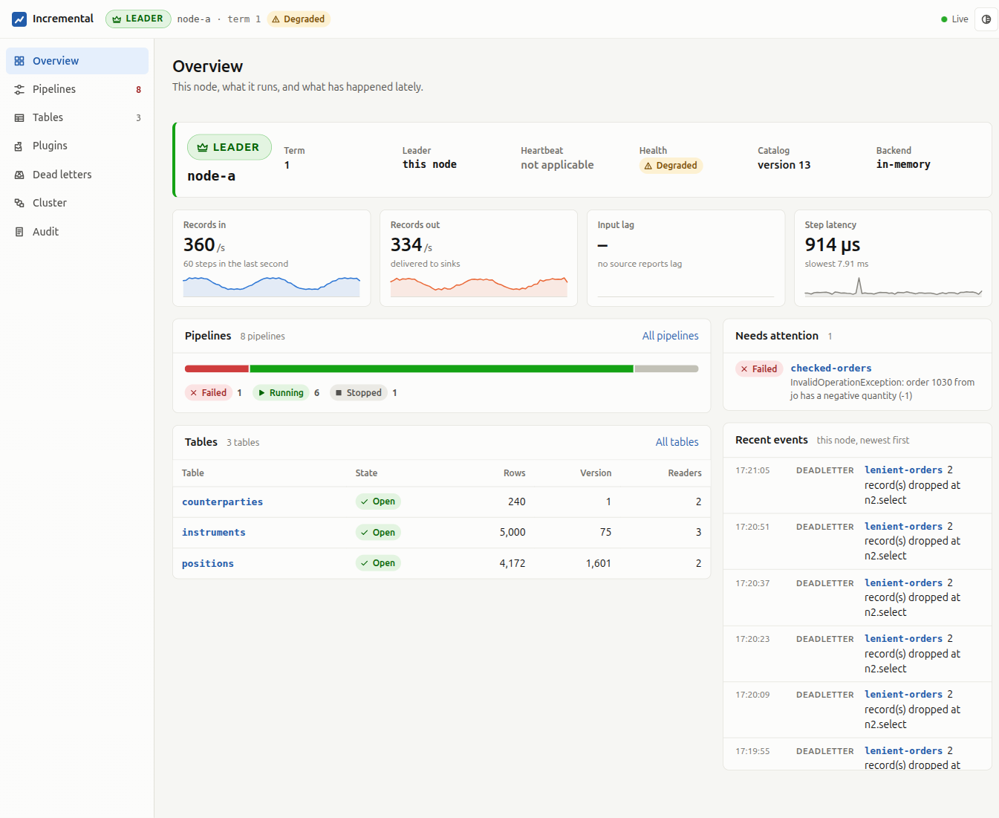
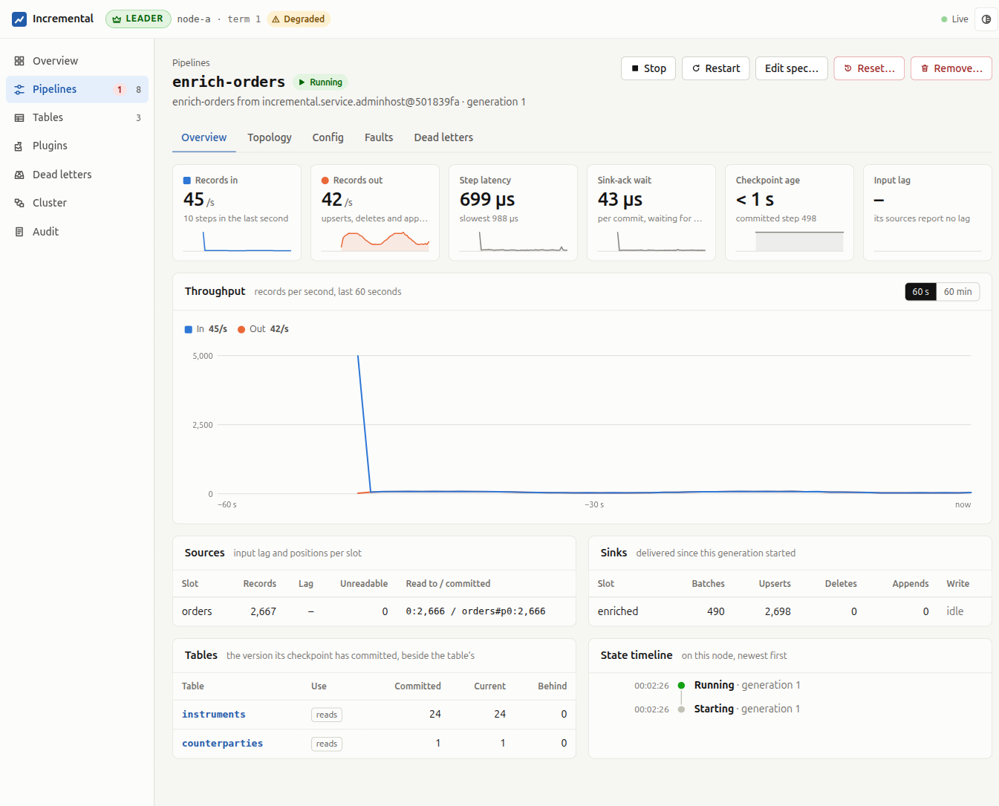
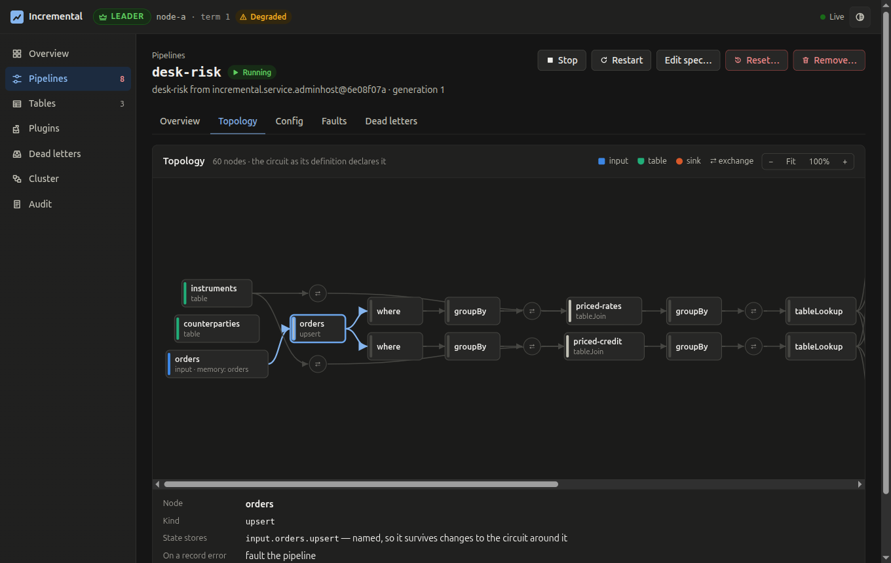
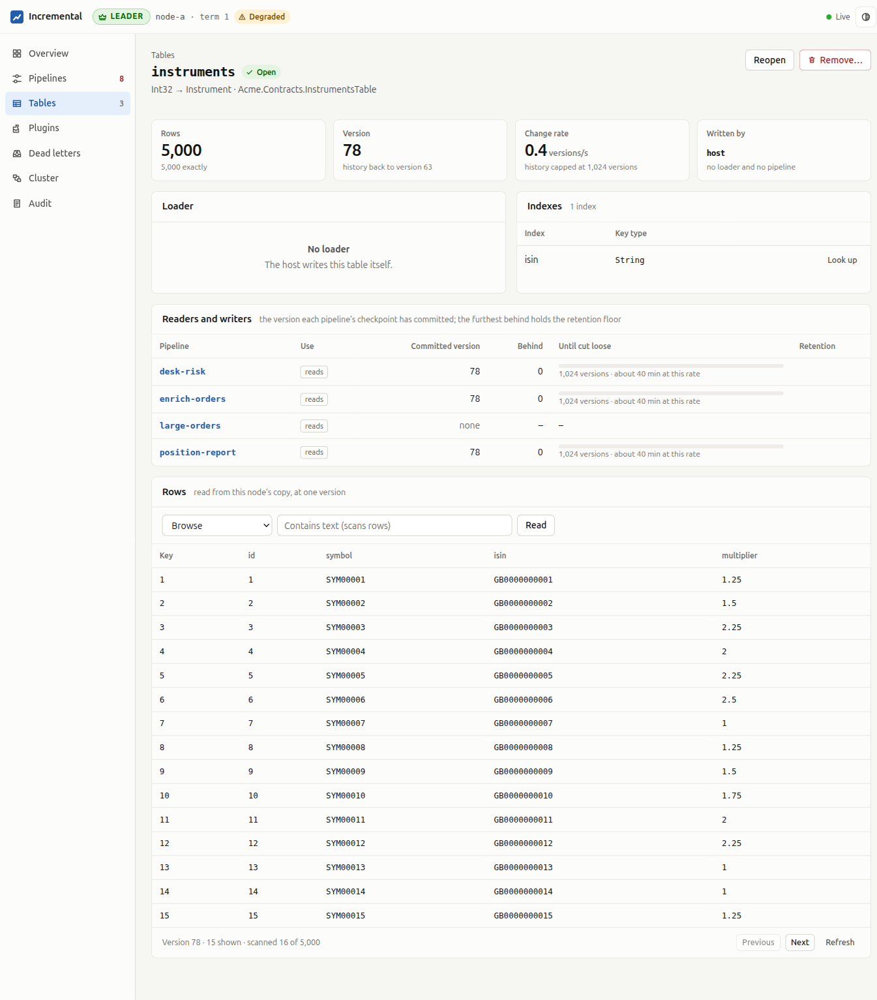
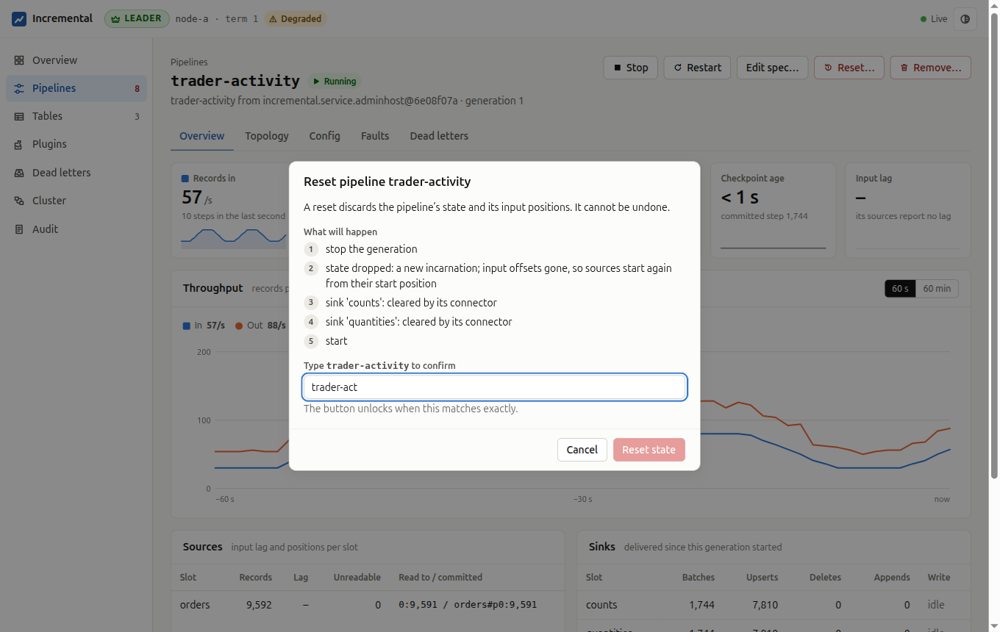
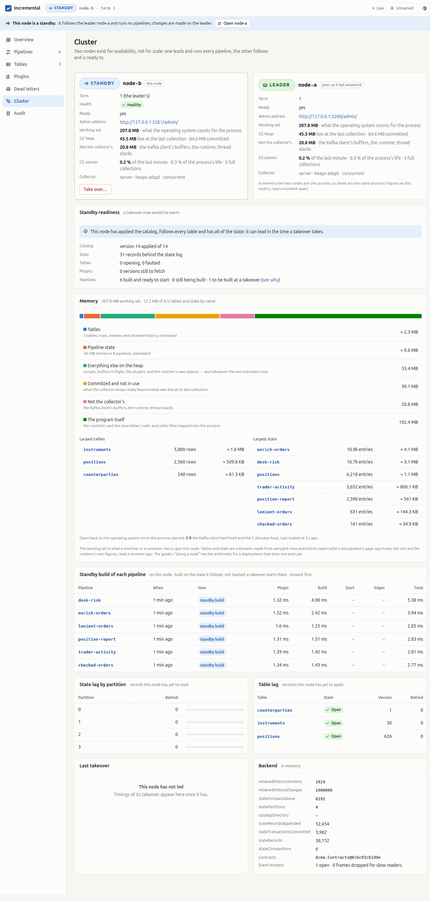
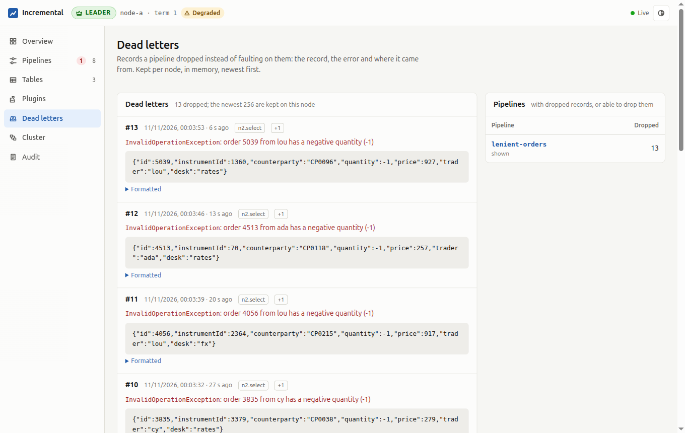

# Incremental

An incremental stream processing library for .NET, built on the ideas of
[DBSP](https://arxiv.org/abs/2203.16684) (the theory behind Feldera): every collection is a
**Z-set** (values with signed weights), every stream carries **deltas**, and every operator
— including joins and aggregations — processes only the changes, never the full state.

```csharp
var builder = new CircuitBuilder(new CircuitOptions { Workers = 4 });

var orders    = builder.Input<Order>("orders");
var customers = builder.Input<Customer>("customers");

var revenueDef = orders
    .Where(o => o.Amount > 0)
    .GroupBy(o => o.CustomerId)
    .Join(customers.GroupBy(c => c.Id),
          (_, order, customer) => new RegionAmount(customer.Region, order.Amount))
    .GroupBy(x => x.Region)
    .Sum(x => x.Amount)
    .ToOutput();

await using var circuit = builder.Build();
circuit.Start();

var ordersIn = circuit.Handle(orders);      // definitions redeem for typed handles —
var revenue  = circuit.Handle(revenueDef);  // no string lookups, no restating types

await ordersIn.InsertAsync(new Order(101, custId: 1, amount: 60m));
await ordersIn.RemoveAsync(new Order(101, custId: 1, amount: 60m)); // cancelled — retracts downstream

await foreach (var batch in revenue.Changes())
    Console.WriteLine(batch); // e.g. {(emea, 40) => +1, (emea, 100) => -1}
```

The API is a plain fluent builder over delegates. It borrows LINQ's names where the
semantics genuinely match (`Select`, `Where`, `GroupBy`, `Distinct`) but is deliberately
**not** LINQ: no expression trees, no `IEnumerable`/`IQueryable` contract, nothing that
constrains what operators can exist or how they execute. See `docs/intro.md` for the full
introduction.

## Concepts

**Z-sets and weights.** A `ZSet<T>` maps values to signed 64-bit weights. Weight +1 is an
insertion, -1 a deletion; weights add, and zero-weight entries vanish. Because deletion is
just data, retraction flows through the entire pipeline for free: cancel an order and the
join output, the group's `SUM`, and the group's `MAX` all correct themselves incrementally.

**Circuits and steps.** `CircuitBuilder` declares a dataflow DAG; `Build()` freezes it into
a `Circuit`. Execution is step-based: each step drains a batch from the inputs, pushes the
resulting deltas through every operator in topological order, and publishes per-output
deltas. Integrating an output's deltas reproduces the current state of that view.

**Incremental operators.**

| Operator | Incrementalization |
| --- | --- |
| `Select` / `Where` / `SelectMany` / `Concat` / `Minus` / `Negate` | Linear — applied to the delta directly, stateless |
| `Join` | Bilinear: Δ(L ⋈ R) = ΔL ⋈ R + (L + ΔL) ⋈ ΔR, probing integrated per-side state |
| `Count` / `Sum` (`AggregateLinear`) | Linear aggregates: folded straight from the delta, state is one (row count, accumulator) pair per key — no group contents stored, update cost independent of group size |
| `Min` / `Max` | Tournament tree per key: values are hash-partitioned into leaf buckets, each level above holds its children's extrema, the root's extremum is the result. Updates — deleting the current minimum included — touch a fixed number of ≤16-entry buckets and propagate up only while a bucket's extremum changes, so cost is independent of group size |
| `Aggregate` (`Fold`, custom) | Integrated group state per key; recomputes touched groups, retracts the stale result (-1) and asserts the new one (+1). Correct for any non-invertible aggregate under deletion |
| `Distinct` | Integrated weight per value; emits only presence transitions |
| `TopK` | Integrated group per key; emits only membership changes (displaced rows retracted). A threshold short-circuit skips the re-rank whenever a key's delta rows all fall strictly below the current K-th entry, so steady-state cost is O(delta) even for huge groups. Multiplicities count toward K |
| `AntiJoin` | Integrated left side plus per-key right-side row counts; a key whose match-presence flips retracts or re-asserts its left rows |
| `LeftJoin` / `FullJoin` | Pure composition: inner join ⊕ mapped anti-join(s) — the Z-set algebra makes the union incremental for free |
| `Join` / `LeftJoin` against a table | The same bilinear rule with the right-hand state replaced by a probe of a shared table at the step's pinned version: Δ(F ⋈ T) = F ⋈ ΔT + ΔF ⋈ T. State is the fact side only, however many circuits join the table; the left join needs no anti-join. Through a secondary index (`By`) a key has a group of rows rather than one |
| `Lookup` / `LookupAppendOnly` | Enrich on arrival: each record probes a shared table once and is never corrected, so table changes are not an input at all. `Lookup` remembers what it emitted per record and retracts exactly that; `LookupAppendOnly` is stateless and faults on a retraction |
| `TumblingWindow` / `HoppingWindow` | Pure data transformation (flat-map) on a grouping: records join every window covering their event time, and the window composes into the group's identity automatically — aggregates over the windowed grouping are windowed aggregates, with eviction derived from the window. Late and deleted events correct their windows via ordinary deltas |
| `SessionWindow` | Stateful, unlike the fixed windows: integrated events per session key, re-sessionized per touched key (never a full rescan). Rows whose session bounds change are retracted and re-asserted, so a bridging or late event merges sessions and a deletion shrinks or splits one — downstream aggregates correct themselves via the ordinary deltas |
| `Recurse` | Fixed-point subcircuit (DBSP recursion), iterated to convergence within each step; the loop's `Join`/`Distinct` state is profiled by inner iteration (incremental in both time dimensions), so the emitted delta is exactly the change between successive fixed points — retractions included, cyclic derivations unwound in well-founded order |

**Watermarks and eviction.** Correctness never depends on watermarks here — late events
just produce correcting deltas. Watermarks serve one purpose: bounding state.
`WithEventTime(v => v.At, lateness)` declares an event-time source (and carries the
timestamp in the type: windows only exist on groupings of an event-timed stream, enforced
at compile time); the circuit's watermark advances to (max event time seen − lateness),
min across sources, frozen between steps so all workers agree, and events below it are
dropped. Windowed groupings derive eviction from the window automatically — state for a
window is deleted once the watermark closes it, already-emitted results stay final, and a
windowed pipeline runs forever in constant memory:

```csharp
views.WithEventTime(v => v.At, lateness: TimeSpan.FromSeconds(2))
     .GroupBy(v => v.Page)
     .TumblingWindow(windowSize)
     .Count()                 // rows (WindowStart, WindowEnd, Page, Count); eviction automatic
     .TopK(3, r => r.Value);  // top pages within each window
```

For keyed state whose lifecycle isn't window-derived, the escape hatch is
`.EvictWhen(key => closesAt)` on any grouping.

**Session windows.** `.GroupBy(c => c.UserId).SessionWindow(gap)` groups each key's
events into sessions separated by at least `gap` of event-time inactivity; a session spans
[first event, last event + gap), and an event exactly at a session's end starts a new one.
Session assignment can't be a flat-map — which events share a session depends on which
other events exist — so the operator runs on the worker owning each key and re-sessionizes
a key's integrated events whenever a step touches it, retracting the rows whose bounds
changed. The session bounds compose into the group's identity like any window, so
aggregates are per-session automatically and a key's event state is dropped once the
watermark passes its last event + gap:

```csharp
clicks.WithEventTime(c => c.At, lateness)
      .GroupBy(c => c.UserId)
      .SessionWindow(TimeSpan.FromMinutes(30))
      .Count(); // clicks per session, corrected as sessions extend, merge, or split
```

**Emit-on-close.** Live windowed results flap by design — each update retracts the stale
row and asserts the new one. `.OnClose()` on a windowed result emits each row exactly once,
final, when the watermark closes its window, in the same step the window's state is
evicted:

```csharp
views.WithEventTime(v => v.At, lateness)
     .GroupBy(v => v.Page)
     .TumblingWindow(windowSize)
     .Count()
     .OnClose()   // one final (window, page, count) row per group, no flapping
     .ToOutput();
```

Underneath sits `.WindowCloses()` on a grouping — a first-class stream announcing each key
exactly once (weight +1, never retracted) when the watermark passes its deadline — which
remains available for close-driven pipelines the paved road doesn't cover.

**Recursion (fixed points).** `.Recurse(body)` closes a stream over itself and computes the
least fixed point `X = Distinct(seed ∪ body(X))` — the DBSP recursive circuit, with the
stream it is called on as the seed and `Distinct` as the built-in stabilizer. Transitive
closure is the classic shape:

```csharp
var closure = edges.Recurse(paths =>
    paths.GroupBy(p => p.To)
         .Join(edges.GroupBy(e => e.From), (_, p, e) => (p.From, e.To)));
```

Within every outer step the subcircuit iterates to convergence — a feedback edge (z⁻¹ over
iterations) circulates the loop delta, outer streams referenced by the body enter at
iteration 0 only (δ0), and the loop stops when no delta circulates on any worker — then
emits the net change of the new fixed point versus the previous step's, so downstream sees
ordinary incremental deltas. The stateful operators inside a loop (`Join`, `Distinct`) are
incremental in *both* time dimensions: their state remembers at which iteration each row's
weight arrived, which is what makes deletions unwind derivations in well-founded order —
deleting an edge retracts exactly the paths with no remaining acyclic derivation, even when
paths "support themselves" around a cycle. Workers iterate in lockstep (the convergence
decision is a global all-workers reduction on the exchange barrier), so the body's joins
shuffle correctly mid-loop, and a `maxIterations` guard (default 10 000) faults the circuit
if a non-monotone body never converges. Bodies may use the linear operators plus
`GroupBy`/`Join`/`Distinct`; aggregations and the like are rejected at definition time.

**Shared tables.** Reference data that many circuits join — instruments, customers,
accounts — fed through a `KeyedInput` is held once in the input and once more in every
join that reads it, per circuit, and a circuit added later sees none of the rows already
loaded. A `SharedTable<TKey, TRow>` is the same data held once per process, outside any
circuit:

```csharp
var instruments = new SharedTable<int, Instrument>("instruments", i => i.Id);
await instruments.Writer.UpsertAsync(row);            // stage…
await instruments.Writer.CommitAsync();               // …and publish as one version
await instruments.Writer.ReplaceAllAsync(snapshot);   // snapshot sync: deletes what it omits

var inst = builder.Table(instruments);                // in any circuit, in any number of them

trades.GroupBy(t => t.InstrumentId)                   // retroactive: corrected when the row changes
      .Join(inst, (id, trade, instrument) => …);
trades.Lookup(inst, t => t.InstrumentId,              // on arrival: enriched once, never corrected
              (trade, instrument) => …);
trades.GroupBy(t => t.Isin)                           // on a column that is not the table's key
      .Join(inst.By("isin", i => i.Isin), (isin, trade, instrument) => …);
inst.Changes();                                       // the table itself as a stream of its rows

enriched.ToTable(traderDesks);                        // a circuit's result as a table: a derived table
```

The table is a change log plus a multi-version view. One writer applies batches; each
batch that changes anything is the next *version*. Every circuit step pins the latest
version of each table it reads and sees exactly that version on every worker for the whole
step, and receives the net changes since the version its previous step saw — so to a
circuit a table is an input whose rows live somewhere else. The pinned version commits
with the checkpoint like an input offset, and a restarted circuit catches up from it.
Probes are lock-free and allocation-free; rows must be immutable, because every circuit in
the process shares the same objects. This is the one place state is shared across threads.

The two ways to join differ in what happens after the fact arrived. `Join`/`LeftJoin` keep
the facts and correct them whenever their row changes, so a hot row re-emits everything
joined to it. `Lookup` enriches once: it keeps only what it emitted, so that retracting or
upserting a record takes back exactly the row it produced, and reference changes cause no
output at all. `LookupAppendOnly` keeps nothing, for streams that only ever insert. A new
circuit needs no backfill for either — its first facts probe the table as it stands — and
`Changes()` begins with the table's current rows for the pipelines that aggregate the
reference data itself. Tables are per process: a clustered circuit cannot attach one.

`ToTable` turns a circuit's table-shaped result into a shared table that other circuits
join — a *derived table*, so a chain of dependent joins is computed once and costs each
pipeline one hop. The circuit becomes the table's only writer. Each step is one table
version, committed before the circuit's checkpoint, and the checkpoint records the version
it covers; after a crash the circuit takes back what it wrote past that version before it
replays, so the table always equals the circuit's state. A circuit cannot read a table it
writes, directly or through other derived tables. The design, with what is still to come
(a durable log, hosting), is in [docs/design/shared-tables.md](docs/design/shared-tables.md).

**Exchange (multi-threading).** `CircuitOptions.Workers = N` runs N worker threads, each
owning its own instance of every operator and its own shard of all operator state.
`GroupBy` inserts an *exchange* operator — the DBSP/timely-dataflow shuffle — which
hash-partitions each delta by key and redistributes it across workers mid-step (barrier
synchronized), so joins and grouped aggregations are correct and scale with the worker
count. `Distinct` shuffles by value automatically. There is no locking on operator state:
one shard, one thread. The engine adapts to the worker count: with `Workers = 1` steps
run inline on the coordinator (no worker thread, no handoff — hundreds-of-µs step
latency for small workloads), while multi-worker exchanges synchronize on a barrier that
spins briefly — mid-step the workers are already hot — and parks on a kernel wait after a
spin budget, so a long wait (a network round trip, a slow peer) stops burning cores.

**Routing hashes.** Exchanges route by `StableHash`, a process- and machine-stable
structural hash (FNV-1a over string contents, raw bit patterns for numbers, a compiled
per-type fold over public members for records/tuples/collections) — never by
`GetHashCode`, whose string hashing is randomized per process. A randomized route would
send the same key to different workers on different processes, silently splitting a
join's state across a cluster or orphaning it across a checkpoint restart. A key type
`StableHash` cannot derive a hash for (interfaces, delegates, unordered collections,
types with no public readable members) is rejected at definition time; a type whose
equality diverges from its public structure (say, a case-insensitive key) takes the
`GroupBy(keySelector, stableHash)` / `Distinct(stableHash)` overloads — the supplied
`Func<TKey, uint>` must return the same value for equal keys in every process, on every
machine.

**Cross-process exchange (clustering).** The same shuffle spans machines, behind the same
operator API: the circuit definition is built unchanged on every process — user code
(`GroupBy`/`Join`/aggregations) never learns the cluster exists — and only
`CircuitOptions.Cluster` declares the process's place in a static topology. Each of the N
processes hosts a contiguous slice of the global worker set (process p owns global workers
[p·Workers, (p+1)·Workers)), every exchange hash-partitions by key across all Workers × N
of them, and shards bound for a remote worker — a delta batch is just (value, weight)
pairs, retractions included — are encoded by a dense per-type codec (compiled from the same
structural rules as `StableHash`, with a JSON fallback for types it cannot round-trip and a
format byte on every frame) and shipped as length-prefixed frames over a transport:
`TcpExchangeTransport` (plain sockets, no dependencies; each process gets the shared
endpoint list and its own index, connections are retried until the mesh is up) or
`InMemoryExchangeTransport` for tests.

> **Security**: the TCP transport is unauthenticated cleartext — the handshake is a bare
> process index, and anyone who can reach the port can join the mesh and inject state.
> Run it only on a trusted, isolated network segment (or inside a mesh/tunnel the
> deployment provides); TLS/authentication is deliberately deferred. Frame payloads are
> capped (`maxFrameBytes`, default 64 MB, same value everywhere) so a corrupt or hostile
> length prefix is rejected rather than allocated.

```csharp
// process 0 of 2 — process 1 runs the identical code with processIndex: 1
var options = new CircuitOptions
{
    Workers  = 4,                     // local workers; the cluster has global workers 0..7
    AutoStep = false,                 // clustered circuits step explicitly, in lockstep
    Cluster  = new ClusterOptions
    {
        Transport = new TcpExchangeTransport(
            processIndex: 0,
            endpoints: ["hostA:9000", "hostB:9000"]),
    },
};
```

Steps are lockstep: every process calls `StepAsync` for every step (hence
`AutoStep = false`), each draining its own inputs — an input is declared everywhere and may
be fed on any process; feed each source where its producer lives. A step aligns at two
points. Mid-step, a worker cannot proceed past an exchange until every peer's shards for
that (step, exchange) have arrived; empty shards are still sent, so the per-peer frame
sequence is dense and alignment never depends on data being present — frames arrive in send
order, which is the same deterministic node order on every process, and a mismatch faults
loudly as a desync instead of merging the wrong step's data. At the end of the step the
processes exchange step-end frames carrying their watermark observations, so the frozen
watermark is the same global min-reduction everywhere and eviction/window-close decisions
stay consistent cluster-wide. Output handles carry the deltas the local workers produced;
consume every process's handle (or key the final operator so the rows you care about land
on one process) for the full stream. Backpressure crosses the wire too: send queues are
bounded, so a slow peer — or its slow output consumer — stalls the cluster's step instead
of buffering unboundedly.

A peer disconnecting or faulting poisons the local circuit through the ordinary fault path
(a descriptive exception on the step, the handles, and `Circuit.Fault`) — never a hang. A
peer that is *stuck* rather than dead — a wedged delegate, a half-dead host holding its
connections — is covered by `CircuitOptions.ExchangeTimeout` (null by default: wait
forever): when set, any single cross-process wait — an exchange's shards, the step-end
alignment, space in a peer's bounded send queue — that outlasts it faults the circuit with
a descriptive `TimeoutException` instead of stalling every process. Size it well above the
slowest healthy step; a fired timeout is terminal like any fault — rebuild from the last
committed checkpoint once the cluster is healthy. Checkpointing stays per process: each
commits its own shards' state and its own inputs' offsets, under keys carrying the process
index plus a step marker, so processes sharing one physical store never clobber each other;
lockstep steps and equal `CheckpointInterval`s mean every process commits the same step
boundaries, and after a crash all processes must resume from the same committed step —
compare `Circuit.CommittedStep` across processes before feeding data (there is deliberately
no distributed commit protocol). `Recurse` is not supported in clustered circuits — the
per-iteration convergence decision would need a cross-process round trip every loop
iteration — and is rejected at `Build()`.

**Backpressure.** Everything between producer and consumer is a bounded
`System.Threading.Channels` channel:

```
producer --await InsertAsync--> [bounded input channel] --drain--> step --publish--> [bounded output channel] --> consumer
```

A slow consumer fills its output channel, which stalls step publishing, which stops input
draining, which fills the input channels, which suspends producers inside `InsertAsync`.
No configuration, no dropped data.

**Faults.** When any worker throws mid-step (a user delegate, a storage error), the fault
propagates cooperatively instead of deadlocking the circuit: the faulting worker poisons the
exchange barrier, so peers blocked mid-shuffle — recursion-loop iterations included — bail
out of the step rather than deadlock, and the circuit moves to a terminal faulted state
within that step. The faulting `StepAsync` throws the original exception (an
`AggregateException` when several workers fault in the same step), consumers’ `Changes()`
observes it after the pre-fault deltas, producers blocked in `InsertAsync` are released with
a `CircuitFaultedException` (original fault as its inner) instead of hanging, and
`Circuit.Fault` exposes it; `DisposeAsync` of a faulted circuit completes quietly. A failed
or cancelled output publish faults the circuit too — by then state has already advanced, so
dropping the step's merged deltas would silently desynchronize every consumer's integrated
view. A faulted circuit's in-memory state is unusable — the faulting step is half-applied —
but that step is never committed, so with a checkpointing storage provider the last
committed checkpoint is intact: rebuild the circuit against the same provider to recover
exactly-once (below).

**Observability.** `CircuitOptions.Name` names the circuit in its logs and as the
`circuit` tag on every metric, so circuits sharing a process stay distinguishable;
`CircuitOptions.LoggerFactory` receives the logs (categories `Incremental.Circuit` and
`Incremental.Cluster`: lifecycle at Information, checkpoint commits at Debug, faults and
cluster timeouts at Error — record contents are never logged):

```csharp
var options = new CircuitOptions { Name = "orders", LoggerFactory = loggerFactory };
```

Metrics need no wiring: the `Incremental` `Meter` is always on and costs nothing
unlistened.

| Instrument | Meaning |
| --- | --- |
| `incremental.circuit.steps`, `.step_duration` | steps completed; wall-clock per step, drain through publish |
| `incremental.circuit.records` | input records drained into steps (after replay dedup) |
| `incremental.circuit.faults` | transitions to the terminal faulted state |
| `incremental.circuit.checkpoint_commits`, `.checkpoint_commit_duration` | atomic state+offsets commits |
| `incremental.circuit.sink_ack_wait` | seconds a commit waited for acknowledged outputs' consumers to confirm delivery, one measurement per commit |
| `incremental.circuit.dead_letters` | records dropped under the `DeadLetter` error policy, tagged by `operator` |
| `incremental.circuit.input_queue_depth`, `.output_queue_depth` | bounded-channel depths, per port |
| `incremental.circuit.watermark_lag` | now minus the frozen watermark, seconds |
| `incremental.circuit.barrier_wait` | cumulative seconds each worker has spent waiting on exchange and loop barriers |
| `incremental.cluster.frames_sent/received`, `.bytes_sent/received`, `.send_queue_depth` | exchange traffic, per peer |

**Keyed inputs.** `builder.KeyedInput<K,V>(name, keySelector)` declares an input with
upsert/delete-by-key semantics: the circuit keeps the current row per key, so
`UpsertAsync(row)` emits the retraction of the previous version automatically and
`DeleteAsync(key)` retracts the current one. This is the natural way to feed reference /
master data (and any stream whose rows are amended in place) — one upsert to a reference
row re-attributes everything joined against it. The current rows are checkpointed operator
state (stored under the input's name, so topology edits leave them alone), which makes a
keyed input safe to re-feed after a restart: re-upserting a row the recovered state already
holds is a no-op, so a producer can simply send its whole table again. A key deleted at the
source while the circuit was down is only retracted if the re-feed includes its delete. The
offset-stamped overloads (`UpsertAsync(row, offset)`, `DeleteAsync(key, partition, offset)`)
replay exactly-once from `CommittedOffsets`, as on plain inputs. Several commands for one
key within a step resolve last-write-wins, so a key needs one logical producer — in a
cluster, if two processes write the same key in the same step, which one wins is
unspecified. The cost is memory: the table is held once more in the input's state, beside
whatever copy a downstream join keeps.

**What your types must satisfy.** Values are Z-set members and dictionary keys, so every
type flowing through a stream needs value equality — records are the natural fit. A
`class` without `Equals`/`GetHashCode` overrides breaks silently: a retraction never finds
the insertion it should cancel, and the two coexist at weights +1/−1. With Redis-backed
state or a cluster, values must additionally round-trip losslessly through the storage
serializer's JSON (public properties/fields; no polymorphism, no reference cycles, no
private-only state — a type serializing as `{}` collapses every instance into one); the
cluster's dense codec follows the same structural rules. Types whose equality diverges
from their public structure need the custom stable-hash overloads (above). Delegates
handed to operators — selectors, predicates, aggregates, eviction deadlines — must be pure.
`Sum` over integer accumulators is checked (overflow faults the circuit instead of
wrapping); floating-point sums drift permanently under retraction (adding x then −x does
not restore the accumulator), so prefer `decimal` or `long`.

**Storage.** Stateful operators keep their state behind `IStorageProvider`
(`IWeightStore`, `IIndexedWeightStore`, `IValueStore`), created per operator *per worker*
so implementations never see cross-thread access to one store.

- `InMemoryStorageProvider` (default) — heap dictionaries.
- `RedisStorageProvider` (`Incremental.Storage.Redis`) — state in Redis hashes; survives
  restarts, can exceed the heap, and checkpoints (below). `KeyPrefix` is required and must
  be unique per circuit sharing the Redis instance — two circuits under one prefix would
  silently interleave state:

  ```csharp
  var redis = await ConnectionMultiplexer.ConnectAsync("localhost");
  var options = new CircuitOptions
  {
      Storage = new RedisStorageProvider(redis, new RedisStorageOptions { KeyPrefix = "orders-prod" }),
  };
  ```

- `ChangelogStorage` / `ChangelogStorageProvider` — state on the heap, in the same stores
  as the default provider, with every checkpoint appended to an `IStateChangelog` as one
  transaction: the entries that changed since the last checkpoint and a commit record
  carrying the offsets. One `ChangelogStorage` per process serves every circuit;
  `storage.Pipeline("id")` is a circuit's provider. `OpenAsync` restores from the log and
  takes its writer; `Follow` keeps a standby's copy warm, and `PromoteAsync` turns it into
  the active — it fences the previous one, whose next commit throws
  `ChangelogFencedException`. `SharedTable.FollowAsync` / `PromoteAsync` do the same for a
  table over its log. `InMemoryStateChangelog` is the in-process log for tests. Design and
  what was built:
  [docs/design/durability-and-standby.md](docs/design/durability-and-standby.md).

- `Incremental.Service` is what makes the set of tables and pipelines change while the
  process runs: a registry that owns the shared tables and their loaders, a supervisor
  that runs one circuit per pipeline and deploys, replaces, resets and removes them one at
  a time, pipeline definitions loaded from plugin assemblies at runtime, and a catalog — a
  shared table — recording what is deployed, which a standby follows and a restarted node
  rebuilds from. It is written against one backend interface with two implementations:
  in memory (one or several nodes in a process, real fencing, no broker) and Kafka
  (`UseKafkaBackend`: two processes on one `KafkaLog` are an active and a warm standby,
  with the catalog, tables, state and plugin files all on the broker; the `kafka`
  connector and the `kafka` and `debezium` table loaders bind slots and tables to topics
  through named connections). A replace that keeps state is checked against the committed
  checkpoint before anything stops and rolled back if the state turns out not to fit; the
  service publishes a meter, `Incremental.Service`, for a monitoring system; and the
  admin API says what a deploy needs — a definition's slots and settings, the registered
  connectors and connections, a starting spec. A `files` connector reads and writes
  JSON-lines objects through `IObjectStore` (a directory is built in; S3 is yours to
  plug in), a spec's `deadLetters` keeps dropped records in any append sink, at least
  once and across a takeover, and `PipelineTestHarness` tests a definition with no node. See *Running many pipelines* in
  [docs/intro.md](docs/intro.md) and
  [docs/design/enrichment-service.md](docs/design/enrichment-service.md), *As built*.

- `Incremental.Service.Admin` is the service's admin surface: a JSON API and a web UI on
  top of it, mounted with two calls in any ASP.NET Core host.

  ```csharp
  builder.Services.AddIncrementalService(o => o.AdvertisedAdminUrl = "http://node-a:5180/admin/");
  builder.Services.AddIncrementalAdmin(o => o.ExposeRowData = true);
  var app = builder.Build();
  app.MapIncrementalAdmin("/admin");      // UI at /admin/, API at /admin/api
  app.MapIncrementalHealth("/health");    // /health/live, /ready, /status
  ```

  

  The UI shows the node and its role (leader, standby, fenced — a word, a shape and a
  colour), every pipeline with its rates, its topology, its faults and its dead letters,
  every table with its loader, its readers and who holds its retention floor, plugins,
  the cluster and the audit trail. It is fed by one server-sent event stream and says so
  when that stream is gone. Every action asks the node what it will do first and shows
  the plan; a reset or a removal also asks for the id to be typed.

  | | |
  |---|---|
  |  |  |
  |  |  |
  |  |  |

  It is cautious until told otherwise. With no `AuthorizationPolicy` it answers loopback
  requests only — it refuses another host name and what it can tell a proxy forwarded
  (a forwarding header, HTTP/1.0) — so reaching it from another machine means setting a
  policy (`PipelinePolicy`, `TablePolicy`, `NodePolicy` and `PluginPolicy` narrow the
  mutations further). The loopback rule is not authentication: a proxy on the same
  machine that adds no header makes its callers loopback callers, so set a policy before
  putting any proxy in front of it.
  `ReadOnly` refuses every mutation. Row data is off by default: without
  `ExposeRowData` the row endpoints answer 403 and faults, dead letters and events carry
  exception types, not messages, because a message can quote a row. Plugin upload and
  rescan are each a switch, off by default. The health endpoints sit outside all of this
  and return codes only. Every list is paged and bounded by `MaxRows`; every refusal is
  `{ "error": { "code", "message", "details"? } }`; a slow event-stream client loses
  ticks and then its connection, never the server's memory. The UI is hand-written HTML,
  CSS and JavaScript embedded in the assembly: no build step, no CDN, no web font.

  `dotnet run --project tests/Incremental.Service.AdminHost` runs it against three tables
  and eight pipelines on the in-memory backend (`-- --nodes 2` for a leader and a standby
  on ports 5180 and 5181; `--read-only`, `--no-rows`).

- **Start here for the service:** [docs/enrichment-service.md](docs/enrichment-service.md)
  is a guide from an empty directory to a running pipeline plugin — the contract, a
  definition, the project file, a spec, a test — then the host and its adapters, the
  built-in connectors, the admin UI, and operating notes (failover, reset, retention,
  dead letters, MSK). Its code is quoted
  from `examples/Incremental.EnrichmentService`, a complete host:

  ```bash
  dotnet run --project examples/Incremental.EnrichmentService                 # one node, in memory: http://127.0.0.1:5180/admin/
  dotnet run --project examples/Incremental.EnrichmentService -- --nodes 2    # with a standby on 5181
  dotnet run --project examples/Incremental.EnrichmentService -- --headless   # its smoke test; add --nodes 2, or --kafka
  ```

  With the connector stack up, `-- --kafka --node a` and `-- --kafka --node b` in two
  terminals are an active and a standby on Kafka, with reference data in Postgres
  arriving through Debezium; kill the first and the second leads in about three and a
  half seconds.

- `Incremental.Kafka` puts both logs on Kafka. One `KafkaLog` per process owns one
  transactional producer; `log.State` is the `IStateChangelog` over the compacted topic
  `{prefix}.state`, and `log.OpenTableLogAsync<TKey, TRow>(name)` is a table's `ITableLog`
  over `{prefix}.table.{name}.changes` and `.rows`. Concurrent commits from every circuit
  and table share Kafka transactions (group commit). `AcquireWriterAsync` initialises the
  shared `transactional.id`, which fences the previous active:

  ```csharp
  await using var log = await KafkaLog.ConnectAsync(new KafkaLogOptions
  {
      BootstrapServers = "localhost:9092",
      TopicPrefix = "enrichment",
      ReplicationFactor = 1,                       // 3 by default, for a real cluster
  });
  await log.AcquireWriterAsync();                  // the active; a standby does not call this until takeover
  var instruments = await SharedTable<int, Instrument>.OpenAsync(
      "instruments", i => i.Id, await log.OpenTableLogAsync<int, Instrument>("instruments"));
  await using var storage = await ChangelogStorage.OpenAsync(log.State);
  var options = new CircuitOptions { Storage = storage.Pipeline("orders-by-region") };
  ```

  `KafkaLogOptions.ClientConfig` passes any librdkafka setting to every client (TLS and
  SASL for MSK). `FetchBufferKilobytes` (8 MB) bounds what each follower or restore
  consumer may hold fetched and not yet applied.

- `KafkaLeadership` decides which of two nodes is the active, in Kafka alone. The writer
  leaves a heartbeat in `{prefix}.leader` with every transaction and once a second when
  idle. Every node starts as a standby — followers, circuits built and not started — and
  takes over when the topic has been silent for `TakeoverAfter` (3 s; an optional peer
  probe can hold it back), when the leader resigns, or on `TakeOverAsync()`: it fences the
  old leader, commits the next term, promotes the tracked tables, then the storage, then
  calls `StartLeadingAsync`:

  ```csharp
  var leadership = new KafkaLeadership(log, new KafkaLeadershipOptions
  {
      ProbeLeader = LeadershipProbe.Tcp("node-b", 7100),               // a hint, optional
      StartLeadingAsync = (term, ct) => { circuit.Start(); return Task.CompletedTask; },
      StopLeadingAsync = async ct => await circuit.DisposeAsync(),     // for StepDownAsync
  });
  var tableLog = await log.OpenTableLogAsync<int, Instrument>("instruments");
  var instruments = await SharedTable<int, Instrument>.FollowAsync("instruments", i => i.Id, tableLog);
  var storage = ChangelogStorage.Follow(log.State);
  leadership.Track(instruments, tableLog);
  leadership.Track(storage);
  leadership.Changed += status => { if (status.Role is NodeRole.Fenced) Environment.Exit(3); };
  await leadership.StartAsync();
  ```

  A replaced leader ends `Fenced` (it reads the higher term, or its next write fails) and
  the process is expected to exit and return as a standby. A leader inside one long
  commit keeps writing heartbeats into the open transaction, which a standby sees as the
  leader topic's end moving, so a commit may take up to `TakeoverCeiling` (30 s) without
  costing the leader its place. `StepDownAsync()` is the planned handover. `leadership.Leased(sink)` holds sink deliveries back once the leader's
  last commit is older than the lease, and `leadership.Status` reports role, term, leader,
  heartbeat age and follower lag. Measured locally with real processes: 3.2 s from
  `kill -9` to the standby's first output, 3.05 s of which is the timeout (4.7 s when the
  leader died with a transaction open). Not built yet: hosting roles.

- `KafkaSource` reads a topic into a circuit input, a keyed input, or a shared table. The
  position is the checkpoint's, not a consumer group's: every record is handed on stamped
  with its partition and offset, and a source started against a circuit (or a table)
  assigns each partition one record after `circuit.CommittedOffsets(...)` (or
  `table.CommittedOffsets`). The input's bounded channel is the backpressure. A record
  that does not deserialize goes through the circuit's error policy as a `KafkaRecord` —
  topic, partition, offset, bytes — via `InputHandle.RejectAsync`. Offsets that yield
  nothing (a transaction's marker, a tombstone on a stream, a record passed over) are
  recorded through `AdvanceAsync`, so an idle topic's committed position stays at its end
  and retention cannot overtake it. `StartFrom = Latest` takes the end once, at the first
  start, and records it.

  ```csharp
  var source = new KafkaSourceOptions { BootstrapServers = "localhost:9092", Topic = "orders" };
  circuit.Start();
  await using var orders = await KafkaSource.StartAsync(circuit, ordersInput, source);       // JSON values
  await using var accounts = await KafkaSource.StartAsync(circuit, accountsKeyedInput,       // value = upsert,
      new KafkaSourceOptions { BootstrapServers = "localhost:9092", Topic = "accounts" });   // tombstone = delete
  await using var loader = await KafkaSource.StartTableLoaderAsync(instruments,              // topic → SharedTable
      new KafkaSourceOptions { BootstrapServers = "localhost:9092", Topic = "instruments" });
  ```

  `KafkaDeserializers.From(...)` adapts any Confluent deserializer, which is how
  schema-registry formats plug in. `Debezium.Changes<TKey, TRow>()` is the decoder for a
  Debezium change-event topic (JSON converter, with or without schemas), so a Postgres
  table becomes a shared table to `Join` or `Lookup` against; `KafkaConnectClient` and
  `DebeziumPostgres.ConnectorConfig` register the connector.

- `KafkaUpsertSink` (`IUpsertSink`: key → row, a delete is a tombstone, for a compacted
  topic) and `KafkaAppendSink` (`IAppendSink`: every record carries its step in the
  header `incremental.step`) write results to Kafka, at-least-once. By default each has
  an idempotent producer of its own; with `KafkaSinkOptions.Log` set it writes through
  the log's transactional producer instead and a deposed leader cannot write it at all.
  A keyed `KafkaSource` reads an upsert sink's topic back as the same table.

  ```csharp
  await using var sink = new KafkaUpsertSink<string, RegionTotal>(
      new KafkaSinkOptions { Topic = "region-totals", BootstrapServers = "localhost:9092" });
  _ = circuit.Handle(totals).DeliverToAsync(leadership.Leased(sink), row => row.Region);
  ```

- Candidates that make sense next: RocksDB (large state, embedded, fast scans), SQLite.

**Checkpointing and exactly-once restart.** A provider implementing
`ICheckpointStorageProvider` (Redis and the changelog provider do;
`InMemoryCheckpointStorageProvider` is the in-process stand-in for testing) makes checkpoints of the circuit: operators stage their
writes in per-store overlays, and every `CheckpointInterval` steps (default: every step) the
circuit commits {all staged state changes + the input offsets those steps consumed}
atomically — for Redis, one MULTI/EXEC transaction covering every worker's shard plus a
`{prefix}:checkpoint` offsets marker, issued only after all workers have finished their
steps. Either the whole checkpoint lands or none of it does, so durable state and offsets
always agree, even across a crash mid-commit. The commit verifies every command in the
transaction landed — a checkpoint is never reported committed with writes missing.

Producers stamp records with source offsets — `SendAsync(value, weight, partition, offset)`
(and matching `InsertAsync`/`RemoveAsync` overloads), e.g. a Kafka (partition, offset);
dedup is per partition, so one input fronts a whole topic. The single-offset overloads map
to partition 0, and unstamped records are numbered as they are consumed — but an input is
one or the other: mixing stamped and unstamped records throws (immediately at the handle,
and as a circuit fault for a producer that switches kinds across a restart) instead of
silently corrupting the replay position. After a crash, rebuild the circuit against the
same provider: the state is already there, `circuit.CommittedOffsets("orders")` says where
each partition got to (`CommittedOffset` still serves the unstamped and single-partition
cases), and replayed records stamped at or below their partition's checkpoint are dropped
on arrival — resuming a log-style source is exactly-once from the state's point of view.

Restarts are guarded by a **state manifest**: every checkpoint commits a description of
the state it belongs to — each store's identity, the worker and process counts, a format
version — and a rebuilt circuit refuses to start against a checkpoint whose manifest does
not match, listing the mismatches, instead of silently reading another operator's state.
A circuit refused this way is finished — disposing it processes and commits nothing.
By default a store's identity is its position in the circuit, so inserting or reordering
operators orphans downstream state (detected, loudly); `.Named("revenue")` on the stream a
stateful operator returns pins its identity by name instead, so the circuit can evolve
around it and a rebuild still finds its state. Pure additions — new operators, whose state
starts empty — are always allowed. A name pins identity, not meaning: state is resumed
as-is, so rename the operator when its computation changes.

Output batches are transient and not checkpointed — consumers re-derive views by
integrating. Batches published between the last commit and a crash are never replayed, so
**table-shaped outputs resync automatically**: a keyed or windowed result's `ToOutput()`
maintains the view's integrated state behind the storage provider (checkpointed and
recovered with everything else), and the handle's `Changes()` begins with one batch
asserting the current integrated state — treat it as a reset. That makes consumers correct
across restarts and mid-run subscription with no opt-in to remember;
`ToOutput(bootstrap: false)` opts a stateless consumer out of the state cost.
`MaterializeInMemory()` builds on the same resync: a live in-memory view with consistent
`Current()` snapshots on demand — its cost is in its name (O(live rows) heap). Outputs are
single-consumer (a second `Changes()` throws rather than silently splitting the feed), and
plain stream outputs are pure changefeeds: at-most-once across a crash, exactly-once being
the downstream consumer's offset/idempotency concern. (In a cluster an output covers the
local process's workers, like the delta stream itself.)

**Acknowledged outputs: at-least-once to a sink.** `stream.ToAcknowledgedOutput()` declares
an output whose batches the consumer confirms. Each `OutputBatch<T>` carries the step's
`Changes` and its `Sequence`; `handle.ConsumeAsync(sink)` acknowledges when the sink
delegate returns, or read `handle.Batches()` and call `batch.Acknowledge()` yourself (an
acknowledgement covers every earlier batch). A circuit with such an output commits *after*
delivery: a step publishes first, and its checkpoint — state, input offsets, table versions
— waits until every batch published so far has been acknowledged. A crash anywhere between
publish and commit therefore re-runs those steps and delivers their batches again; nothing
is lost, and some batches arrive twice. Sequences are step numbers, committed with the
checkpoint (`Circuit.CommittedStep`) and continued after a restart, so a redelivery is
recognisable as a sequence the sink has already applied. The circuit runs no step while a
commit waits on the sink (`incremental.circuit.sink_ack_wait` measures it); use a larger
`CheckpointInterval` with `CheckpointMaxDelay` — a commit at least that often in time — to
keep steps flowing between commits. A consumer that stops reading faults the circuit rather
than stall it. Plain outputs keep their semantics and hold no commit up. Single process
only. Details in [docs/intro.md](docs/intro.md).

**Sinks.** `handle.DeliverToAsync(sink)` delivers an acknowledged output to an
`IUpsertSink<TKey, TRow>` — each step collapsed to at most one upsert or delete per key — or
to an `IAppendSink<T>`, whose batches carry the step sequence to deduplicate by. The sink is
awaited and the step acknowledged when it returns; a failing write is retried with a bounded
backoff and then faults the circuit (`SinkDeliveryOptions`; `MaxRetries = null` stalls
instead). `InMemoryUpsertSink` and `InMemoryAppendSink` are the test doubles. Under
auto-stepping a crash replay may cut different steps: upserts converge except for a key that
was delivered and is gone again within one merged replay step, and an append sink should
truncate to `Circuit.CommittedStep` on restart — both spelled out in
[docs/intro.md](docs/intro.md).

**Per-record errors.** `CircuitOptions.ErrorPolicy` is `Fault` by default: a throwing
delegate or a null key faults the circuit. `DeadLetter` drops the record instead, reports
it — record, weight, operator, exception — on the bounded `circuit.DeadLetters` channel
(which must be read) and counts it in `incremental.circuit.dead_letters`; `.OnError(policy)`
overrides it for one operator. With `AcknowledgeDeadLetters` the checkpoint waits until
the reader has stored each step's dropped records (`circuit.DeadLetterBatches`,
`DeliverDeadLettersToAsync`), so a crash loses none. A dropped record's retraction is dropped too, which for
stateless operators relies on deterministic delegates. The default path has no exception
handling in it. The list of operators that can dead-letter is in
[docs/intro.md](docs/intro.md).

The circuit commits through `ICheckpointStorageProvider.CommitAsync` and awaits it, so a
provider whose commit is I/O (Redis implements it with `ExecuteAsync`) holds no thread
while it is in flight; the method defaults to the synchronous `Commit`, which is all a
custom provider has to supply.

**Stepping modes.** By default a pump task steps the circuit whenever input is available.
With `AutoStep = false` the circuit advances only on explicit `StepAsync()` calls — exact,
deterministic step boundaries for tests and batch jobs.

## Project layout

```
src/Incremental                    core: Z-sets, builder API, operators, windows, runtime, in-memory
                                       storage, cluster transports (TCP + in-memory)
src/Incremental.Storage.Redis      Redis-backed IStorageProvider
src/Incremental.Kafka              Kafka-backed state changelog and shared-table logs, written
                                       through one transactional producer per process; leader
                                       election and takeover (KafkaLeadership); sources into
                                       inputs and tables (KafkaSource), sinks, Debezium decoding
src/Incremental.Service            the generic parts of an enrichment service: table registry,
                                       pipeline supervisor (one circuit per pipeline), plugin
                                       loading, catalog, service node, metrics and the meter
                                       `Incremental.Service`, discovery; an in-memory backend
                                       (bounded) and a Kafka one; the `kafka`, `files` and
                                       `memory` connectors; a durable dead-letter sink per
                                       pipeline; PipelineTestHarness for plugin authors
src/Incremental.Service.Admin      the admin JSON API and web UI for a service node (ASP.NET
                                       Core; the UI is embedded, hand-written, no build step)
tests/Incremental.Tests            xunit: Z-set algebra, per-step delta semantics, multi-worker runs,
                                       Redis integration (auto-skipped when Redis is down)
tests/Incremental.Kafka.Tests      xunit, against the local broker (`docker compose --profile
                                       connectors up -d`; auto-skipped when it is down): the log
                                       writer, fencing, restore, compaction, failover end to end,
                                       leadership, kill -9 failover between real processes,
                                       sources and sinks, and Postgres → Debezium → table CDC
tests/Incremental.Kafka.FailoverApp  the process those failover tests launch twice: one pipeline,
                                       leader or standby as its KafkaLeadership decides
tests/Incremental.Service.Tests    xunit: registry, supervisor, plugins, catalog and two-node
                                       takeover in memory (no broker); the admin API over real
                                       Kestrel and a smoke test of the UI; the same node on the Kafka
                                       backend, CDC through Debezium, and kill -9 failover between
                                       real processes (skipped when the broker is unreachable)
tests/Incremental.Service.AdminHost  one or two nodes with the admin UI mounted, tables,
                                       pipelines and a generator: what the admin API's tests
                                       run against, and how to look at the UI
tests/Incremental.Service.FailoverApp  one service node as a process, for those failover tests
tests/Incremental.Service.TestPlugins  contract and pipeline assemblies those tests load at
                                       runtime from their output directories; built, never referenced
examples/Incremental.Example       joined + aggregated order analytics with live retraction
examples/Incremental.LogAnalytics  simulated clickstream → 5s tumbling windows → counts → live top-3
                                       per window, rendered as an in-place Spectre.Console dashboard
                                       (bar gauges per window, watermark in the header);
                                       `--redis` keeps operator state in Redis. The hosted
                                       example: a worker service on `Incremental.Hosting`
examples/Incremental.TradeEnrichment trades enriched from shared tables, as a narrative that checks
                                       itself: four reference tables held once (`SharedTable`), a
                                       derived table written by a small circuit (`ToTable`), a
                                       trade circuit that looks the symbol up on arrival (`Lookup`)
                                       and joins desk and rating retroactively (`Join`), two sinks
                                       on the acknowledged-output path. A trader moves desk, an
                                       instrument is renamed, a trade is amended; every claim it
                                       prints is checked against a model, and a wrong one exits 1
examples/Incremental.EnrichmentService  a host for Incremental.Service with the admin UI: a contract
                                       assembly, a pipeline plugin in two versions (five
                                       definitions: joins and a lookup, event-time windows, a derived
                                       table, two inputs joined to each other, an append sink with dead
                                       letters) and its tests (Pipelines.Tests, on PipelineTestHarness),
                                       two custom table sources, a source and a sink connector,
                                       a generator. In memory by default (`--nodes 2` adds a standby);
                                       `--kafka --node a|b` runs two processes on the connector stack
                                       with Postgres → Debezium → tables and Kafka sinks; `--headless`
                                       is the smoke test: it drives the admin API and checks every sink
                                       against a model, through a replace keeping state, one resetting
                                       it, a removal and a takeover (on Kafka: a kill -9).
                                       docs/enrichment-service.md is written around it
examples/Incremental.Showcase      the all-features demo: a marketplace payments desk, served as a
                                       local web app (`dotnet run`, then http://localhost:5170) in
                                       five tabs — enrichment joins (inner/left/full/anti) and
                                       aggregates with one upsert re-attributing history, event-time
                                       windows (tumbling/hopping/session, live vs OnClose, late
                                       events), recursive fraud-ring closure with live edge
                                       deletion, a mid-stream crash recovered exactly-once from
                                       checkpoints (in-memory by default, `--redis` for real), and
                                       scaling out: the same declaration measured at 1/2/4 worker
                                       threads (sharding costs latency and buys throughput — the tab
                                       measures both rather than asserting either) and, with
                                       `--nodes 2` (alias `--cluster`), re-spawned as a second OS
                                       process exchanging shards over TCP. Picking a topology
                                       relaunches the showcase into it and the page reconnects
                                       itself. Each tab shows the fluent declaration that runs it
                                       and buttons that fire its scripted moments; a sidebar
                                       streams the raw enriched changefeed with z-set weights, so
                                       retract-then-assert is visible rather than described; the
                                       footer reads the `Incremental` meter. `--workers N` sets the thread count
                                       (default 2, so the other tabs really exercise the exchange
                                       path). No NuGet dependency beyond
                                       the library: `Microsoft.NET.Sdk.Web` resolves ASP.NET Core
                                       from the shared framework, the page is one dependency-free
                                       HTML file, and state reaches it over server-sent events.
                                       `--headless` runs every tab and trigger unattended, prints
                                       the panels as text, and exits non-zero if a verified act
                                       (crash recovery, cluster shard merge) fails to verify — that
                                       is the CI smoke test. Deliberately not shown: the escape
                                       hatches (Minus/Negate, EvictWhen, WindowCloses, Rows,
                                       weighted SendAsync) — reference material (docs/intro.md),
                                       not headline features
examples/Incremental.TaxiAnalytics genuine big data: ~13M real NYC yellow-taxi trips (parquet, read
                                       via Parquet.Net, downloaded and cached on first run, ~50MB/month;
                                       `--months N`, `--synthetic`) through join + counts + revenue +
                                       top-5 zones per borough; narrated phases, then continuous
                                       single-row churn with a live view until you press a key —
                                       ~1M rows/s bulk load; single-row updates in ~250 µs,
                                       thousands of × cheaper than a full recompute
benchmarks/Incremental.Benchmarks  BenchmarkDotNet suite (Z-set primitives, stateless pipeline,
                                       join / sum / min / top-k delta cost vs state size), plus
                                       `-- --assert`: CI performance contracts that check scaling
                                       ratios (delta cost must not grow with state size) instead of
                                       wall-clock numbers, so they hold on noisy shared runners
benchmarks/Incremental.Torture     throughput rig: the showcase pipeline flat out over a sliding
                                       order population — records/s, process CPU split (workers vs
                                       GC), allocation per record; see Benchmarks below
```

## Benchmarks

```sh
dotnet run -c Release --project benchmarks/Incremental.Benchmarks -- --filter '*'   # full BenchmarkDotNet suite
dotnet run -c Release --project benchmarks/Incremental.Benchmarks -- --assert      # CI performance contracts
dotnet run -c Release --project benchmarks/Incremental.Torture -- --workers 4      # sustained throughput
```

The `--assert` mode is what CI gates on. Shared runners are too noisy for absolute timing
assertions, so each contract runs an identical fixed-size delta against a small and a 64×
larger preloaded state (interleaved trials, medians) and fails if the large/small ratio
exceeds a generous bound (1.5× allocations, 5× time). A regression from O(delta) to O(state)
shows up as a ~64× ratio, so the check is high-signal without being flaky. The full suite
runs on demand via the *Benchmarks* GitHub workflow (`workflow_dispatch`), which uploads
the BenchmarkDotNet artifacts.

`Incremental.Torture` answers the other question — what a whole graph costs per record when
it is running flat out, rather than what one operator costs per delta row. It runs the
showcase pipeline over a sliding population of orders (inserting order *N* retracts order
*N−live*, so state settles at a fixed size and retractions are on every step), reports the
process CPU split between workers and the GC, and has an in-process allocation profiler by
type (`--alloc-types`). `--processes N` runs the cluster graph across co-hosted processes,
which is what puts the exchange wire format on the measured path. See its README for current
numbers and for the runtime GC settings that matter more than any single code change:
**size the server GC's heap count to `CircuitOptions.Workers` rather than to the core count,
turn DATAS off** — a circuit's live set is large and mostly static, which is the shape
DATAS handles worst — **and raise the LOH threshold to 1 MB** so medium arrays stop
triggering gen2 collections.

The operators themselves allocate almost nothing per step — outputs, input batches and the
exchange wire path all run on reused buffers — so at throughput the remaining allocation is
mostly the rows *your* lambdas return. The one consumer-side lever worth knowing: declare
small row and accumulator types as `readonly record struct` (a linear aggregate constructs
a fresh accumulator every fold; as a struct it never touches the heap). `docs/intro.md` has
the details under *Running it fast*, and the showcase's `Records.cs` / `Aggregates.cs` show
the struct-vs-record split.

Every example ships with that configuration applied. `examples/Directory.Build.props` turns
on server and concurrent GC and turns DATAS off for all of them, and each example declares
the worker count it builds its circuit with as `<CircuitWorkers>`, which becomes the
runtimeconfig heap count. So `dotnet run` on any example measures the library rather than
the default GC's idea of what to do with a 20-thread machine. It is startup configuration —
a library cannot set it for you — so an application gets it by copying those few lines into
its own project; `docs/intro.md` has them under *Running it fast*.

## Packaging

MIT-licensed (see `LICENSE`). The five shipped libraries (`Incremental`,
`Incremental.Storage.Redis`, `Incremental.Kafka`, `Incremental.Hosting` — generic-host
and DI integration, see *Hosting it* in `docs/intro.md` — and `Incremental.Service`, see
*Running many pipelines* there) multi-target **net8.0 and net10.0** and carry full NuGet
metadata — `dotnet pack` produces consumable packages with XML docs, SourceLink, and
symbol packages (not yet published to nuget.org; consume by project reference or a local
feed). The only runtime dependency of the core library is
`Microsoft.Extensions.Logging.Abstractions`.

## Running with Redis

```sh
docker compose up -d        # starts Redis on localhost:6379
dotnet test                 # Redis integration tests now run instead of skipping
dotnet run --project examples/Incremental.LogAnalytics -- --redis
```

## Status / roadmap

The semantics above are implemented and tested. The known limitations are deliberate,
disclosed trade-offs (below), not missing semantics:

- [x] Linear-aggregate fast path: `COUNT`/`SUM` maintained from the delta alone with O(keys)
      state (`ILinearAggregate`); custom linear aggregates via `AggregateLinear`
- [x] Tournament trees for `MIN`/`MAX` over large groups (`Min`/`Max` maintain a
      hash-partitioned reduction tree in ordinary indexed stores, so it works over any
      storage provider; deleting the extremum no longer rescans the group)
- [x] Batched/pipelined Redis access (operators drive batched store operations, so a step
      costs a handful of pipelined round trips instead of one per state touch)
- [x] Checkpointing input offsets with state for exactly-once restart (staged writes
      committed atomically with consumed offsets — Redis: one MULTI/EXEC per checkpoint;
      producers stamp records with source offsets, replays below the checkpoint are
      dropped; `InMemoryCheckpointStorageProvider` for testing the semantics)
- [x] `TopK` (per-key ranking with retraction of displaced rows)
- [x] Tumbling and hopping event-time windows (assignment; late data handled by deltas)
- [x] Watermarks: late-event filtering and eviction of closed-key state (aggregate/TopK)
- [x] Anti-join, left and full outer joins
- [x] Window-close notifications (`WindowCloses`: a keyed stream announcing each window
      final, exactly once, when the watermark passes its deadline; joins with the window's
      aggregate to publish finalized results)
- [x] Watermark-driven eviction for join/anti-join/distinct state (keyed `Distinct`
      keeps its state grouped by key so the policy applies)
- [x] Session windows (per-key inactivity gap; a bridging or late event merges sessions and
      a retraction splits them, all via ordinary deltas; key state evicted once the
      watermark passes last event + gap)
- [x] Recursive/iterative circuits (DBSP fixed points) for transitive closure-style queries
      (`Recurse`: per-step fixed-point iteration with a hard-wired `Distinct` stabilizer;
      loop `Join`/`Distinct` state is iteration-profiled so retractions unwind cyclic
      derivations correctly; lockstep multi-worker iteration with a global convergence
      barrier; `maxIterations` guard)
- [x] Cooperative fault propagation across workers (a fault poisons the exchange barrier so
      peers bail out of the step instead of deadlocking; the circuit becomes terminally
      faulted within the step — original exception on the step, the output channels, and
      `Circuit.Fault`; producers released with `CircuitFaultedException`; the committed
      checkpoint untouched, so rebuild-from-checkpoint is the recovery story)
- [x] Cross-process exchange (workers on different machines) behind the same operator API
      (`CircuitOptions.Cluster`: N processes × M workers as contiguous slices of one global
      worker set; exchanges hash-partition across all of them and ship remote shards as
      length-prefixed frames over a transport — TCP over plain sockets, in-memory for
      tests; explicit lockstep steps with dense per-exchange frame alignment, globally
      min-reduced watermarks, cross-process fault propagation, per-process checkpoints
      keyed by process index; `Recurse` + cluster is rejected at build time)
- [x] Production hardening pass: process-stable exchange routing (`StableHash` — the
      randomized string hash silently broke cluster routing and multi-worker restore),
      state manifests + `.Named()` checkpoint identities, per-partition input offsets,
      snapshot outputs for consumer bootstrap, output-publish failures fault the circuit,
      `ILogger` + `Meter` observability, cluster exchange timeouts + frame caps + parking
      barrier, verified Redis commits + required key prefix, checked integer sums, MIT
      license, net8.0/net10.0 NuGet packaging
- [x] 0.2 consumer API (`docs/intro.md`): LINQ-dialect names, group-then-window typed
      ladder (windows only on event-timed groupings, eviction derived, per-window `TopK`,
      `OnClose`), definitions redeemed for typed handles (`circuit.Handle(def)` — outputs
      unnamed), changefeed-first outputs with automatic table-shaped resync and
      `MaterializeInMemory` views

- [x] Generic-host and DI integration (`Incremental.Hosting`: `AddIncremental<TDefinition>()`
      keys a circuit by its definition class; the host owns start/recovery, a draining
      shutdown that outlives the circuit with its consumers, fault policy — stop the
      application by default — configuration binding, shared in-memory views and a health
      check; `Circuit.Completion` is the fault signal it supervises on)

- [x] Sinks and a per-record error policy: `IUpsertSink`/`IAppendSink` delivered from an
      acknowledged output (per-key collapse, bounded retries, backpressure), and
      `RecordErrorPolicy.DeadLetter` with a bounded dead-letter output and per-operator
      `OnError`

### Known limitations (deliberate, disclosed)

- `Incremental.Hosting` does not host clustered circuits yet (no host-side lockstep stepping).

- The TCP cluster transport is **unauthenticated cleartext** — trusted, isolated networks
  only; TLS/authentication is deferred.
- No peer reconnection: a disconnect or fired `ExchangeTimeout` is terminal — rebuild
  every process from the last committed checkpoint.
- Cluster checkpoints commit per process with no distributed commit protocol: a crash can
  leave processes one checkpoint apart — compare `Circuit.CommittedStep` across processes
  before feeding data.
- Exactly-once ends at the output edge: batches published after the last commit are not
  replayed after a crash; table-shaped outputs resync consumers automatically (batch zero
  of the changefeed), stream-shaped outputs are at-most-once across a crash by design.
  Acknowledged outputs (`ToAcknowledgedOutput`) are the at-least-once alternative; they
  stall the circuit at each commit point until the sink confirms (a gate, not a pipeline —
  see `docs/design/durability-and-standby.md`), and are not available on clustered circuits.
- Keyed upsert sinks converge after a crash only up to transient keys when the circuit
  auto-steps: a key delivered before the crash and absent again within one merged replay
  step is never deleted from the sink (the replayed delta has nothing to say about it).
  Manual stepping repeats batches exactly and has no such case; nor does a derived table
  (`ToTable`), which undoes what it wrote past the checkpoint before it replays.
- The `DeadLetter` error policy does not cover every delegate: `TopK` ordering, eviction
  deadlines, session windows and routing hashes still fault.
- A warm standby takes over exactly — sinks end where an uninterrupted run would — only
  if the sources re-send the uncommitted input cut into the same steps and table changes
  land between checkpoints; otherwise failover is at-least-once with the transient-key
  case above, and a `Lookup` may enrich a replayed record from a newer table row.
  `ChangelogStorage` reads the whole changelog, so each process holds every pipeline in it.
- Floating-point sums drift under retraction — prefer `decimal`/`long` accumulators.
- Changing a persisted value type's shape (renaming/retyping members) invalidates its
  serialized state; there is no schema migration — change the key prefix and rebuild from
  source, or keep state types stable.

### Headroom

- [x] All-singing, all-dancing demo showing every feature together
      (`examples/Incremental.Showcase` — see Project layout)
- [x] Keyed-input restart story: the current row per key is checkpointed circuit state,
      so keyed inputs re-feed safely after a restore (the Showcase's Act 4 re-feeds every
      reference table and verifies nothing double-counts) and take source offsets
- [ ] Keyed-input snapshot sync (`ReplaceAllAsync`: retract every key a full-table
      snapshot omits — needs a key scan on value stores; shared tables have it)
- [ ] Shared tables (`docs/design/shared-tables.md`): built so far — the table, its
      writer and change log seam, retroactive `Join`/`LeftJoin`, `Lookup`, secondary
      indexes, `ReplaceAllAsync`, `Changes()`, derived tables (`ToTable`), a Kafka log
      (`KafkaTableLog` in `Incremental.Kafka`); to come — registration in
      `Incremental.Hosting`
- [ ] Durability and warm standby (`docs/design/durability-and-standby.md`): built so
      far — commit after delivery, acknowledged outputs and sinks, the state changelog seam
      (`IStateChangelog`), `ChangelogStorage` with follower mode and promotion, table
      followers, and both logs on Kafka through one transactional producer with group
      commit and `transactional.id` fencing (`Incremental.Kafka`), and leader heartbeats,
      election, takeover, step down and the delivery lease (`KafkaLeadership`), tested by
      `kill -9` between real processes, and Kafka sources, sinks and Debezium CDC
      (`KafkaSource`, `KafkaUpsertSink`, `KafkaAppendSink`, `Debezium`); to come —
      active/standby roles in `Incremental.Hosting`, gRPC and file source adapters
- [ ] Investigate off-heap in-process storage to reduce GC (RocksDB, SQLite candidates)
- [ ] Cluster transport TLS/authentication
