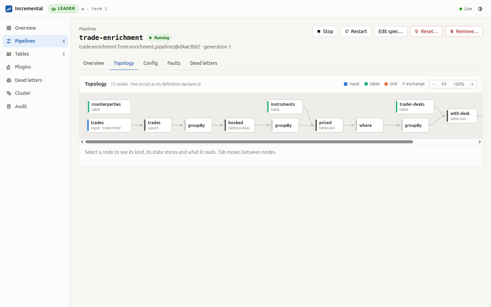
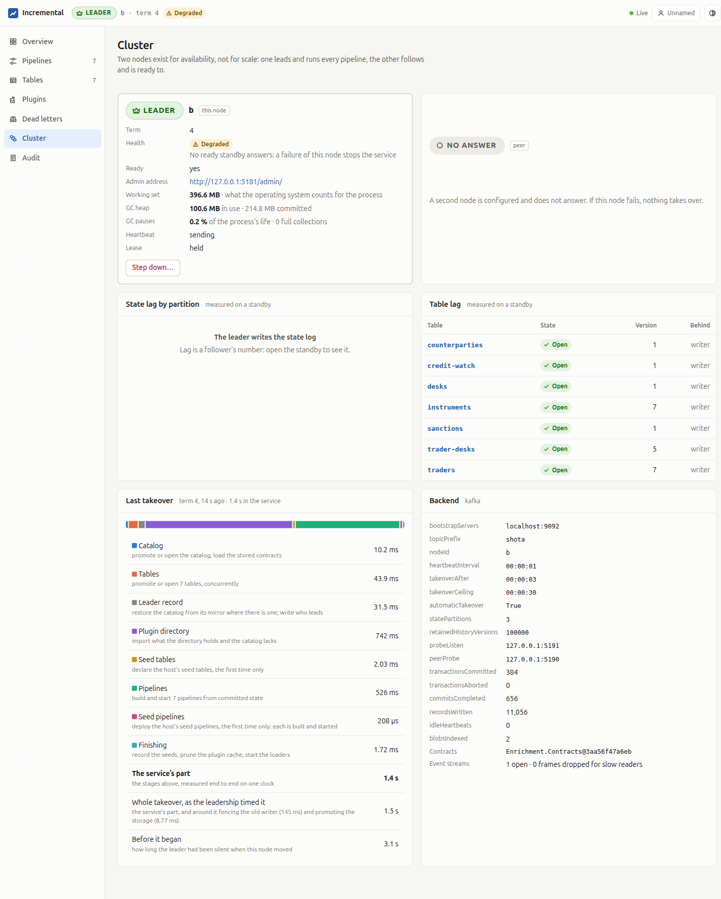

# The enrichment service: a guide

`Incremental.Service` runs many pipelines in one process — each a circuit, deployed and
replaced while the process runs — against reference tables they all share, and keeps a
second process ready to take over. `Incremental.Service.Admin` puts a JSON API and a web
UI over it. This guide goes from nothing to a running pipeline plugin, then through
running and operating the service. Everything it shows is in
[`examples/Incremental.EnrichmentService`](../examples/Incremental.EnrichmentService),
and every block of C# below is a region of that example's sources, quoted: a test
(`DocSnippetTests`) fails if the two drift apart, and CI builds the example.

For the core operators (`Join`, `Lookup`, windows, sinks) read [intro.md](intro.md). For
why the service is built the way it is, and what of the design is not built, read
[design/enrichment-service.md](design/enrichment-service.md) and its *As built*.

- [Concepts](#concepts)
- [Write your first pipeline plugin](#write-your-first-pipeline-plugin)
- [The host](#the-host)
- [Run the example](#run-the-example)
- [The admin UI](#the-admin-ui)
- [Operating it](#operating-it)
- [On Amazon MSK](#on-amazon-msk)
- [Limits, and what is out of scope](#limits-and-what-is-out-of-scope)

## Concepts

**Table.** Reference data held once per process and read by every pipeline: a
`SharedTable`, declared by name. A pipeline joins against it and stores none of it. A
table has one writer — a *loader* (a file, a Kafka topic, a Debezium change topic, or a
table source you write), or a pipeline (`ToTable`), in which case it is a *derived* table.

**Pipeline.** One circuit: inputs, operators, sinks. It is described by a *definition* —
a class with a `Build` method — and deployed by a *spec*, which is data: which definition,
its settings, and what each of the definition's named slots is bound to. One definition
can be deployed many times with different settings and bindings; each deployment has its
own state, keyed by its id.

**Plugin.** An assembly of definitions, loaded at runtime into its own
`AssemblyLoadContext`. Several versions of one plugin can be loaded side by side, and a
version unloads when no pipeline uses it. A **contract** is the other kind of assembly:
the row types and table definitions that the host and all plugins share. It is loaded
once and never unloaded, which is what lets two plugins join the same table.

**Catalog.** The durable record of what is deployed — tables, pipelines, plugin
versions, the audit log. It is itself a shared table on the backend's log. Every change
goes through it, and it is the only input to "what should exist": a node that starts on
storage holding a catalog rebuilds what the catalog names.

**Node roles.** Every node runs the same code and starts as a **standby**. One node
**leads**: it writes the catalog and the tables and runs every pipeline. A standby
follows the catalog, follows the tables, holds each pipeline's state as bytes, fetches
plugin files, and builds nothing until it takes over. Two nodes exist for availability,
not for scale. A node that loses leadership (**fenced** by a takeover, or **resigned** by
stepping down) never leads again in that process: it exits, and comes back as the standby.

**Backend.** Where the catalog, the table logs, the pipelines' state and leadership
live. In memory (one process, nothing kept, for tests and for trying things out) or Kafka.

## Write your first pipeline plugin

Three things: a contract assembly, a plugin assembly, and a spec.

### 1. The contract

Row types of shared tables, and the tables' definitions. The host compiles this assembly
in; plugins reference it.

<!-- snippet: examples/Incremental.EnrichmentService/Contracts/Contracts.cs#contract -->
```csharp
// A contract assembly: the row types of shared tables and the tables' definitions. It is
// loaded once per process and never unloaded, so every plugin version sees the same types.
[assembly: IncrementalContract]

namespace Enrichment.Contracts;

// Rows are immutable records: every pipeline in the process is handed the same objects.
public sealed record Instrument(int Id, string Symbol, string Isin, string AssetClass, decimal Multiplier);

public sealed record Counterparty(string Id, string Name, string Country, string Rating);

public sealed record Trader(int Id, string Name, int DeskId);

public sealed record Desk(int Id, string Name, string Region);

/// <summary>A derived row: a trader with their desk, written by the trader-desks pipeline.</summary>
public sealed record TraderDesk(int TraderId, string Trader, int DeskId, string Desk, string Region);

public sealed class InstrumentsTable : TableDefinition<int, Instrument>
{
    // An index is declared once, with its selector, and read as table.By(InstrumentsTable.ByIsin).
    public static readonly IndexDefinition<Instrument, string> ByIsin = new("isin", i => i.Isin);

    public override string Name => "instruments";
    public override int KeyOf(Instrument row) => row.Id;
    protected override void Configure(TableBuilder<int, Instrument> table) => table.Index(ByIsin);
}
```

A definition class is declared once and may be declared as a table under several names.
A static holder (`Reference.Instruments` in the example) saves writing `new
InstrumentsTable()` in every pipeline. Do not call it `Tables` if your namespaces start
with `Incremental.`: it collides with `Incremental.Tables`.

### 2. A definition

<!-- snippet: examples/Incremental.EnrichmentService/Pipelines/TradeEnrichment.cs#trade-enrichment -->
```csharp
/// <summary>
/// Trades enriched from three shared tables, each join of the kind its column needs: the
/// counterparty is looked up when the trade arrives and then left alone; the instrument
/// and the trader's desk are joined, so a change to either corrects every trade it touches.
/// </summary>
[Pipeline("trade-enrichment", Description = "Trades with counterparty (on arrival), instrument and desk (retroactive), filtered by notional.")]
public sealed class TradeEnrichment : IPipelineDefinition<TradeEnrichment.Settings>
{
    public sealed record Settings
    {
        [Range(0, 1e12), Description("Trades with a notional below this are dropped.")]
        public decimal MinNotional { get; init; }

        [StateNeutral, Description("A label for operators; it changes no stored row.")]
        public string? Label { get; init; }
    }

    public void Build(PipelineBuilder p, Settings s)
    {
        var counterparties = p.Table(Reference.Counterparties);
        var instruments = p.Table(Reference.Instruments);
        var traderDesks = p.Table(Reference.TraderDesks);

        var enriched = p.KeyedInput<long, Trade>("trades", t => t.Id)
            // Enrich on arrival: who the counterparty was when the trade was booked.
            .Lookup(counterparties, t => t.CounterpartyId,
                (t, c) => new Booked(t, c.Name, c.Rating),
                t => new Booked(t, "(unknown)", "NR")).Named("booked")
            // Retroactive: a corrected multiplier reprices every trade in the instrument.
            .GroupBy(b => b.Trade.InstrumentId)
            .Join(instruments, (_, b, i) => new Priced(b, i.Symbol, b.Trade.Quantity * b.Trade.Price * i.Multiplier)).Named("priced")
            .Where(x => x.Notional >= s.MinNotional)
            // Retroactive: a trader who moves desk takes their trades with them.
            .GroupBy(x => x.Booked.Trade.TraderId)
            .Join(traderDesks, (_, x, td) => Row(x, td)).Named("with-desk");

        p.UpsertSink("enriched", enriched, e => e.TradeId);
    }

    private static EnrichedTrade Row(Priced x, TraderDesk td) => new(
        x.Booked.Trade.Id, x.Symbol, x.Booked.Counterparty, x.Booked.Rating, td.Trader, td.Desk, td.Region, x.Notional
#if V2
        , x.Notional >= 1_000_000m ? "block" : "regular"     // version 2: one more computed column
#endif
        );
}

// Private to the plugin: every loaded version has its own types of these names. Booked and
// Priced are what the two joins store per trade, so their shape is part of the state.
public sealed record Booked(Trade Trade, string Counterparty, string Rating);

public sealed record Priced(Booked Booked, string Symbol, decimal Notional);

public sealed record EnrichedTrade(
    long TradeId, string Symbol, string Counterparty, string Rating, string Trader, string Desk, string Region, decimal Notional
#if V2
    , string Size
#endif
    );
```

What is going on:

- `p.KeyedInput`, `p.Input`, `p.UpsertSink` and `p.AppendSink` name **slots**. What a
  slot is connected to is the spec's business, not the definition's.
- `p.Table(definition)` gives the core's `TableRef`: `Join`, `LeftJoin`, `Lookup`,
  `LookupAppendOnly`, `Changes()`, `By(index)`. Everything between the slots is the core
  API; `p.Circuit` is the `CircuitBuilder` if you need it.
- **The join kind is chosen per join.** `Join` is retroactive: change the table row and
  every fact joined to it is corrected. `Lookup` enriches a record as it arrives and
  leaves it alone. In the definition above a renamed counterparty affects only trades
  booked afterwards, while a corrected multiplier reprices every trade in the instrument.
  Put the lookup *before* the retroactive joins if "as it arrived" is to mean the trade's
  arrival: a lookup downstream of a join looks again whenever the join re-emits.
- Settings are one type per definition, bound from the spec's `settings` with
  `System.Text.Json` (camelCase, unknown members refused, string enums) and then
  validated with DataAnnotations — before anything is deployed.
- The `#if V2` lines are how the example builds a second version of the same plugin
  from the same sources. Yours will be two commits.

Two more definitions, for the other shapes. An aggregate over event-time windows, on an
append input:

<!-- snippet: examples/Incremental.EnrichmentService/Pipelines/DeskExposure.cs#desk-exposure -->
```csharp
/// <summary>
/// Notional per desk in tumbling windows of execution time. Each execution is an event: it
/// takes the desk its trader sat on when it arrived (an append-only lookup keeps nothing),
/// and a window's state is dropped when the watermark passes its end.
/// Version 2 groups by region instead — a different key under the same store, so its
/// state is not version 1's and the replace has to reset.
/// </summary>
[Pipeline("desk-exposure", Description = "Notional per desk (v2: per region) in tumbling windows of execution time.")]
public sealed class DeskExposure : IPipelineDefinition<DeskExposure.Settings>
{
    public sealed record Settings
    {
        [Range(1, 86_400), Description("The window's length in seconds.")]
        public int WindowSeconds { get; init; } = 60;

        [Range(0, 3600), Description("How late, in seconds of event time, an execution may arrive and still count.")]
        public int LatenessSeconds { get; init; } = 5;
    }

    public void Build(PipelineBuilder p, Settings s)
    {
        var exposure = p.Input<Trade>("executions")
            .LookupAppendOnly(p.Table(Reference.TraderDesks), t => t.TraderId,
                (t, td) => new DeskExecution(Group(td), t.Quantity * t.Price, t.ExecutedAt))
            .WithEventTime(x => x.ExecutedAt, TimeSpan.FromSeconds(s.LatenessSeconds))
            .GroupBy(x => x.Group)
            .TumblingWindow(TimeSpan.FromSeconds(s.WindowSeconds))
            .Sum(x => x.Notional).Named("exposure")
            .Rows()
            .Select(w => new Exposure(w.Key, w.WindowStart, w.WindowEnd, w.Value));

        p.UpsertSink("exposure", exposure, e => $"{e.Group}@{e.WindowStart.UtcDateTime:yyyy-MM-ddTHH:mm:ss}Z");
    }

#if V2
    private static string Group(TraderDesk td) => td.Region;
#else
    private static string Group(TraderDesk td) => td.Desk;
#endif
}

public sealed record DeskExecution(string Group, decimal Notional, DateTimeOffset ExecutedAt);

public sealed record Exposure(string Group, DateTimeOffset WindowStart, DateTimeOffset WindowEnd, decimal Notional);
```

And a derived table, with no input and no sink:

<!-- snippet: examples/Incremental.EnrichmentService/Pipelines/TraderDesks.cs#trader-desks -->
```csharp
/// <summary>
/// A derived table: traders joined to desks once, for every pipeline that wants a trade's
/// desk. It has no input and no sink — it reads two tables as streams of their changes and
/// writes a third.
/// </summary>
[Pipeline("trader-desks", Description = "traders ⋈ desks, written to the shared table trader-desks.")]
public sealed class TraderDesks : IPipelineDefinition
{
    public void Build(PipelineBuilder p) =>
        p.ToTable(
            Reference.TraderDesks,
            p.Table(Reference.Traders).Changes()
                .GroupBy(t => t.DeskId)
                .Join(p.Table(Reference.Desks), (_, t, d) => new TraderDesk(t.Id, t.Name, d.Id, d.Name, d.Region)).Named("trader-desk"));
}
```

#### Rules for definitions

- A definition has a public parameterless constructor. `Build` runs many times — at
  import, at every dry run, for every generation — and must only describe the circuit: no
  I/O, no threads, no writes to statics.
- Delegates are deterministic. A record dropped or mapped one way when inserted must be
  dropped or mapped the same way when it is retracted.
- **A value captured by a delegate upstream of a stateful operator is part of the
  state.** `MinNotional` above sits before a join: change it and keep the state, and rows
  the new threshold would have dropped stay delivered. The service asks on every such
  change, and the honest answer is usually `reset`. Mark a settings property
  `[StateNeutral]` only if it changes no stored row.
- Name every stateful operator with `.Named()`. Unnamed state is positional: insert an
  operator above it and the state has no home.
- Hold nothing of the plugin's in a static — statics pin the load context, and the
  version can then never unload. A service the definition needs comes from `p.Services`.
- Row and key types of shared tables live in the contract. Everything else (`Booked`,
  `Priced`, `EnrichedTrade` above) is private to the plugin, and each loaded version has
  its own copy of those types.
- State is JSON. A property renamed between versions reads back as its default. Types
  that appear in a store's *key* — a grouping's records, a `Distinct`'s values — must
  keep their shape across a `keep`; nothing detects it if they do not.

### 3. The project

A plugin is a class library whose output directory holds the plugin's assembly, its
`.deps.json` and its private dependencies — and none of what the host provides. That
directory, or a zip of it, is the package.

```xml
<Project Sdk="Microsoft.NET.Sdk">
  <PropertyGroup>
    <TargetFramework>net10.0</TargetFramework>
    <!-- Copies the assemblies of the NuGet packages the plugin references: its private dependencies. -->
    <CopyLocalLockFileAssemblies>true</CopyLocalLockFileAssemblies>
  </PropertyGroup>
  <ItemGroup>
    <!-- Provided by the host: compile against them, copy nothing of them. "native" matters:
         without it the Kafka client's native libraries (about 100 MB) land in runtimes/. -->
    <ProjectReference Include="…/src/Incremental.Service/Incremental.Service.csproj" Private="false" ExcludeAssets="runtime;native" />
    <ProjectReference Include="…/src/Incremental/Incremental.csproj" Private="false" ExcludeAssets="runtime;native" />
    <ProjectReference Include="../Contracts/Enrichment.Contracts.csproj" Private="false" />
    <!-- A private dependency: copied beside the plugin and loaded from there. -->
    <PackageReference Include="Some.Library" Version="1.2.3" />
  </ItemGroup>
</Project>
```

The example's [`Plugin.props`](../examples/Incremental.EnrichmentService/Plugin.props)
is this, shared by its three plugin projects (which reference no package of their own).
Look at the output directory before you ship it: it should hold your assembly, your
dependencies and nothing named `Incremental*`, `Confluent*` or `runtimes/`.

The plugin's name is its assembly's name in lower case (`enrichment.pipelines`); its
version is a hash of its files, so the same build imported twice is one version. The
main assembly is the one with a `.deps.json` beside it, or the only `.dll`, or the file
a `plugin.json` names (`{ "assembly": "lib/My.Plugin.dll" }`).

Where a plugin's references are loaded from:

1. A **contract assembly** the process has loaded — always that one, even if the plugin
   ships its own copy.
2. The **host**, for the assemblies whose types cross between host and plugin —
   `Incremental*`, `Microsoft.Extensions.*`, `Confluent.Kafka` and the framework —
   whatever the plugin ships.
3. The **host**, for any other assembly it happens to carry, if the host's version is at
   least the one the plugin was built against. If the plugin was built against a newer
   one and ships it, the plugin gets its own copy.
4. The **plugin's own files**, for everything else.

### 4. A spec

<!-- snippet: examples/Incremental.EnrichmentService/Host/World.cs#specs -->
```csharp
public PipelineSpec TraderDesks(string version = "") => new()
{
    Id = "trader-desks",
    Plugin = Plugin,
    Version = version,                  // may be empty while the plugin has one stored version
    Definition = "trader-desks",
};

public PipelineSpec TradeEnrichment(string id, decimal minNotional, string version = "") => new()
{
    Id = id,
    Plugin = Plugin,
    Version = version,
    Definition = "trade-enrichment",
    Settings = Json($$"""{ "minNotional": {{minNotional.ToString(System.Globalization.CultureInfo.InvariantCulture)}}, "label": "{{id}}" }"""),
    Inputs = new Dictionary<string, JsonElement> { ["trades"] = Trades },
    Sinks = new Dictionary<string, JsonElement> { ["enriched"] = Sink(id) },
};

public PipelineSpec DeskExposure(string version = "") => new()
{
    Id = "desk-exposure",
    Plugin = Plugin,
    Version = version,
    Definition = "desk-exposure",
    Settings = Json("""{ "windowSeconds": 60, "latenessSeconds": 5 }"""),
    Inputs = new Dictionary<string, JsonElement> { ["executions"] = Trades },
    Sinks = new Dictionary<string, JsonElement> { ["exposure"] = Sink("desk-exposure") },
};
```

`Trades` and `Sink(name)` in that code are slot bindings — JSON that names a connector
and gives it its config:

```json
{ "connector": "trade-feed" }
{ "connector": "view", "name": "trade-enrichment" }
{ "connector": "kafka", "connection": "log", "topic": "enrich.trades" }
```

The first two are connectors the example's host registers; the third is built in. A spec
may also carry `tables` (table slot → declared table, so one definition can read
`instruments-eu` here and `instruments-us` there), `circuit` (workers, checkpoint
interval, `errorPolicy`) and `restart` (how many faults in how long before the pipeline
is `Failed`).

Deploy it from the host (`node.Pipelines.DeployAsync(spec, new DeployOptions(), ct)`),
as a seed (`AddPipeline(spec)`, applied once per deployment: the catalog records which
seeds have been applied, so a seeded pipeline that is removed stays removed, and a seed
added to the host later is applied by the next leader), or over the admin API:

```bash
curl -X PUT http://127.0.0.1:5180/admin/api/pipelines/big-trades \
  -H 'X-Incremental-Admin: 1' -H 'Content-Type: application/json' -d '{
    "plugin": "enrichment.pipelines", "definition": "trade-enrichment",
    "settings": { "minNotional": 30000000 },
    "inputs": { "trades":   { "connector": "trade-feed" } },
    "sinks":  { "enriched": { "connector": "view", "name": "big-trades" } } }'
```

A deploy is checked before anything is touched: the settings bind and validate, the
definition is run against a builder that is never built, every slot is bound to a
connector that supports its kind, every table is declared with the definition's types.
Add `?dryRun=true` and that check is all that happens.

## The host

The host is an ordinary generic-host application. It registers the service, the
contract, and whatever is specific to its surroundings:

<!-- snippet: examples/Incremental.EnrichmentService/Host/Node.cs#host -->
```csharp
var service = builder.Services.AddIncrementalService(o =>
    {
        o.PluginDirectory = Path.Combine(AppContext.BaseDirectory, "plugins");     // imported at first lead
        o.CacheDirectory = Path.Combine(world.DataDirectory, "cache-" + nodeId);    // one per node
        o.AdvertisedAdminUrl = $"http://127.0.0.1:{port}/admin/";                   // where a standby's UI sends you
        o.ExitOnLeadershipLoss = exitOnLeadershipLoss;
    })
    .AddContracts(typeof(Instrument).Assembly)                                      // row types and table definitions
    .AddObjectStore("refdata", _ => new LocalObjectStore(Path.Combine(world.DataDirectory, "refdata")))
    .AddTableSource("instrument-feed", _ => new InstrumentFeedSourceFactory(world.Instruments))
    .AddTableSource("directory", _ => new DirectorySourceFactory(world.Traders, world.Desks))
    .AddSourceConnector("trade-feed", _ => new TradeFeedConnector(world.Trades))
    .AddSinkConnector("view", _ => new ViewConnector(world.Views));
```

Tables are seeded the same way pipelines are — written to the catalog once, by the
first leader that finds the seed not yet applied, and after that the catalog is the
record (a seeded table that is removed is not declared again):

<!-- snippet: examples/Incremental.EnrichmentService/Host/World.cs#tables -->
```csharp
service
    .AddTable(Reference.Instruments, new TableLoaderSpec("instrument-feed"))        // a custom source, with positions
    .AddTable(Reference.Traders, new TableLoaderSpec("directory"))                  // a custom source, snapshot + changes
    .AddTable(Reference.Desks, new TableLoaderSpec("directory"))
    .AddTable(Reference.Counterparties, counterparties)                             // the built-in file loader
    .AddTable(Reference.TraderDesks);                                               // no loader: a pipeline writes it
```

And the admin surface:

<!-- snippet: examples/Incremental.EnrichmentService/Host/Node.cs#admin -->
```csharp
builder.Services.AddIncrementalAdmin(o =>
{
    // With no authorization policy the admin API answers loopback requests only.
    o.ExposeRowData = true;             // off by default: rows and exception messages are tenant data
    o.AllowPluginUpload = true;         // off by default: an upload is code that will run in this process
    o.AllowPluginRescan = true;
});

var app = builder.Build();
app.MapIncrementalAdmin("/admin");      // the UI at /admin/, the API at /admin/api
app.MapIncrementalHealth("/health");    // /health/live, /health/ready, /health/status — outside the loopback rule
```

### Adapters

Sources and sinks the service does not ship are yours to write, in the host, against
four small interfaces. The example has one of each kind.

**A table source with positions** stamps each change with where it came from and resumes
from the positions the table's last committed version carries. After a restart or a
takeover it continues; it never reloads.

<!-- snippet: examples/Incremental.EnrichmentService/Host/Adapters.cs#table-source-positions -->
```csharp
/// <summary>
/// A table source for a feed with positions. It stamps every change with the feed's
/// position, and resumes from the positions the table's last committed version carries —
/// so a restart, or a takeover by another node, continues exactly where the table stands.
/// Registered as the loader kind <c>instrument-feed</c>.
/// </summary>
public sealed class InstrumentFeedSource(PositionedFeed<Instrument> feed) : ITableSource<int, Instrument>
{
    public async Task RunAsync(TableSourceContext<int, Instrument> context, CancellationToken cancellationToken)
    {
        // Partition 0, offset of the last change in the table; -1 when the table is new.
        var next = context.Table.CommittedOffsets.GetValueOrDefault(0, -1) + 1;
        while (true)
        {
            var published = feed.Published;
            while (next < published)
            {
                context.Report(TableSourceState.Streaming, $"feed@{next}", published - next);
                // One version per chunk: readers never see half of it.
                var end = Math.Min(published, next + 4096);
                for (; next < end; next++)
                    await context.Writer.UpsertAsync(feed.At(next), partition: 0, offset: next);
                await context.Writer.CommitAsync(cancellationToken);
            }
            context.Report(TableSourceState.Idle, $"feed@{next}", lag: 0);
            await feed.WaitForAsync(next, cancellationToken);
        }
    }
}
```

**A table source without positions** makes the table equal to the system's current rows
on every start, then applies changes as it hears of them.

<!-- snippet: examples/Incremental.EnrichmentService/Host/Adapters.cs#table-source-snapshot -->
```csharp
/// <summary>
/// A table source for a system with no positions. Every start makes the table equal to
/// the system's current rows (<c>ReplaceAllAsync</c> upserts them and deletes what they do
/// not mention), then applies changes as they are heard. Registered as the loader kind
/// <c>directory</c>.
/// </summary>
public sealed class DirectorySource<TKey, TRow>(LiveDirectory<TKey, TRow> directory) : ITableSource<TKey, TRow>
    where TKey : notnull
    where TRow : class
{
    public async Task RunAsync(TableSourceContext<TKey, TRow> context, CancellationToken cancellationToken)
    {
        context.Report(TableSourceState.Snapshotting);
        var (rows, change) = directory.Snapshot();
        await context.Writer.ReplaceAllAsync(rows, cancellationToken: cancellationToken);
        while (true)
        {
            var (changed, upTo, next) = directory.Since(change);
            if (changed.Count > 0)
            {
                foreach (var row in changed)
                    await context.Writer.UpsertAsync(row);
                await context.Writer.CommitAsync(cancellationToken);
            }
            change = upTo;
            context.Report(TableSourceState.Idle, $"change {change}");
            await next.WaitAsync(cancellationToken);
        }
    }
}
```

Throwing from `RunAsync` is a loader fault: the loader is restarted under the restart
policy while readers keep the table's last version. A record the source cannot read goes
to `context.Unreadable(position, error, bytes)`, which counts and skips it or faults at
it, as the table's `onUnreadable` says.

**A source connector** feeds an input slot. It is started after the circuit, so the
committed offsets it is handed are where to resume; it stamps a partition and an offset
on every record so that the next checkpoint carries them.

<!-- snippet: examples/Incremental.EnrichmentService/Host/Adapters.cs#source-connector -->
```csharp
/// <summary>
/// A source connector for the trade feed, as an append input (every record an execution)
/// and as a keyed input (a later record for an id amends the trade). It resumes from the
/// circuit's committed offsets, which the service hands it after the circuit has started.
/// Registered as the connector <c>trade-feed</c>; a spec binds a slot to it with
/// <c>{ "connector": "trade-feed" }</c>.
/// </summary>
public sealed class TradeFeedConnector(PositionedFeed<Trade> feed) : IAppendSourceConnector, IKeyedSourceConnector
{
    // Called at the dry run: check the slot's config here, and name any secret properties.
    public ConnectorDescription Describe(JsonElement config) => new("the example's generated trade feed");

    public Task<IRunningSource> StartAsync<T>(SourceContext<T> context, CancellationToken cancellationToken) where T : notnull
    {
        var from = context.CommittedOffsets.GetValueOrDefault(0, -1) + 1;
        return Task.FromResult<IRunningSource>(new Reader(feed, from,
            (trade, offset, ct) => context.Input.InsertAsync(Typed<T>(trade), 0, offset, ct)));
    }

    public Task<IRunningSource> StartAsync<TKey, TValue>(KeyedSourceContext<TKey, TValue> context, CancellationToken cancellationToken)
        where TKey : notnull
        where TValue : notnull
    {
        var from = context.CommittedOffsets.GetValueOrDefault(0, -1) + 1;
        return Task.FromResult<IRunningSource>(new Reader(feed, from,
            (trade, offset, ct) => context.Input.UpsertAsync(Typed<TValue>(trade), 0, offset, ct)));
    }

    // The slot's type is the definition's; this feed carries one type.
    private static T Typed<T>(Trade trade) =>
        trade is T typed ? typed : throw new InvalidOperationException($"The trade feed carries {nameof(Trade)}, and the slot wants {typeof(T).Name}.");

    private sealed class Reader : IRunningSource
    {
        private readonly PositionedFeed<Trade> _feed;
        private readonly CancellationTokenSource _stop = new();
        private readonly Task _run;
        private readonly long _from;
        private long _next;

        public Reader(PositionedFeed<Trade> feed, long from, Func<Trade, long, CancellationToken, ValueTask> send)
        {
            _feed = feed;
            _from = from;
            _next = from;
            _run = Task.Run(async () =>
            {
                while (true)
                {
                    await feed.WaitForAsync(_next, _stop.Token);
                    // The input is a bounded channel: a slow circuit makes this wait.
                    await send(feed.At(_next), _next, _stop.Token);
                    Interlocked.Increment(ref _next);
                }
            });
            // A fault here faults the pipeline, which restarts it under its restart policy.
            Completion = _run.ContinueWith(
                t => t.IsFaulted && !_stop.IsCancellationRequested ? Task.FromException(t.Exception!.GetBaseException()) : Task.CompletedTask,
                TaskScheduler.Default).Unwrap();
        }

        public Task Completion { get; }

        public SourceStats Stats
        {
            get
            {
                var next = Interlocked.Read(ref _next);
                return new SourceStats(next - _from, 0, new Dictionary<int, long> { [0] = next - 1 }, Math.Max(0, _feed.Published - next));
            }
        }

        public async ValueTask DisposeAsync()
        {
            _stop.Cancel();
            try
            {
                await _run;
            }
            catch
            {
                // Cancellation, or the fault Completion already carries.
            }
        }
    }
}
```

**A sink connector** makes an `IUpsertSink` or `IAppendSink` for a sink slot. The
service wraps it in the delivery loop: one batch at a time, retried with backoff, the
checkpoint committed only after the write returns.

<!-- snippet: examples/Incremental.EnrichmentService/Host/Adapters.cs#sink-connector -->
```csharp
/// <summary>
/// A sink connector: an upsert sink that keeps each key's latest row as JSON, to be read
/// at <c>/views/{name}</c>. It stands in for a database table or a cache. Rows are
/// serialized with the pipeline's own options (<c>context.Json</c>), never a process-wide
/// instance, so a plugin version's types can be unloaded with it. Registered as the
/// connector <c>view</c>: <c>{ "connector": "view", "name": "enriched" }</c>.
/// </summary>
public sealed class ViewConnector(Views views) : IUpsertSinkConnector, IResettableSinkConnector
{
    public ConnectorDescription Describe(JsonElement config) => new($"the in-process view '{NameOf(config, "…")}'");

    public IUpsertSink<TKey, TRow> Create<TKey, TRow>(SinkContext context) where TKey : notnull =>
        new Sink<TKey, TRow>(views.Open(NameOf(context.Config, $"{context.PipelineId}/{context.Slot}")), context.Json);

    // A reset pipeline computes its results again from nothing; what the old run wrote goes.
    public Task ResetAsync(SinkContext context, CancellationToken cancellationToken)
    {
        views.Open(NameOf(context.Config, $"{context.PipelineId}/{context.Slot}")).Clear();
        return Task.CompletedTask;
    }

    private static string NameOf(JsonElement config, string fallback) =>
        config.ValueKind == JsonValueKind.Object && config.TryGetProperty("name", out var name) && name.GetString() is { Length: > 0 } given ? given : fallback;

    private sealed class Sink<TKey, TRow>(View view, JsonSerializerOptions json) : IUpsertSink<TKey, TRow> where TKey : notnull
    {
        // One batch per step, at most one upsert or delete per key. Returning is the
        // acknowledgement: the step's checkpoint is committed only after this returns.
        public ValueTask WriteAsync(UpsertBatch<TKey, TRow> batch, CancellationToken cancellationToken)
        {
            foreach (var key in batch.Deletes)
                view.Delete(JsonSerializer.Serialize(key, json));
            foreach (var (key, row) in batch.Upserts)
                view.Upsert(JsonSerializer.Serialize(key, json), JsonSerializer.Serialize(row, json));
            return ValueTask.CompletedTask;
        }
    }
}
```

A connector implements the kinds it supports and no others; a slot bound to a connector
that does not implement the slot's kind is refused at the dry run. Built in are `memory`
(tests), `kafka` (append and keyed sources, JSON or Debezium; upsert and append sinks),
and the table loaders `file`, `kafka` and `debezium`.

## Run the example

```bash
dotnet run --project examples/Incremental.EnrichmentService
```

One node on the in-memory backend, no docker. Open <http://127.0.0.1:5180/admin/>. Five
tables are loaded — instruments by the positions source, traders and desks by the
snapshot source, counterparties from a file, `trader-desks` by a pipeline — four
pipelines run, and a generator publishes 50 trades a second and changes one reference
row every five seconds. The sinks are at <http://127.0.0.1:5180/views>.

| | |
|---|---|
| `-- --nodes 2` | leader and standby in one process, on ports 5180 and 5181, still in memory |
| `-- --kafka --node a` / `--node b` | one process per node on the local connector stack (below) |
| `-- --headless` | the smoke test, in memory; add `--nodes 2` for a takeover, `--kafka` for two processes and a kill |
| `-- --kafka --clean` | removes what the Kafka mode made under its prefix |
| `--port N`, `--rate N`, `--prefix name`, `--no-generate`, `--no-pipelines`, `--verbose` | |

Things to try in the UI, in the default mode:

1. **Pipelines → trade-enrichment → Topology.** The circuit as the definition declared
   it: the three tables, the lookup, the two joins, the filter, the sink.
2. **Tables → trader-desks.** Written by a pipeline; read by three. *Rows* reads from
   this node's copy at one version; *Look up* reads by an index.
3. **Plugins → upload** `bin/Debug/net10.0/plugin-packages/enrichment.pipelines-v2.zip`
   from the example's output directory. It is stored as a second version.
4. **Pipelines → trade-enrichment → Edit spec…**, set `"version"` to the new version.
   The dry run says a state choice is required; choose *keep*. The pipeline restarts on
   version 2 with its state: `http://127.0.0.1:5180/views/trade-enrichment` now shows a
   `size` on every row emitted since, and not on the rest.
5. The same for **desk-exposure**, choosing *reset*: version 2 groups by region, so it
   reads its input again from the start.
6. **Pipelines → large-trades → Remove…** The dialog wants the id typed.

### On Kafka, with a standby

```bash
docker compose --profile connectors up -d      # Kafka, Postgres, Debezium's Kafka Connect

# terminal 1 — it prepares the stack, waits 3 s for a leader to speak, then leads
dotnet run --project examples/Incremental.EnrichmentService -- --kafka --node a
# terminal 2 — once a is up
dotnet run --project examples/Incremental.EnrichmentService --no-build -- --kafka --node b
```

Node `a` is at <http://127.0.0.1:5180/admin/>, node `b` at <http://127.0.0.1:5181/admin/>.
Here instruments, traders and desks are rows in Postgres; a Debezium connector turns
their changes into topics; the tables are declared with the `debezium` loader. Trades
come from the topic `enrich.trades`, and the sinks are the compacted topics
`enrich.out.*`. The leader's process also generates: it produces trades and updates a
row in Postgres every five seconds.

Then:

1. Open both UIs. `b` shows **Standby** and a banner pointing at the leader; its
   *Cluster* page shows the catalog, state and table lag, and "a takeover now would be warm".
2. Kill `a` hard: `kill -9` its process (Ctrl+C is a graceful step-down, which is step 4).
3. Watch `b`: about three seconds of silence, then **Leader**, term 2, pipelines Running.
   *Cluster → Last takeover* shows where the time went. `b` is `Degraded` with the reason
   `no-ready-standby` until a standby answers.
4. Start `a` again. It comes back as the standby. Now press Ctrl+C in `b`'s terminal: it
   steps down because a ready standby answers, and `a` leads within a second.

State persists under the prefix (`enrich` unless `--prefix` says otherwise) in Kafka and
Postgres; `-- --kafka --clean` removes it.

Across machines this needs two things the example does not do: an authorization policy
(the admin API is loopback-only without one — see *Operating it*), and probe endpoints
on addresses the other node can reach.

The backend is configured in one place:

<!-- snippet: examples/Incremental.EnrichmentService/Host/Node.cs#kafka-backend -->
```csharp
// Two processes are configured alike except for the node id and the probe ports.
// The log's cluster is also the Kafka connection "log", which specs may name.
service.UseKafkaBackend(new KafkaServiceBackendOptions
{
    Log = new KafkaLogOptions
    {
        BootstrapServers = kafka.Bootstrap,
        TopicPrefix = kafka.Prefix,
        NodeId = nodeId,
        ReplicationFactor = 1,              // the local stack has one broker; 3 in production
        StatePartitions = 3,
    },
    TakeoverAfter = TimeSpan.FromSeconds(3),                                    // silence before a standby takes over
    ProbeListen = new IPEndPoint(IPAddress.Loopback, probePort),
    PeerProbe = ("127.0.0.1", peerProbePort),
});
```

### The smoke test

`-- --headless` drives the service through its admin API and checks every sink against a
model computed without the pipelines
([`Host/Model.cs`](../examples/Incremental.EnrichmentService/Host/Model.cs)): deploy,
2,000 trades, a desk move, a multiplier correction, a counterparty rename, an upload of
version 2, a replace keeping state, a replace resetting it, a removal, and — with two
nodes — a takeover. A claim that does not hold exits 1. CI does not run it (it runs no
example); run it after changing the service.

## The admin UI

Mounted at `/admin/`; the API is under `/admin/api` and is the same thing a script would
use ([intro.md](intro.md#looking-at-it-the-admin-api-and-ui) has the endpoint table).
The screenshots are of the example.

**Overview.** The node's role and health, rates across all pipelines, what needs
attention, tables, and the node's recent events.


**A pipeline.** Rates, step latency, how long commits wait for sinks, checkpoint age and
input lag; per source the position read and the position committed; per sink what was
delivered; per table the version the pipeline's checkpoint has committed beside the
table's current one. The buttons are the actions: each shows its plan first, and reset
and remove want the id typed.


**Topology.** The circuit, node by node, with the names of its state stores. On a
standby, which runs no plugin code, it is the declared edges only.



**A table.** Rows, version, who writes it, its loader's state and position, its indexes,
and its readers — the pipeline furthest behind holds the retention floor, and "until cut
loose" says how much history is left before a stopped reader would need a reset.


**Plugins.** Stored versions, what each defines with its settings, which pipelines use
which, and the upload.


**Cluster, on a standby.** How ready it is to lead, and why not if it is not.


**Cluster, after a takeover** (Kafka backend). The peer does not answer, so the node is
Degraded; the bar is the last takeover's time by stage.



*Dead letters* and *Audit* are the other two pages: records a pipeline under
`errorPolicy: DeadLetter` dropped, with the operator that dropped them; and every change
to the catalog with who made it.

## Operating it

**Failover.** The standby takes over after `TakeoverAfter` (3 s) without a heartbeat. It
fences the old leader at the broker, promotes the catalog and the tables, builds each
pipeline's circuit from its committed state, and starts the sources at their committed
offsets. Locally, with five tables and four pipelines, the takeover itself is about half
a second after the three seconds of silence. Delivery is at least once: whatever the old
leader had delivered but not committed is delivered again. An upsert sink converges; an
append sink sees duplicates.

**A node that stops leading exits.** Exit code 3: fenced by a takeover. 4: resigned
(stepped down). 5: its catalog writer faulted and no ready standby answered. Run nodes
under a supervisor that restarts them; a restarted node is the standby. Start the first
node of a new deployment before the second: two nodes that start together on an empty
log both take over, and one is fenced at once.

**Takeover and step-down by hand.** `POST node/takeover` on the standby is refused
unless it is warm; `POST node/stepdown` on the leader is refused unless the peer answers
as a ready standby. Both take `dryRun=true` (the answer is the plan) and `force=true`,
and the real action needs `confirm=<node id>` — the id of the node the request is sent
to, as for reset and remove:

```bash
curl -X POST 'http://127.0.0.1:5181/admin/api/node/takeover?confirm=b' -H 'X-Incremental-Admin: 1'
```

A node shutting down steps down by itself if a ready standby answers. A standby counts
as behind on state (`state-behind`, not ready) only when it was behind at each of its
last three one-second samples: a follower of a leader that commits all the time is a
few records behind at most instants and caught up between them.

A step-down whose resignation cannot be committed does not leave a leader that leads
nothing: the node closes its writer and ends as fenced (exit code 3), and the standby
takes over on the silence instead.

**What a replaced node logs.** One warning: `Service node a is Fenced; it will not lead
again in this process`. It abandons its circuits without draining them, since nothing of
theirs can be committed any more. A circuit caught in the middle of a step reports that
as a fault of its own; from the moment the node knows it no longer leads, those reports
are written at Debug. A circuit can find out before its node does — its commit is
refused by the fencing — and then `Circuit … faulted on step N` is logged at Error with
a stack, followed by `Pipeline … ended because this node no longer leads`. Neither
means the takeover failed: that is judged on the new leader, where every pipeline should
be `Running`.

**Failing pipelines never move leadership.** A pipeline that faults is torn down and
restarted on its committed state with a doubling backoff; more than `maxRestarts`
faults in the window and it is `Failed` until someone restarts it. `Failed` is not
recorded in the catalog: a new leader tries again. A table whose loader faults keeps its
last version for its readers while the loader is retried.

**A connector that does not answer** is given `ConnectorTimeout` (30 s) — for a source's
`StartAsync` and for a sink connector's `ResetAsync`. Past it the pipeline is treated as
faulted and tried again like any other fault. A takeover waits for every pipeline's
start, so this is also the longest one pipeline's connector can hold a takeover up.

**Replace: keep or reset.** A replace that changes the plugin version, the definition,
a setting not marked `[StateNeutral]`, an input or table binding, or the worker count is
refused with `state-choice-required` until the request says `state=keep` or
`state=reset`. `keep` restarts the new generation on the old one's state and offsets,
and recomputes nothing: rows delivered before stay as they were until something changes
them. It is only as safe as the two versions' state is compatible, and it is not checked
before the pipeline stops — an incompatible `keep` (a different worker count is one)
leaves the pipeline in backoff with its committed state untouched, and the way out is
the old spec or a reset.

**Reset.** State and input offsets are deleted and the pipeline starts again from its
inputs' beginning, against the tables as they are now — so a `Lookup`'s "as it arrived"
becomes "as of the replay". What the old run wrote to a sink is removed only if the
sink's connector can do that (`IResettableSinkConnector`; the `kafka` connector cannot):
after a reset that changes the keys a pipeline produces, a Kafka sink still holds the old
keys. The smoke test's Kafka mode shows exactly this. Reset and remove need
`confirm=<id>`.

**A reset or a removal is recorded before it is carried out**, and from then on it is
finished whatever becomes of the request: a caller that disconnects cancels nothing. If
it cannot be finished — the state log or a resettable sink's store is unreachable — the
pipeline stays down in `Backoff` with the reason (`reset not finished: …`), shows
`unfinished reset`, and the act is tried again with the usual backoff; a new leader
does the same. It is never started around a pending reset, and a pipeline pending
removal is never started. `restart` retries the pending act at once; sending the reset
or the removal again does too. A deploy is refused until it is finished.

**Secrets in a spec.** A connector names the properties of its config that are secret,
and the API returns those as `"***"`. A spec sent back with `"***"` in such a property
keeps the stored value for that slot and connector, so a spec read from the API can be
edited and deployed again; where nothing is stored to keep, `"***"` is refused.

**Retention.** A table keeps the history its readers may still need: back to the oldest
version any pipeline in the catalog has committed — a stopped pipeline counts — and, for
the standby's sake, everything newer than `FollowerRetention` (10 min). The backend caps
it (`RetainedHistoryVersions`: 100,000 on Kafka, 1,024 in memory). A stopped pipeline
that the cap passes cannot resume and needs a reset; the table page shows each reader's
distance from that, and the plan a `stop` returns states it.

**Dead letters.** Under `"circuit": { "errorPolicy": "DeadLetter" }` a record an
operator throws on is dropped — its retraction too — and kept in a ring of the newest
256 per pipeline, on the node that ran it. The ring is not durable and does not survive
a failover; a durable dead-letter sink is not built. Under the default policy, `Fault`,
the same record faults the pipeline, and since it is read again after the restart, the
pipeline ends in `Failed`.

**Security.** With no `AuthorizationPolicy` the admin API answers only loopback
requests that name a loopback host, carry no forwarding header (`Forwarded`,
`X-Forwarded-*`, `X-Real-IP`, `Via`) and are not HTTP/1.0. That is a default for a
developer's machine, not authentication. A reverse proxy on the same machine makes every
caller a loopback caller; the checks catch the proxies that give themselves away — nginx
by default speaks HTTP/1.0 to its upstream — and cannot catch one that rewrites the
host, adds no header and speaks HTTP/1.1. **Behind any proxy, set a policy**;
`PipelinePolicy`, `TablePolicy`, `NodePolicy` and `PluginPolicy` then say who may change
what. Row data and exception messages are off
unless `ExposeRowData` is set, and uploading code is off unless `AllowPluginUpload` is.
Health (`/health/live`, `/ready`, `/status`) is outside all of this, for load balancers.
A plugin is trusted code: it runs in the service's process with the service's rights.

**Each node needs** its own `CacheDirectory`; the plugin directory, if it has one, on
whichever node may lead first (the other gets plugin files from the backend); and the
host's `ShutdownTimeout` above `StopTimeout` + `AbandonTimeout` (25 s by default) if
sinks are slow. A configured cache directory is kept between runs (a restart loads
plugins from disk) and pruned of versions the catalog no longer holds. Left unset, the
cache is a directory under the system's temporary path that belongs to the process: it
is deleted when the node is disposed, and a starting node deletes those of processes
that no longer run.

**Plugins and contracts.** Deleting a plugin version is refused while a pipeline names
it, and deleting a contract is refused while a declared table's definition comes from it
and from no other stored version — a node that started without it could not create the
table. One version of a contract is loaded per process. Of the stored versions a
starting process loads the one imported last; one imported while an older is loaded
shows as `pending` and takes effect at the restart, and the older one then shows as
`superseded`. To go back, delete the newer version and restart. Importing a version
that is already stored changes nothing, except that any file the blob store has lost is
put back — which is the repair if a version cannot be fetched.

**Browsing rows.** A page of a table's rows carries `next`: pass it back as `from` for
the page after it. Rows that are passed over are not looked at, so any row of a table of
any size can be reached. A search (`contains=`) looks at no more than `MaxScannedRows`
rows per request and then stops with `truncated` and a `next` to carry on from. The rows
under an index key are paged with `skip`.

## On Amazon MSK

Nothing in a spec names a cluster. Bootstrap servers, client settings and callbacks are
the host's, given once for the backend's log and once per extra connection; a spec says
`"connection": "market-data"` and a topic. The settings are passed through to librdkafka
unchanged, and the builder callbacks are where an IAM token refresh goes:

<!-- snippet: examples/Incremental.EnrichmentService/Host/Node.cs#msk -->
```csharp
/// <param name="token">Returns a signed IAM token and its expiry — from the
/// AWS.MSK.Auth package's <c>AWSMSKAuthTokenGenerator</c>, which this repository does not reference.</param>
public static void UseMsk(
    IncrementalServiceBuilder service, string bootstrapServers, string nodeId, Func<(string Token, long ExpiryMs)> token)
{
    void Refresh(IClient client, string _)
    {
        try
        {
            var (value, expiryMs) = token();
            client.OAuthBearerSetToken(value, expiryMs, "incremental-service");
        }
        catch (Exception ex)
        {
            client.OAuthBearerSetTokenFailure(ex.Message);
        }
    }

    var log = new KafkaLogOptions
    {
        BootstrapServers = bootstrapServers,        // the cluster's IAM bootstrap string (port 9098)
        TopicPrefix = "enrichment",
        NodeId = nodeId,
        ReplicationFactor = 3,
        // librdkafka settings, applied to every client the log makes.
        ClientConfig = new Dictionary<string, string>
        {
            ["security.protocol"] = "SASL_SSL",
            ["sasl.mechanism"] = "OAUTHBEARER",
        },
        // What a dictionary cannot carry: the token refresh, on every client. The admin
        // client is one of its own (it creates and describes the topics) and needs it too.
        ConfigureProducer = producer => producer.SetOAuthBearerTokenRefreshHandler(Refresh),
        ConfigureConsumer = consumer => consumer.SetOAuthBearerTokenRefreshHandler(Refresh),
        ConfigureAdmin = admin => admin.SetOAuthBearerTokenRefreshHandler(Refresh),
    };
    service.UseKafkaBackend(new KafkaServiceBackendOptions { Log = log });      // also the connection "log"

    // A second cluster that pipelines may read and write, restricted to its own topics.
    service.AddKafkaConnection("market-data", _ =>
    {
        var connection = new KafkaConnection
        {
            BootstrapServers = "b-1.marketdata.example:9098",
            ConfigureProducer = producer => producer.SetOAuthBearerTokenRefreshHandler(Refresh),
            ConfigureConsumer = consumer => consumer.SetOAuthBearerTokenRefreshHandler(Refresh),
        };
        connection.ClientConfig["security.protocol"] = "SASL_SSL";
        connection.ClientConfig["sasl.mechanism"] = "OAUTHBEARER";
        connection.AllowedTopicPrefixes.Add("md.");
        return connection;
    });
}
```

That method is compiled with the example and never called.

**None of this has been run against MSK.** What is verified is a single local broker
with no authentication. Specifically not verified:

- IAM (OAUTHBEARER) authentication and token refresh on the log's transactional
  producer, its consumers and the admin client, over hours.
- The permissions the service needs. It creates its own topics — `{prefix}.state`,
  `{prefix}.leader`, two per table, `{prefix}.svc.blobs` — with compaction and its own
  partition counts, and uses a transactional id. Under IAM the node's role therefore
  needs to create, describe, read and write topics under the prefix and to use that
  transactional id; the exact set of actions has not been worked out against a real
  cluster. Topics for sources and sinks are yours to create.
- Replication factor 3 and `min.insync.replicas` 2: takeover and hand-over times were
  measured at replication factor 1.
- Behaviour through a broker restart, a rolling upgrade, or a partition leader moving —
  beyond the client's own retries.
- MSK Serverless, whose restrictions on topic configuration and transactions have not
  been compared with what the service asks for.
- Debezium on MSK Connect: the example registers its connector through Kafka Connect's
  REST API, which MSK Connect does not expose; there the connector is created in AWS and
  only the change topics' names matter to the service.

## Limits, and what is out of scope

- **Pipelines are code.** A declarative spec that needs no plugin is not built; nothing
  stands in its way (it would be one more definition whose settings are the spec).
- **The standby builds no circuits.** It holds state as bytes and builds at takeover, so
  the takeover pays for decoding every pipeline's state. That is measured only for small
  state.
- **`keep` is not verified before the pipeline stops.** What a replace reports about
  the two versions (`declared data shapes identical` or `differ`) compares what the
  plugin's own assembly declares: the public members of its types, its enums' members and
  values, its anonymous types' members. A shape that exists only inside a delegate — a
  tuple, a type from a private dependency — is not compared, so `identical` is evidence
  and not proof.
- **Plugin blobs are deleted by an unfenced writer.** A leader that is replaced in the
  middle of deleting a plugin version looks at whether it still leads before each file
  it deletes, which leaves a window of one call in which it can delete a file the new
  leader has just stored again. Importing the version again puts the file back.
- **No `file` source or sink connector, no durable dead-letter sink, no test harness
  for definitions** (`PipelineTestHarness` in the design). Test a definition by running
  a node in memory with the `memory` connector, as `tests/Incremental.Service.Tests` do.
- **A contract cannot change shape under a running service.** Changing a row type of a
  shared table means a new table (a new name) or a new deployment.
- **One leader runs everything.** The load must fit one node; a pipeline may use several
  workers (threads), but pipelines are not spread over nodes.
- **Tenancy is the host's.** The service has no notion of a tenant: no quotas, no
  isolation between plugins, no per-tenant authorization beyond the four policies.
- **Sink topics and source topics are not created**, and removing a table keeps its log.
- **Windows:** an idle input stalls the watermark, and events later than the allowed
  lateness are dropped without a record ([intro.md](intro.md#event-time-watermarks-and-lateness)).
