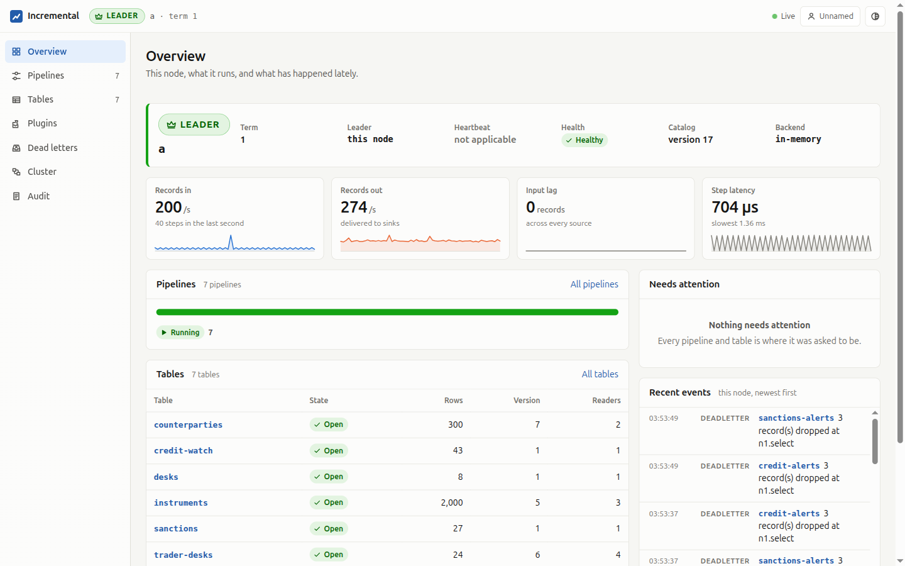
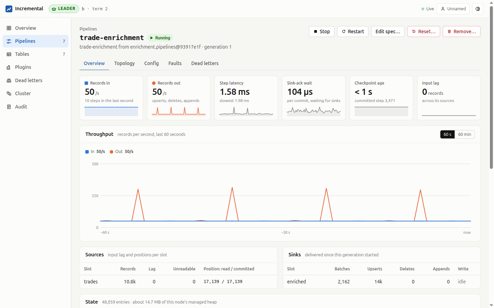
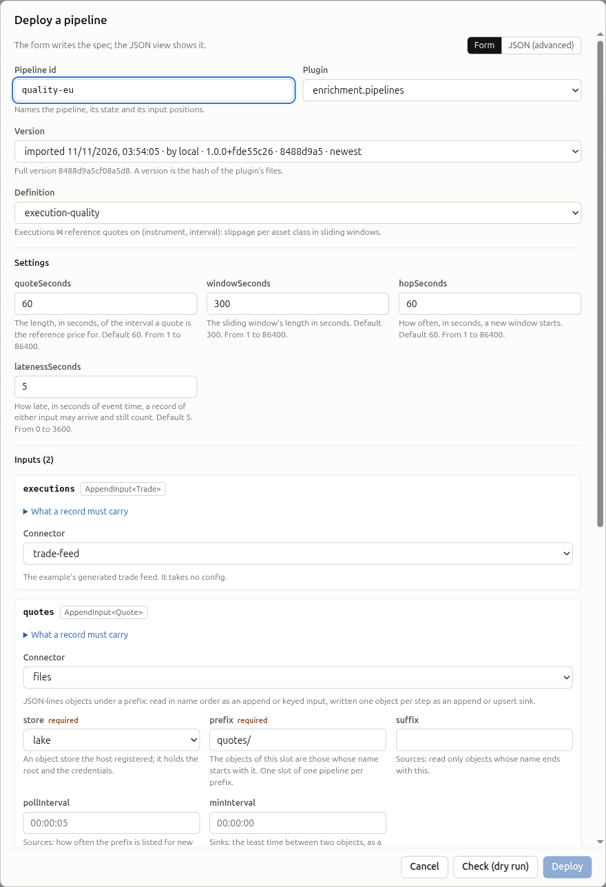
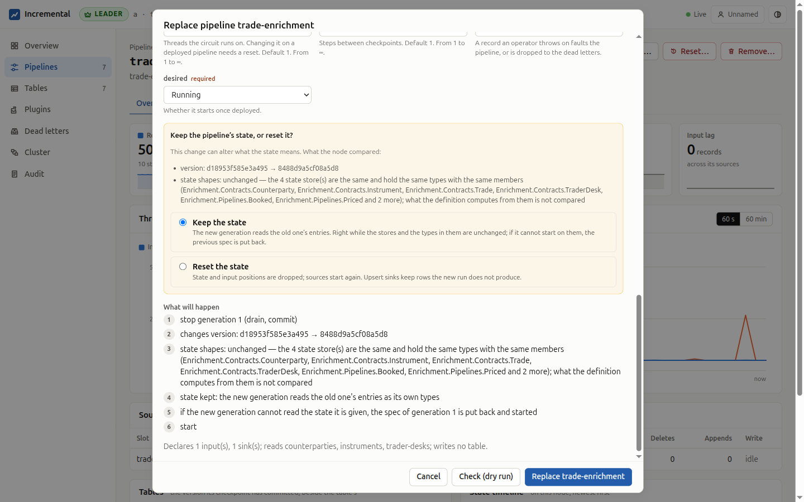
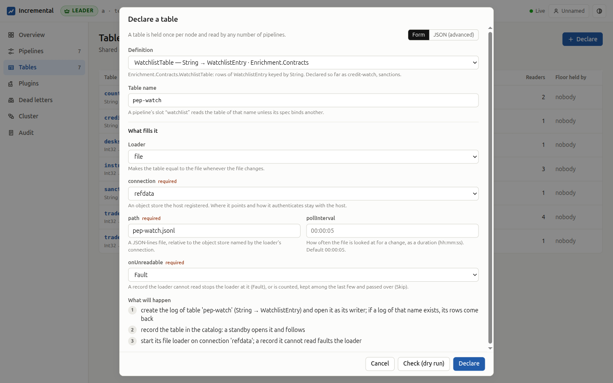
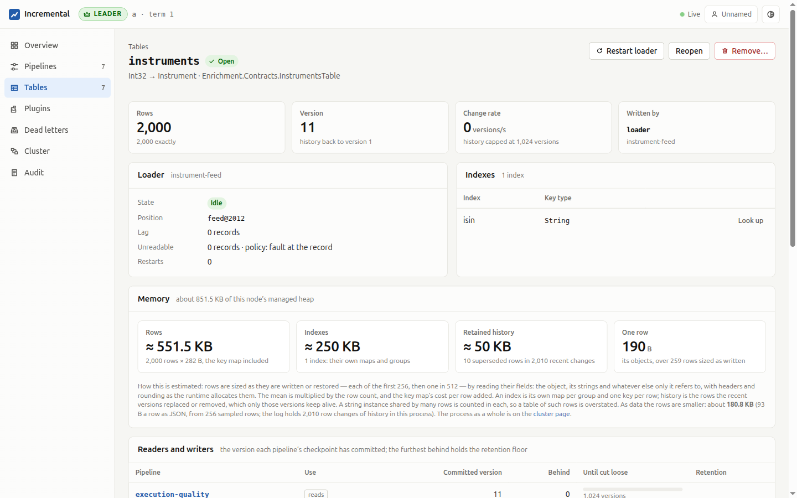
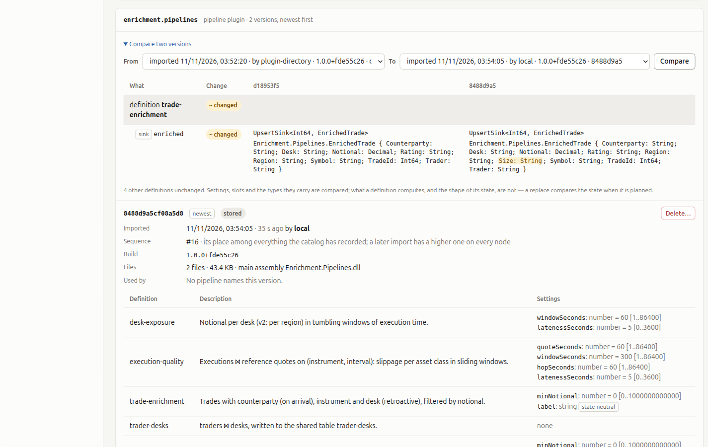
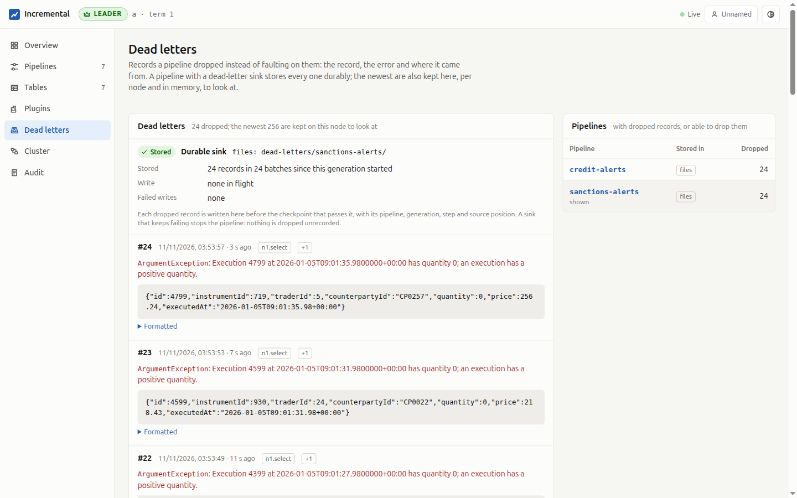
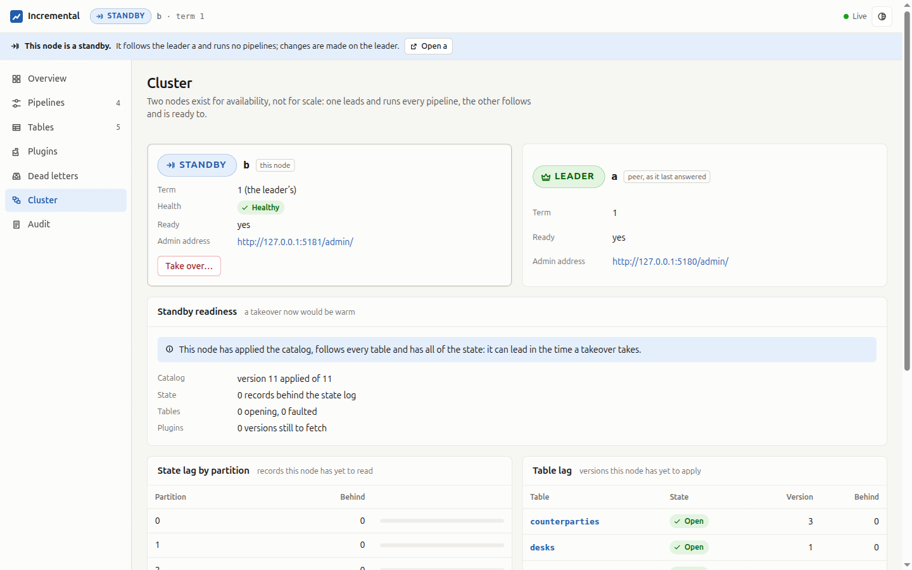
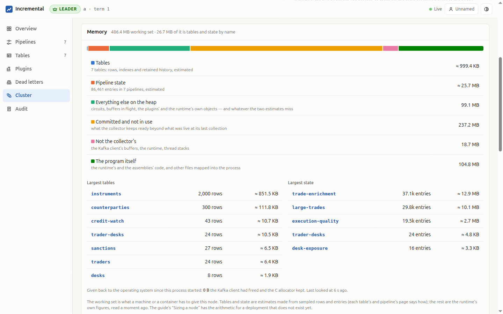

# The enrichment service: a guide

`Incremental.Service` runs many pipelines in one process — each a circuit, deployed and
replaced while the process runs — against reference tables they all share, and keeps a
second process ready to take over. `Incremental.Service.Admin` puts a JSON API and a web
UI over it. This guide goes from nothing to a running pipeline plugin, then through
running and operating the service. Everything it shows is in
[`examples/Incremental.EnrichmentService`](../examples/Incremental.EnrichmentService),
and every block of C# below is a region of that example's sources, quoted: a test
(`DocSnippetTests`) fails if the two drift apart, and CI builds the example.

For the core operators (`Join`, `Lookup`, windows, sinks) read [intro.md](intro.md). For
why the service is built the way it is, and what of the design is not built, read
[design/enrichment-service.md](design/enrichment-service.md) and its *As built*.

- [Concepts](#concepts)
- [Write your first pipeline plugin](#write-your-first-pipeline-plugin)
- [The host](#the-host)
- [Run the example](#run-the-example)
- [The admin UI](#the-admin-ui)
- [Operating it](#operating-it)
- [On Amazon MSK](#on-amazon-msk)
- [Limits, and what is out of scope](#limits-and-what-is-out-of-scope)

## Concepts

**Table.** Reference data held once per process and read by every pipeline: a
`SharedTable`, declared by name. A pipeline joins against it and stores none of it. A
table has one writer — a *loader* (a file, a Kafka topic, a Debezium change topic, or a
table source you write), or a pipeline (`ToTable`), in which case it is a *derived* table.

**Pipeline.** One circuit: inputs, operators, sinks. It is described by a *definition* —
a class with a `Build` method — and deployed by a *spec*, which is data: which definition,
its settings, and what each of the definition's named slots is bound to. One definition
can be deployed many times with different settings and bindings; each deployment has its
own state, keyed by its id.

**Plugin.** An assembly of definitions, loaded at runtime into its own
`AssemblyLoadContext`. Several versions of one plugin can be loaded side by side, and a
version unloads when no pipeline uses it. A **contract** is the other kind of assembly:
the row types and table definitions that the host and all plugins share. It is loaded
once and never unloaded, which is what lets two plugins join the same table.

**Catalog.** The durable record of what is deployed — tables, pipelines, plugin
versions, the audit log. It is itself a shared table on the backend's log. Every change
goes through it, and it is the only input to "what should exist": a node that starts on
storage holding a catalog rebuilds what the catalog names.

**Node roles.** Every node runs the same code and starts as a **standby**. One node
**leads**: it writes the catalog and the tables and runs every pipeline. A standby
follows the catalog and the tables, fetches the plugins, and builds every pipeline's
circuit on the state it follows — built, not started: it runs no step. A takeover
starts those circuits, which is why its length does not depend on how much state the
pipelines hold. Two nodes exist for availability, not for scale. A node that loses leadership (**fenced** by a takeover, or **resigned** by
stepping down) never leads again in that process: it exits, and comes back as the standby.

**Backend.** Where the catalog, the table logs, the pipelines' state and leadership
live. In memory (one process, nothing kept, for tests and for trying things out) or Kafka.

## Write your first pipeline plugin

Three things: a contract assembly, a plugin assembly, and a spec.

### 1. The contract

Row types of shared tables, and the tables' definitions. The host compiles this assembly
in; plugins reference it.

<!-- snippet: examples/Incremental.EnrichmentService/Contracts/Contracts.cs#contract -->
```csharp
// A contract assembly: the row types of shared tables and the tables' definitions. It is
// loaded once per process and never unloaded, so every plugin version sees the same types.
[assembly: IncrementalContract]

namespace Enrichment.Contracts;

// Rows are immutable records: every pipeline in the process is handed the same objects.
public sealed record Instrument(int Id, string Symbol, string Isin, string AssetClass, decimal Multiplier);

public sealed record Counterparty(string Id, string Name, string Country, string Rating);

public sealed record Trader(int Id, string Name, int DeskId);

public sealed record Desk(int Id, string Name, string Region);

/// <summary>A derived row: a trader with their desk, written by the trader-desks pipeline.</summary>
public sealed record TraderDesk(int TraderId, string Trader, int DeskId, string Desk, string Region);

public sealed class InstrumentsTable : TableDefinition<int, Instrument>
{
    // An index is declared once, with its selector, and read as table.By(InstrumentsTable.ByIsin).
    public static readonly IndexDefinition<Instrument, string> ByIsin = new("isin", i => i.Isin);

    public override string Name => "instruments";
    public override int KeyOf(Instrument row) => row.Id;
    protected override void Configure(TableBuilder<int, Instrument> table) => table.Index(ByIsin);
}
```

A definition class is declared once and may be declared as a table under several names.
A static holder (`Reference.Instruments` in the example) saves writing `new
InstrumentsTable()` in every pipeline. Do not call it `Tables` if your namespaces start
with `Incremental.`: it collides with `Incremental.Tables`.

### 2. A definition

<!-- snippet: examples/Incremental.EnrichmentService/Pipelines/TradeEnrichment.cs#trade-enrichment -->
```csharp
/// <summary>
/// Trades enriched from three shared tables, each join of the kind its column needs: the
/// counterparty is looked up when the trade arrives and then left alone; the instrument
/// and the trader's desk are joined, so a change to either corrects every trade it touches.
/// <para>
/// Every trade is a new key, so nothing would ever close one: a retroactive join keeps
/// every fact it has joined, and a keyed input every row it has had. What bounds them is
/// the trade's own time. A trade is <em>open</em> for <c>OpenSeconds</c> of event time —
/// the watermark runs that far behind the newest trade seen — and while it is open an
/// amendment replaces it and a change of reference data corrects it. Then it is
/// <em>final</em>: an amendment that arrives later is dropped as late, its row in the sink
/// stays as last emitted, and every operator below forgets it (<c>evictWhenFinal</c> on
/// the input, <c>EvictWhenFinal()</c> on each grouping). The state is about
/// <c>OpenSeconds × trades per second</c> trades, whatever the feed's length. Copy this
/// shape for any retroactive join over a stream of facts.
/// </para>
/// </summary>
[Pipeline("trade-enrichment", Description = "Trades with counterparty (on arrival), instrument and desk (retroactive while open), filtered by notional.")]
public sealed class TradeEnrichment : IPipelineDefinition<TradeEnrichment.Settings>
{
    public sealed record Settings
    {
        [Range(0, 1e12), Description("Trades with a notional below this are dropped.")]
        public decimal MinNotional { get; init; }

        [Range(1, 30 * 86_400), Description("How long, in seconds of event time behind the newest trade, a trade stays open to amendments and reference-data corrections. Then it is final and its state goes.")]
        public int OpenSeconds { get; init; } = 3600;

        [StateNeutral, Description("A label for operators; it changes no stored row.")]
        public string? Label { get; init; }
    }

    public void Build(PipelineBuilder p, Settings s)
    {
        var counterparties = p.Table(Reference.Counterparties);
        var instruments = p.Table(Reference.Instruments);
        var traderDesks = p.Table(Reference.TraderDesks);

        var enriched = p.KeyedInput<long, Trade>("trades", t => t.Id)
            // The trade's time, and how long it stays open: the input forgets a trade's row
            // once it is final.
            .WithEventTime(t => t.ExecutedAt, TimeSpan.FromSeconds(s.OpenSeconds), evictWhenFinal: true)
            // Enrich on arrival: who the counterparty was when the trade was booked.
            .GroupBy(t => t.CounterpartyId).EvictWhenFinal()
            .Lookup(counterparties,
                (_, t, c) => new Booked(t, c.Name, c.Rating),
                (_, t) => new Booked(t, "(unknown)", "NR")).Named("booked")
            // Retroactive while open: a corrected multiplier reprices the instrument's open trades.
            .WithEventTime(b => b.Trade.ExecutedAt)
            .GroupBy(b => b.Trade.InstrumentId).EvictWhenFinal()
            .Join(instruments, (_, b, i) => new Priced(b, i.Symbol, b.Trade.Quantity * b.Trade.Price * i.Multiplier)).Named("priced")
            .Where(x => x.Notional >= s.MinNotional)
            // Retroactive while open: a trader who moves desk takes their open trades with them.
            .WithEventTime(x => x.Booked.Trade.ExecutedAt)
            .GroupBy(x => x.Booked.Trade.TraderId).EvictWhenFinal()
            .Join(traderDesks, (_, x, td) => Row(x, td)).Named("with-desk");

        p.UpsertSink("enriched", enriched, e => e.TradeId);
    }

    private static EnrichedTrade Row(Priced x, TraderDesk td) => new(
        x.Booked.Trade.Id, x.Symbol, x.Booked.Counterparty, x.Booked.Rating, td.Trader, td.Desk, td.Region, x.Notional
#if V2
        , x.Notional >= 1_000_000m ? "block" : "regular"     // version 2: one more computed column
#endif
        );
}

// Private to the plugin: every loaded version has its own types of these names. Booked and
// Priced are what the two joins store per trade, so their shape is part of the state.
public sealed record Booked(Trade Trade, string Counterparty, string Rating);

public sealed record Priced(Booked Booked, string Symbol, decimal Notional);

public sealed record EnrichedTrade(
    long TradeId, string Symbol, string Counterparty, string Rating, string Trader, string Desk, string Region, decimal Notional
#if V2
    , string Size
#endif
    );
```

What is going on:

- `p.KeyedInput`, `p.Input`, `p.UpsertSink` and `p.AppendSink` name **slots**. What a
  slot is connected to is the spec's business, not the definition's.
- `p.Table(definition)` gives the core's `TableRef`: `Join`, `LeftJoin`, `Lookup`,
  `LookupAppendOnly`, `Changes()`, `By(index)`. Everything between the slots is the core
  API; `p.Circuit` is the `CircuitBuilder` if you need it.
- **The join kind is chosen per join.** `Join` is retroactive: change the table row and
  every fact joined to it is corrected. `Lookup` enriches a record as it arrives and
  leaves it alone. In the definition above a renamed counterparty affects only trades
  booked afterwards, while a corrected multiplier reprices every open trade in the
  instrument.
  Put the lookup *before* the retroactive joins if "as it arrived" is to mean the trade's
  arrival: a lookup downstream of a join looks again whenever the join re-emits.
- **A retroactive join keeps every record it has joined, and a `Lookup` what it
  emitted for every record**, so that each can correct or take back exactly that. Over
  a stream of trades, where every trade is a new key, that is one entry per trade for
  ever — unless something closes it. Here it is the trade's own time: a trade is open
  for `openSeconds` of event time, then final, and `EvictWhenFinal()` on each grouping
  (with `evictWhenFinal: true` on the input) forgets it. On a stream that only ever
  arrives and needs no retroactivity, `LookupAppendOnly` keeps nothing at all.
  [Bounding a join over a stream of facts](#bounding-a-join-over-a-stream-of-facts) is
  the whole story, with the arithmetic.
- Settings are one type per definition, bound from the spec's `settings` with
  `System.Text.Json` (camelCase, unknown members refused, string enums) and then
  validated with DataAnnotations — before anything is deployed.
- The `#if V2` lines are how the example builds a second version of the same plugin
  from the same sources. Yours will be two commits.

Two more definitions, for the other shapes. An aggregate over event-time windows, on an
append input:

<!-- snippet: examples/Incremental.EnrichmentService/Pipelines/DeskExposure.cs#desk-exposure -->
```csharp
/// <summary>
/// Notional per desk in tumbling windows of execution time. Each execution is an event: it
/// takes the desk its trader sat on when it arrived (an append-only lookup keeps nothing),
/// and a window's state is dropped when the watermark passes its end.
/// Version 2 groups by region instead — a different key under the same store, so its
/// state is not version 1's and the replace has to reset.
/// </summary>
[Pipeline("desk-exposure", Description = "Notional per desk (v2: per region) in tumbling windows of execution time.")]
public sealed class DeskExposure : IPipelineDefinition<DeskExposure.Settings>
{
    public sealed record Settings
    {
        [Range(1, 86_400), Description("The window's length in seconds.")]
        public int WindowSeconds { get; init; } = 60;

        [Range(0, 3600), Description("How late, in seconds of event time, an execution may arrive and still count.")]
        public int LatenessSeconds { get; init; } = 5;
    }

    public void Build(PipelineBuilder p, Settings s)
    {
        var exposure = p.Input<Trade>("executions")
            .LookupAppendOnly(p.Table(Reference.TraderDesks), t => t.TraderId,
                (t, td) => new DeskExecution(Group(td), t.Quantity * t.Price, t.ExecutedAt))
            .WithEventTime(x => x.ExecutedAt, TimeSpan.FromSeconds(s.LatenessSeconds))
            .GroupBy(x => x.Group)
            .TumblingWindow(TimeSpan.FromSeconds(s.WindowSeconds))
            .Sum(x => x.Notional).Named("exposure")
            .Rows()
            .Select(w => new Exposure(w.Key, w.WindowStart, w.WindowEnd, w.Value));

        p.UpsertSink("exposure", exposure, e => $"{e.Group}@{e.WindowStart.UtcDateTime:yyyy-MM-ddTHH:mm:ss}Z");
    }

#if V2
    private static string Group(TraderDesk td) => td.Region;
#else
    private static string Group(TraderDesk td) => td.Desk;
#endif
}

public sealed record DeskExecution(string Group, decimal Notional, DateTimeOffset ExecutedAt);

public sealed record Exposure(string Group, DateTimeOffset WindowStart, DateTimeOffset WindowEnd, decimal Notional);
```

A derived table, with no input and no sink:

<!-- snippet: examples/Incremental.EnrichmentService/Pipelines/TraderDesks.cs#trader-desks -->
```csharp
/// <summary>
/// A derived table: traders joined to desks once, for every pipeline that wants a trade's
/// desk. It has no input and no sink — it reads two tables as streams of their changes and
/// writes a third.
/// </summary>
[Pipeline("trader-desks", Description = "traders ⋈ desks, written to the shared table trader-desks.")]
public sealed class TraderDesks : IPipelineDefinition
{
    public void Build(PipelineBuilder p) =>
        p.ToTable(
            Reference.TraderDesks,
            p.Table(Reference.Traders).Changes()
                .GroupBy(t => t.DeskId)
                .Join(p.Table(Reference.Desks), (_, t, d) => new TraderDesk(t.Id, t.Name, d.Id, d.Name, d.Region)).Named("trader-desk"));
}
```

#### Two inputs

A definition may declare any number of inputs. Each is a slot of its own, bound by the
spec to a connector of its own, and the two streams are joined with the core's stream
join. This one joins executions to the reference price quoted for their instrument and
minute, then looks the instrument up in a table:

<!-- snippet: examples/Incremental.EnrichmentService/Pipelines/ExecutionQuality.cs#execution-quality -->
```csharp
/// <summary>
/// Two inputs joined to each other: every execution meets the reference price quoted for
/// its instrument in the interval it was done in, and the difference — the slippage, in
/// basis points — is summed per asset class over a sliding window.
/// <para>
/// Both inputs carry event time, so the circuit's watermark is the lower of the two: it
/// only moves when both feeds have moved, and nothing is late merely because one source
/// was read ahead of the other. The join's key is (instrument, interval), and
/// <c>EvictWhen</c> closes a key when the watermark passes the interval's end — from then
/// on neither side holds anything for it, which is what keeps the state of a join between
/// two unbounded streams bounded. The watermark and the keys waiting to close are in the
/// checkpoint with the rows they bound, so that holds across a restart and a takeover
/// too: a key open when the leader died still closes on the node that took over.
/// </para>
/// <para>
/// It is a left join: an execution in an instrument that was not quoted in its interval is
/// still counted, as unpriced. Should the quote arrive after the execution — and before the
/// interval closes — the unpriced row is taken back and the priced one put in its place,
/// through the window totals too.
/// </para>
/// </summary>
[Pipeline("execution-quality", Description = "Executions ⋈ reference quotes on (instrument, interval): slippage per asset class in sliding windows.")]
public sealed class ExecutionQuality : IPipelineDefinition<ExecutionQuality.Settings>
{
    public sealed record Settings
    {
        [Range(1, 86_400), Description("The length, in seconds, of the interval a quote is the reference price for.")]
        public int QuoteSeconds { get; init; } = 60;

        [Range(1, 86_400), Description("The sliding window's length in seconds.")]
        public int WindowSeconds { get; init; } = 300;

        [Range(1, 86_400), Description("How often, in seconds, a new window starts.")]
        public int HopSeconds { get; init; } = 60;

        [Range(0, 3600), Description("How late, in seconds of event time, a record of either input may arrive and still count.")]
        public int LatenessSeconds { get; init; } = 5;
    }

    public void Build(PipelineBuilder p, Settings s)
    {
        var interval = TimeSpan.FromSeconds(s.QuoteSeconds);
        var lateness = TimeSpan.FromSeconds(s.LatenessSeconds);
        IntervalKey In(int instrument, DateTimeOffset at) =>
            new(instrument, new DateTimeOffset(at.UtcTicks - at.UtcTicks % interval.Ticks, TimeSpan.Zero));

        // One slot per input; the spec binds each to a connector of its own.
        var executions = p.Input<Trade>("executions")
            // A table lookup before the stream join: the instrument's asset class, as of
            // arrival. Executions only ever arrive, so the lookup remembers nothing. After
            // the join it would have to (the join takes rows back), one entry per
            // execution with nothing to close them: state that grows for ever.
            .LookupAppendOnly(p.Table(Reference.Instruments), t => t.InstrumentId,
                (t, i) => new ClassedTrade(i.AssetClass, t.InstrumentId, t.ExecutedAt, t.Price))
            .WithEventTime(t => t.ExecutedAt, lateness);
        var quotes = p.Input<Quote>("quotes").WithEventTime(q => q.At, lateness);

        var priced = executions
            .GroupBy(t => In(t.InstrumentId, t.ExecutedAt))
            .EvictWhen(key => key.Start + interval)
            .LeftJoin(
                quotes.GroupBy(q => In(q.InstrumentId, q.At)),
                (_, t, q) => new ClassedExecution(t.AssetClass, t.ExecutedAt, Math.Round((t.Price - q.Mid) / q.Mid * 10_000m, 2)),
                (_, t) => new ClassedExecution(t.AssetClass, t.ExecutedAt, null)).Named("priced");

        var quality = priced
            .WithEventTime(x => x.ExecutedAt, lateness)
            .GroupBy(x => x.AssetClass)
            .HoppingWindow(TimeSpan.FromSeconds(s.WindowSeconds), TimeSpan.FromSeconds(s.HopSeconds))
            .AggregateLinear(new QualityTotals()).Named("quality")
            .Rows()
            .Select(w => new Quality(w.Key, w.WindowStart, w.WindowEnd, w.Value.Priced, w.Value.Unpriced, w.Value.SlippageBps));

        p.UpsertSink("quality", quality, q => $"{q.AssetClass}@{q.WindowStart.UtcDateTime:yyyy-MM-ddTHH:mm:ss}Z");
    }
}

/// <summary>The join's key: an instrument and the start of a quote interval.</summary>
public readonly record struct IntervalKey(int InstrumentId, DateTimeOffset Start);

/// <summary>An execution with its instrument's asset class: what the join keeps per key
/// until the key closes.</summary>
public sealed record ClassedTrade(string AssetClass, int InstrumentId, DateTimeOffset ExecutedAt, decimal Price);

public sealed record ClassedExecution(string AssetClass, DateTimeOffset ExecutedAt, decimal? SlippageBps);

/// <summary>What a window holds per asset class. A linear aggregate keeps this and nothing
/// else per window: a row added or taken back changes it by the row's own contribution.</summary>
public readonly record struct Totals(long Priced, long Unpriced, decimal SlippageBps);

public sealed class QualityTotals : ILinearAggregate<ClassedExecution, Totals>
{
    public Totals Zero => default;

    public Totals Map(ClassedExecution x, long weight) =>
        x.SlippageBps is { } bps ? new Totals(weight, 0, bps * weight) : new Totals(0, weight, 0);

    public Totals Combine(Totals a, Totals b) => new(a.Priced + b.Priced, a.Unpriced + b.Unpriced, a.SlippageBps + b.SlippageBps);
}

public sealed record Quality(string AssetClass, DateTimeOffset WindowStart, DateTimeOffset WindowEnd, long Priced, long Unpriced, decimal SlippageBps);
```

What a second input changes:

- **The watermark is the lower of the inputs'.** Each `WithEventTime` is a clock, and the
  circuit's watermark is the minimum over them, less the lateness. So a record is never
  late because the other source happened to be read first — after a restart, say, when
  one topic is drained in a step and the other is not — and nothing closes until both
  feeds have passed it. The price is that an input with no records holds the watermark
  where it is: windows stay open and the join keeps its keys.
- **The table lookup comes before the join.** Executions only arrive, so
  `LookupAppendOnly` can class them with no state at all. Behind the left join the rows
  are taken back and re-asserted, a lookup there would have to remember each one, and
  with nothing to close them that is an entry per execution for as long as the pipeline
  lives. (This example had it there, and grew by 3,000 entries a minute.)
- **A join between two streams keeps both sides, so bound it.** `EvictWhen` on a
  grouping says when a key is finished; here a key is an instrument and a minute, and it
  closes when the watermark passes the minute's end. What was emitted for it stays final.
  Without it the join's state grows with the streams. The join's key has to carry the
  time for that to be expressible: joining on the instrument alone would keep every
  execution for ever.
- **The watermark and the eviction hold across a restart and a takeover.** Both are in
  the checkpoint: every commit carries the watermark and each input's highest event time
  beside the input positions, and every key or window waiting to close is an entry in a
  deadline store that is committed, followed by the standby and restored like the rows it
  bounds. So a circuit that starts — after a restart, a takeover, a replace that keeps
  state — has the watermark its last checkpoint had: a record that was late before is
  late after, and a closed window stays closed. And the keys that were open still close
  when the watermark passes them, whether or not another record ever touches them. The
  cost is one more state entry per open key or window per operator that bounds it,
  written when the key opens and removed when it closes. A remembered `Lookup` under
  `EvictWhen` is the one operator whose entries are not per key: it remembers per fact,
  so it has one entry per fact it remembers — keyed by the fact, as its remembered row
  is — written when the fact is asserted and removed when the fact is taken back or its
  key closes. An order that is corrected a hundred times costs one entry, not a hundred.
- **`LeftJoin` emits the unmatched row and takes it back.** An execution whose quote has
  not arrived is emitted as unpriced; when the quote arrives the unpriced row is
  retracted and the priced one asserted, and the window totals downstream follow. The
  sink sees one row per window whose numbers move.
- **One checkpoint holds every input's position.** Each source resumes from its own —
  a topic's partition offsets, a file and a line — and the two are committed together
  with the state they produced, so a restart or a takeover cannot leave the join with
  one side further on than its state says.
- **Order between the inputs is not defined** and the definition must not depend on
  it. This one does not: whichever of an execution and its quote arrives first, the
  result after both is the same.

Its spec binds two slots:

<!-- snippet: examples/Incremental.EnrichmentService/Host/World.cs#spec-two-inputs -->
```csharp
public PipelineSpec ExecutionQuality(string version = "") => new()
{
    Id = "execution-quality",
    Plugin = Plugin,
    Version = version,
    Definition = "execution-quality",
    Settings = Json("""{ "quoteSeconds": 60, "windowSeconds": 300, "hopSeconds": 60, "latenessSeconds": 5 }"""),
    // Two inputs, each bound on its own: the trade feed, and the quote files (or topic).
    Inputs = new Dictionary<string, JsonElement> { ["executions"] = Trades, ["quotes"] = Quotes },
    Sinks = new Dictionary<string, JsonElement> { ["quality"] = Sink("execution-quality") },
};
```

#### An append sink, dead letters, one definition on two tables

<!-- snippet: examples/Incremental.EnrichmentService/Pipelines/WatchlistAlerts.cs#watchlist-alerts -->
```csharp
/// <summary>
/// An alert for every execution with a counterparty on a watchlist: an append-only result,
/// so it has an append sink — each alert is delivered once per step that produced it and
/// never taken back. Which watchlist is the spec's business: the definition names the slot
/// <c>watchlist</c>, and a spec's <c>"tables": { "watchlist": "sanctions" }</c> binds it,
/// so the same class is deployed once per list.
/// <para>
/// An execution with no quantity cannot be sized, and <see cref="Sized"/> throws on it.
/// Deployed with <c>"errorPolicy": "DeadLetter"</c> the record is dropped and reported —
/// to the pipeline's dead-letter sink if the spec binds one — and the pipeline carries on;
/// under the default policy the same record stops it.
/// </para>
/// </summary>
[Pipeline("watchlist-alerts", Description = "Executions with a counterparty on a watchlist, as an append-only stream of alerts.")]
public sealed class WatchlistAlerts : IPipelineDefinition<WatchlistAlerts.Settings>
{
    public sealed record Settings
    {
        [Range(0, 1e12), Description("Executions with a notional below this raise no alert.")]
        public decimal MinNotional { get; init; }

        [StateNeutral, Description("What an alert from this deployment is marked with.")]
        public string Severity { get; init; } = "review";
    }

    public void Build(PipelineBuilder p, Settings s)
    {
        var alerts = p.Input<Trade>("executions")
            .Select(Sized)
            .Where(x => x.Notional >= s.MinNotional)
            // On arrival, and append-only: nothing is remembered. An execution whose
            // counterparty is not on the list finds no row and is dropped.
            .LookupAppendOnly(p.Table(Reference.Watchlist), x => x.Trade.CounterpartyId,
                (x, entry) => new Alert(x.Trade.Id, x.Trade.ExecutedAt, entry.CounterpartyId, entry.Reason, x.Notional, s.Severity));

        p.AppendSink("alerts", alerts);
    }

    private static SizedExecution Sized(Trade t) =>
        t.Quantity > 0
            ? new SizedExecution(t, t.Quantity * t.Price)
            : throw new ArgumentException($"Execution {t.Id} at {t.ExecutedAt:O} has quantity {t.Quantity}; an execution has a positive quantity.");
}

public sealed record SizedExecution(Trade Trade, decimal Notional);

public sealed record Alert(long TradeId, DateTimeOffset ExecutedAt, string CounterpartyId, string Reason, decimal Notional, string Severity);
```

- **`p.AppendSink`** is for a result that is only ever added to. Each step's records are
  delivered once, under the step's sequence number; a retraction reaching it faults the
  pipeline, because an append sink cannot take a record back. Everything upstream of it
  must therefore be append-only: an append input, `Select`, `Where`, `LookupAppendOnly`.
- **The error policy is the spec's**, per pipeline (`"circuit": { "errorPolicy":
  "DeadLetter" }`), or the definition's per operator (`.OnError(…)`). Under `DeadLetter`
  the execution `Sized` throws on is dropped, counted and reported, and the pipeline
  carries on; where the dropped records go is [below](#dead-letters).
- **A table slot is bound by the spec.** The definition says `p.Table(Reference.Watchlist)`,
  which names the slot `watchlist`. The host declares two tables of that definition
  (`AddTable(Reference.Watchlist, loader, name: "sanctions")` and `"credit-watch"`), and
  each deployment's spec says which one it reads:

<!-- snippet: examples/Incremental.EnrichmentService/Host/World.cs#spec-alerts -->
```csharp
public PipelineSpec WatchlistAlerts(string id, string watchlist, decimal minNotional, string severity, string version = "") => new()
{
    Id = id,
    Plugin = Plugin,
    Version = version,
    Definition = "watchlist-alerts",
    Settings = Json($$"""{ "minNotional": {{minNotional.ToString(System.Globalization.CultureInfo.InvariantCulture)}}, "severity": "{{severity}}" }"""),
    // A record the definition throws on is dropped and reported, not fatal…
    Circuit = new PipelineCircuitOptions { ErrorPolicy = Incremental.RecordErrorPolicy.DeadLetter },
    // …and kept: any append sink connector will do. Files in memory, a topic on Kafka.
    DeadLetters = kafka is null
        ? Files($"dead-letters/{id}/")
        : Json($$"""{ "connector": "kafka", "connection": "log", "topic": "{{kafka.DeadLetterTopic(id)}}" }"""),
    // The definition's table slot "watchlist", bound to one of the two declared watchlists.
    Tables = new Dictionary<string, string> { ["watchlist"] = watchlist },
    Inputs = new Dictionary<string, JsonElement> { ["executions"] = Trades },
    Sinks = new Dictionary<string, JsonElement> { ["alerts"] = Files($"alerts/{id}/") },
};
```

#### Rules for definitions

- A definition has a public parameterless constructor. `Build` runs many times — at
  import, at every dry run, for every generation — and must only describe the circuit: no
  I/O, no threads, no writes to statics.
- Delegates are deterministic. A record dropped or mapped one way when inserted must be
  dropped or mapped the same way when it is retracted.
- **A value captured by a delegate upstream of a stateful operator is part of the
  state.** `MinNotional` above sits before a join: change it and keep the state, and rows
  the new threshold would have dropped stay delivered. The service asks on every such
  change, and the honest answer is usually `reset`. Mark a settings property
  `[StateNeutral]` only if it changes no stored row.
- Name every stateful operator with `.Named()`. Unnamed state is positional: insert an
  operator above it and the state has no home.
- Hold nothing of the plugin's in a static — statics pin the load context, and the
  version can then never unload. A service the definition needs comes from `p.Services`.
- Row and key types of shared tables live in the contract. Everything else (`Booked`,
  `Priced`, `EnrichedTrade` above) is private to the plugin, and each loaded version has
  its own copy of those types.
- State is JSON. A property renamed between versions reads back as its default. Types
  that appear in a store's *key* — a grouping's records, a `Distinct`'s values — must
  keep their shape across a `keep`; nothing detects it if they do not.

### 3. The project

A plugin is a class library whose output directory holds the plugin's assembly, its
`.deps.json` and its private dependencies — and none of what the host provides. That
directory, or a zip of it, is the package.

```xml
<Project Sdk="Microsoft.NET.Sdk">
  <PropertyGroup>
    <TargetFramework>net10.0</TargetFramework>
    <!-- Copies the assemblies of the NuGet packages the plugin references: its private dependencies. -->
    <CopyLocalLockFileAssemblies>true</CopyLocalLockFileAssemblies>
  </PropertyGroup>
  <ItemGroup>
    <!-- Provided by the host: compile against them, copy nothing of them. "native" matters:
         without it the Kafka client's native libraries (about 100 MB) land in runtimes/. -->
    <ProjectReference Include="…/src/Incremental.Service/Incremental.Service.csproj" Private="false" ExcludeAssets="runtime;native" />
    <ProjectReference Include="…/src/Incremental/Incremental.csproj" Private="false" ExcludeAssets="runtime;native" />
    <ProjectReference Include="../Contracts/Enrichment.Contracts.csproj" Private="false" />
    <!-- A private dependency: copied beside the plugin and loaded from there. -->
    <PackageReference Include="Some.Library" Version="1.2.3" />
  </ItemGroup>
</Project>
```

The example's [`Plugin.props`](../examples/Incremental.EnrichmentService/Plugin.props)
is this, shared by its three plugin projects (which reference no package of their own).
Look at the output directory before you ship it: it should hold your assembly, your
dependencies and nothing named `Incremental*`, `Confluent*` or `runtimes/`.

The plugin's name is its assembly's name in lower case (`enrichment.pipelines`); its
version is a hash of its files, so the same build imported twice is one version. The
main assembly is the one with a `.deps.json` beside it, or the only `.dll`, or the file
a `plugin.json` names (`{ "assembly": "lib/My.Plugin.dll" }`).

Where a plugin's references are loaded from:

1. A **contract assembly** the process has loaded — always that one, even if the plugin
   ships its own copy.
2. The **host**, for the assemblies whose types cross between host and plugin —
   `Incremental*`, `Microsoft.Extensions.*`, `Confluent.Kafka` and the framework —
   whatever the plugin ships.
3. The **host**, for any other assembly it happens to carry, if the host's version is at
   least the one the plugin was built against. If the plugin was built against a newer
   one and ships it, the plugin gets its own copy.
4. The **plugin's own files**, for everything else.

### 4. A spec

<!-- snippet: examples/Incremental.EnrichmentService/Host/World.cs#specs -->
```csharp
public PipelineSpec TraderDesks(string version = "") => new()
{
    Id = "trader-desks",
    Plugin = Plugin,
    Version = version,                  // may be empty while the plugin has one stored version
    Definition = "trader-desks",
};

// A trade stays open to corrections for two minutes of event time: short, so that the
// example shows its state levelling off within minutes (the definition's default is an hour).
public PipelineSpec TradeEnrichment(string id, decimal minNotional, string version = "", int openSeconds = 120) => new()
{
    Id = id,
    Plugin = Plugin,
    Version = version,
    Definition = "trade-enrichment",
    Settings = Json($$"""{ "minNotional": {{minNotional.ToString(System.Globalization.CultureInfo.InvariantCulture)}}, "openSeconds": {{openSeconds}}, "label": "{{id}}" }"""),
    Inputs = new Dictionary<string, JsonElement> { ["trades"] = Trades },
    Sinks = new Dictionary<string, JsonElement> { ["enriched"] = Sink(id) },
};

public PipelineSpec DeskExposure(string version = "") => new()
{
    Id = "desk-exposure",
    Plugin = Plugin,
    Version = version,
    Definition = "desk-exposure",
    Settings = Json("""{ "windowSeconds": 60, "latenessSeconds": 5 }"""),
    Inputs = new Dictionary<string, JsonElement> { ["executions"] = Trades },
    Sinks = new Dictionary<string, JsonElement> { ["exposure"] = Sink("desk-exposure") },
};
```

`Trades` and `Sink(name)` in that code are slot bindings — JSON that names a connector
and gives it its config:

```json
{ "connector": "trade-feed" }
{ "connector": "view", "name": "trade-enrichment" }
{ "connector": "kafka", "connection": "log", "topic": "enrich.trades" }
```

The first two are connectors the example's host registers; the third is built in, as
are `files` and `memory` ([below](#the-built-in-connectors)). A spec may also carry
`tables` (table slot → declared table, so one definition can read `sanctions` here and
`credit-watch` there), `circuit` (workers, checkpoint interval, `errorPolicy`),
`deadLetters` (a connector config: where dropped records are kept) and `restart` (how
many faults in how long before the pipeline is `Failed`).

Deploy it from the host (`node.Pipelines.DeployAsync(spec, new DeployOptions(), ct)`),
as a seed (`AddPipeline(spec)`, applied once per deployment: the catalog records which
seeds have been applied, so a seeded pipeline that is removed stays removed, and a seed
added to the host later is applied by the next leader), or over the admin API:

```bash
curl -X PUT http://127.0.0.1:5180/admin/api/pipelines/big-trades \
  -H 'X-Incremental-Admin: 1' -H 'Content-Type: application/json' -d '{
    "plugin": "enrichment.pipelines", "definition": "trade-enrichment",
    "settings": { "minNotional": 30000000 },
    "inputs": { "trades":   { "connector": "trade-feed" } },
    "sinks":  { "enriched": { "connector": "view", "name": "big-trades" } } }'
```

A deploy is checked before anything is touched: the settings bind and validate, the
definition is run against a builder that is never built, every slot is bound to a
connector that supports its kind, every table is declared with the definition's types.
Add `?dryRun=true` and that check is all that happens.

#### Asking the service what a spec can say

A spec names slots, connectors, connections and tables. None of that has to be read
from a host's source: the admin API answers it (the leader, for the first two — they run
the definition's `Build`).

| | |
|---|---|
| `GET plugins/{name}/{version}/definitions/{definition}` | its settings (type, default, range, enum values, required, state-neutral), its input and sink slots (kind, record type, key type), and the tables it reads and writes (slot, key and row type, definition). `?settings={…}` describes it under those settings instead of the defaults. |
| `GET plugins/{name}/{version}/definitions/{definition}/template?id=…` | a spec to start from: real slot names, each bound to a connector this host registered for that kind of slot (the host's own before `memory` and `kafka`), settings at their defaults — with `valid` saying whether the dry run accepts it as it is, and `connectorsForSlot` listing the alternatives |
| `GET connectors` | every registered connector: the slot kinds it supports, whether a reset clears what it wrote, and its config's properties if it describes them (`IConfigDescribed`) |
| `GET connections` | the Kafka connections and object stores by name and kind. Nothing of where they point or how they authenticate. |
| `GET table-sources` | the loader kinds — `file`, `kafka`, `debezium` and the host's — with their config and the kind of connection each names |

```bash
curl 'http://127.0.0.1:5180/admin/api/plugins/enrichment.pipelines/9fc096cf168f00ef/definitions/desk-exposure/template?id=exposure-eu'
```

answers, in the example,

```json
{ "spec": { "id": "exposure-eu", "plugin": "enrichment.pipelines", "version": "9fc096cf168f00ef",
            "definition": "desk-exposure", "settings": { "windowSeconds": 60, "latenessSeconds": 5 },
            "inputs": { "executions": { "connector": "trade-feed" } },
            "sinks":  { "exposure":   { "connector": "view" } } },
  "valid": true, "problems": [], "notes": [],
  "connectorsForSlot": { "executions": ["files", "kafka", "memory", "trade-feed"], "exposure": ["files", "kafka", "memory", "view"] } }
```

and `PUT pipelines/exposure-eu` accepts that `spec` unchanged. Where a slot's connector
needs more than its name (a `kafka` slot needs a connection and a topic, a `files` slot
a store and a prefix) the template leaves those properties empty, `valid` is false and
`notes` says what to fill in.

### 5. A test

A definition is tested without a node. `PipelineTestHarness`
(`Incremental.Service.Testing`, in the `Incremental.Service` package) binds the settings
and runs `Build` exactly as the service does, over tables the test fills, with inputs
the test feeds and sinks it reads. Steps are the test's to take, and a step returns when
the sinks hold what it produced — so there is nothing to wait for and nothing to poll.

<!-- snippet: examples/Incremental.EnrichmentService/Pipelines.Tests/TradeEnrichmentTests.cs#test-trade-enrichment -->
```csharp
public class TradeEnrichmentTests
{
    private static readonly DateTimeOffset T0 = new(2026, 1, 5, 9, 0, 0, TimeSpan.Zero);

    private static readonly Instrument Abc = new(1, "ABC", "GB0000000001", "Equity", 2m);
    private static readonly Counterparty Acme = new("CP0001", "Acme Holdings", "GB", "AA");
    private static readonly TraderDesk Ada = new(7, "Ada A.", 3, "Macro", "EMEA");

    // The definition, its settings as a spec carries them, and the tables it reads with
    // their first rows. Nothing else exists: no node, no connector, no catalog.
    private static Task<PipelineTestHarness> StartAsync(string settings = """{ "minNotional": 1000 }""") =>
        PipelineTestHarness.For<TradeEnrichment>()
            .Settings(settings)
            .Table(Reference.Instruments, [Abc])
            .Table(Reference.Counterparties, [Acme])
            .Table(Reference.TraderDesks, [Ada])
            .StartAsync();

    private static Trade Trade(long id, long quantity, string counterparty = "CP0001") => new(id, 1, 7, counterparty, quantity, 10m, T0);

    [Fact]
    public async Task A_trade_is_joined_to_its_three_tables_and_filtered_by_notional()
    {
        await using var pipeline = await StartAsync();
        var trades = pipeline.KeyedInput<long, Trade>("trades");
        await trades.UpsertAsync(Trade(1, quantity: 100));      // 100 × 10 × multiplier 2 = 2,000
        await trades.UpsertAsync(Trade(2, quantity: 10));       // 200: below the minimum
        await pipeline.StepAsync();                              // returns when the sinks are written

        var enriched = pipeline.UpsertSink<long, EnrichedTrade>("enriched").Rows;
        Assert.Equal(new EnrichedTrade(1, "ABC", "Acme Holdings", "AA", "Ada A.", "Macro", "EMEA", 2000m), Assert.Single(enriched).Value);
    }

    [Fact]
    public async Task The_instrument_and_the_desk_are_retroactive_and_the_counterparty_is_as_of_arrival()
    {
        await using var pipeline = await StartAsync();
        await pipeline.KeyedInput<long, Trade>("trades").UpsertAsync(Trade(1, quantity: 100));
        await pipeline.StepAsync();

        // Three tables change. Two are joined, one was looked up when the trade arrived.
        await pipeline.Table(Reference.Instruments).UpsertAsync(Abc with { Multiplier = 3m });
        await pipeline.Table(Reference.TraderDesks).UpsertAsync(Ada with { Desk = "Rates", Region = "APAC" });
        await pipeline.Table(Reference.Counterparties).UpsertAsync(Acme with { Name = "Acme (renamed)" });
        await pipeline.StepAsync();

        var row = pipeline.UpsertSink<long, EnrichedTrade>("enriched").Rows[1];
        Assert.Equal(3000m, row.Notional);                      // repriced
        Assert.Equal(("Rates", "APAC"), (row.Desk, row.Region)); // moved
        Assert.Equal("Acme Holdings", row.Counterparty);        // left alone
    }

    [Fact]
    public async Task An_unknown_counterparty_is_marked_and_a_deleted_trade_leaves_the_sink()
    {
        await using var pipeline = await StartAsync();
        var trades = pipeline.KeyedInput<long, Trade>("trades");
        await trades.UpsertAsync(Trade(1, quantity: 100, counterparty: "CP9999"));
        await pipeline.StepAsync();
        var sink = pipeline.UpsertSink<long, EnrichedTrade>("enriched");
        Assert.Equal(("(unknown)", "NR"), (sink.Rows[1].Counterparty, sink.Rows[1].Rating));

        await trades.DeleteAsync(1);
        await pipeline.StepAsync();
        Assert.Empty(sink.Rows);
    }

    [Fact]
    public async Task A_trade_is_corrected_while_it_is_open_and_left_alone_once_it_is_final()
    {
        await using var pipeline = await StartAsync("""{ "minNotional": 1000, "openSeconds": 60 }""");
        var trades = pipeline.KeyedInput<long, Trade>("trades");
        await trades.UpsertAsync(Trade(1, quantity: 100));                                   // at T0
        await pipeline.StepAsync();
        await trades.UpsertAsync(Trade(2, quantity: 100) with { ExecutedAt = T0.AddMinutes(2) });
        await pipeline.StepAsync();                                                          // the watermark: T0 + 1 min

        await pipeline.Table(Reference.Instruments).UpsertAsync(Abc with { Multiplier = 3m });
        await pipeline.StepAsync();
        var rows = pipeline.UpsertSink<long, EnrichedTrade>("enriched").Rows;
        Assert.Equal(2000m, rows[1].Notional);                  // final: as it was emitted
        Assert.Equal(3000m, rows[2].Notional);                  // open: repriced

        // An amendment of a final trade is behind the watermark: dropped as late.
        await trades.UpsertAsync(Trade(1, quantity: 500));
        await pipeline.StepAsync();
        Assert.Equal(2000m, rows[1].Notional);
    }

    [Fact]
    public async Task The_state_holds_the_open_trades_and_no_more_however_long_the_feed()
    {
        await using var pipeline = await StartAsync("""{ "minNotional": 0, "openSeconds": 60 }""");
        var trades = pipeline.KeyedInput<long, Trade>("trades");
        var entries = new List<long>();
        for (var second = 0; second < 1200; second++)       // a trade a second, each a new id
        {
            await trades.UpsertAsync(Trade(second, quantity: 100) with { ExecutedAt = T0.AddSeconds(second) });
            if (second % 10 == 9)
            {
                await pipeline.StepAsync();
                entries.Add(pipeline.StateSize.Entries);
            }
        }
        // Per open trade: its row in the input, what the lookup emitted for it, its fact in
        // each join, and a deadline in each of the four. Open: the 61 seconds from the
        // watermark (60 behind the newest trade) on, and the step's own 10 until the next
        // step evicts what this one made final.
        Assert.InRange(entries.Max(), 1, 8 * (61 + 10));
        Assert.Equal(entries[^1], entries[^50]);                 // level: it stopped growing
        Assert.Equal(1200, pipeline.UpsertSink<long, EnrichedTrade>("enriched").Rows.Count);
    }

    [Fact]
    public async Task Settings_an_operator_could_not_deploy_are_refused_here_too()
    {
        var refused = await Assert.ThrowsAsync<ServiceException>(() => StartAsync("""{ "minNotional": -1 }"""));
        Assert.Contains(refused.Details, d => d.Contains("minNotional"));
    }
}
```

| | |
|---|---|
| `PipelineTestHarness.For<TDefinition>()` | then `.Settings(json)`, `.Table(definition, rows, name)`, `.BindTable(slot, table)`, `.ErrorPolicy(…)`, `.Workers(n)`, `.Services(provider)`, and `.StartAsync()` |
| `Input<T>(slot)`, `KeyedInput<TKey, TValue>(slot)` | the core's input handles: `InsertAsync`, `RemoveAsync`, `UpsertAsync`, `DeleteAsync` |
| `Table(definition, name)` | `UpsertAsync(rows)`, `DeleteAsync(keys)` — one table version each — and `Rows`, which is also how a derived table (`ToTable`) is read |
| `StepAsync()` | one step over everything sent and changed since the last. A record that faults the circuit is thrown from here. |
| `UpsertSink<TKey, TRow>(slot).Rows`, `AppendSink<T>(slot).Records` | what the slot's sink holds |
| `DeadLetters`, `Watermark`, `Shape` | the records dropped so far; the event-time watermark; the slots and tables `Build` declared |
| `StateSize` | `Entries` and `Stores` (entries by store name) as of the last step: assert that a definition's state returns to a bound under a long feed, as `The_state_holds_the_open_trades_…` above does |

Settings that would be refused at a deploy are refused by `StartAsync` with the same
`ServiceException`, and a slot asked for under the wrong name or type says what the
definition declared. A table the definition reads and the test does not give starts
empty. Run a definition with `.Workers(2)` at least once: keyed state that is not
behind an exchange on its key is only wrong with more than one worker.

Two inputs are two handles. The order in which a test sends is the order of arrival
within a step, and the watermark is read between steps:

<!-- snippet: examples/Incremental.EnrichmentService/Pipelines.Tests/ExecutionQualityTests.cs#test-two-inputs -->
```csharp
[Fact]
public async Task An_execution_meets_the_quote_of_its_interval_whichever_of_the_two_arrives_first()
{
    await using var pipeline = await StartAsync();
    var executions = pipeline.Input<Trade>("executions");
    var quotes = pipeline.Input<Quote>("quotes");

    // The quote first, then the execution: 101 against a mid of 100 is +100 bp.
    await quotes.InsertAsync(new Quote(1, T0, 100m));
    await executions.InsertAsync(Execution(1, instrument: 1, second: 10, price: 101m));
    // The execution first: no quote yet for the gilt, so it is counted as unpriced.
    await executions.InsertAsync(Execution(2, instrument: 2, second: 20, price: 99m));
    await pipeline.StepAsync();

    // Each execution is in the two windows that cover it.
    Assert.Equal((1, 0, 100m), Windows(pipeline)[("Equity", T0)]);
    Assert.Equal((1, 0, 100m), Windows(pipeline)[("Equity", T0.AddMinutes(-1))]);
    Assert.Equal((0, 1, 0m), Windows(pipeline)[("Govt Bond", T0)]);

    // The gilt's quote arrives: the unpriced row is taken back, the priced one counted.
    await quotes.InsertAsync(new Quote(2, T0, 100m));
    await pipeline.StepAsync();
    Assert.Equal((1, 0, -100m), Windows(pipeline)[("Govt Bond", T0)]);
}

[Fact]
public async Task A_quote_prices_only_its_own_interval_and_a_closed_interval_is_forgotten()
{
    await using var pipeline = await StartAsync();
    var executions = pipeline.Input<Trade>("executions");
    var quotes = pipeline.Input<Quote>("quotes");

    await quotes.InsertAsync(new Quote(1, T0, 100m));
    await executions.InsertAsync(Execution(1, instrument: 1, second: 70, price: 102m));        // the next interval: no quote there
    await pipeline.StepAsync();
    Assert.Equal((0, 1, 0m), Windows(pipeline)[("Equity", T0.AddMinutes(1))]);

    // Both inputs move on by ten minutes, and the watermark — the lower of the two —
    // passes the end of that interval: the join has let go of it, and the execution's
    // result is final. A quote for it now is late, and dropped.
    await quotes.InsertAsync(new Quote(1, T0.AddMinutes(10), 100m));
    await executions.InsertAsync(Execution(2, instrument: 1, second: 600, price: 100m));
    await pipeline.StepAsync();
    Assert.True(pipeline.Watermark > T0.AddMinutes(2));

    await quotes.InsertAsync(new Quote(1, T0.AddMinutes(1), 100m));
    await pipeline.StepAsync();
    Assert.Equal((0, 1, 0m), Windows(pipeline)[("Equity", T0.AddMinutes(1))]);
}
```

And the error policy is the harness's to set, as it is the spec's:

<!-- snippet: examples/Incremental.EnrichmentService/Pipelines.Tests/WatchlistAlertsTests.cs#test-dead-letters -->
```csharp
[Fact]
public async Task An_execution_that_cannot_be_sized_is_a_dead_letter_and_the_rest_carry_on()
{
    await using var pipeline = await PipelineTestHarness.For<WatchlistAlerts>()
        .Settings("""{ "severity": "block" }""")
        .Table(Reference.Watchlist, [new WatchlistEntry("CP0001", "sanctioned")])
        .ErrorPolicy(RecordErrorPolicy.DeadLetter)          // a spec's "circuit": { "errorPolicy": "DeadLetter" }
        .StartAsync();

    await pipeline.InsertAsync("executions",
    [
        Execution(1, "CP0001"),
        Execution(2, "CP0001", quantity: 0),                // what the generator's poison flag produces
        Execution(3, "CP0002"),                             // not on the list
        Execution(4, "CP0001"),
    ]);
    await pipeline.StepAsync();

    Assert.Equal([1L, 4L], pipeline.AppendSink<Alert>("alerts").Records.Select(a => a.TradeId).Order());
    Assert.All(pipeline.AppendSink<Alert>("alerts").Records, a => Assert.Equal(("sanctioned", "block", 1000m), (a.Reason, a.Severity, a.Notional)));

    var dropped = Assert.Single(pipeline.DeadLetters);
    Assert.Equal(Execution(2, "CP0001", quantity: 0), dropped.Record);
    Assert.Contains("has quantity 0", dropped.Exception.Message);
}

[Fact]
public async Task Under_the_default_policy_the_same_execution_stops_the_pipeline()
{
    await using var pipeline = await PipelineTestHarness.For<WatchlistAlerts>().StartAsync();
    await pipeline.InsertAsync("executions", [Execution(2, "CP0001", quantity: 0)]);
    var fault = await Assert.ThrowsAnyAsync<Exception>(() => pipeline.StepAsync());
    Assert.Contains("has quantity 0", fault.ToString());
}
```

The test project is an ordinary one that references the plugin and the contract
([`Pipelines.Tests`](../examples/Incremental.EnrichmentService/Pipelines.Tests); xunit
here, but the harness knows no test framework):

```xml
<ItemGroup>
  <PackageReference Include="Incremental.Service" Version="…" />
  <PackageReference Include="xunit.v3" Version="4.0.1" />
  <ProjectReference Include="..\Contracts\Enrichment.Contracts.csproj" />
  <ProjectReference Include="..\Pipelines\Enrichment.Pipelines.csproj" />
</ItemGroup>
```

What the harness leaves out is what the service adds round a circuit — connectors, a
restart from a checkpoint, a replace on kept state, a takeover. A definition cannot get
those wrong by itself; what it can get wrong is what it computes, and what its state is
keyed by. For the rest, run the service in memory: the smoke test below is that, for
this example.

## The host

The host is an ordinary generic-host application. It registers the service, the
contract, and whatever is specific to its surroundings:

<!-- snippet: examples/Incremental.EnrichmentService/Host/Node.cs#host -->
```csharp
var service = builder.Services.AddIncrementalService(o =>
    {
        o.PluginDirectory = Path.Combine(AppContext.BaseDirectory, "plugins");     // imported at first lead
        o.CacheDirectory = Path.Combine(world.DataDirectory, "cache-" + nodeId);    // one per node
        o.AdvertisedAdminUrl = $"http://127.0.0.1:{port}/admin/";                   // where a standby's UI sends you
        o.ExitOnLeadershipLoss = exitOnLeadershipLoss;
    })
    .AddContracts(typeof(Instrument).Assembly)                                      // row types and table definitions
    .AddObjectStore("refdata", _ => new LocalObjectStore(Path.Combine(world.DataDirectory, "refdata")))
    .AddObjectStore("lake", _ => world.Lake)                                        // quote files in, alerts and dead letters out
    .AddTableSource("instrument-feed", _ => new InstrumentFeedSourceFactory(world.Instruments))
    .AddTableSource("directory", _ => new DirectorySourceFactory(world.Traders, world.Desks))
    .AddSourceConnector("trade-feed", _ => new TradeFeedConnector(world.Trades))
    .AddSinkConnector("view", _ => new ViewConnector(world.Views));
```

Tables are seeded the same way pipelines are — written to the catalog once, by the
first leader that finds the seed not yet applied, and after that the catalog is the
record (a seeded table that is removed is not declared again):

<!-- snippet: examples/Incremental.EnrichmentService/Host/World.cs#tables -->
```csharp
service
    .AddTable(Reference.Instruments, new TableLoaderSpec("instrument-feed"))        // a custom source, with positions
    .AddTable(Reference.Traders, new TableLoaderSpec("directory"))                  // a custom source, snapshot + changes
    .AddTable(Reference.Desks, new TableLoaderSpec("directory"))
    .AddTable(Reference.Counterparties, counterparties)                             // the built-in file loader
    .AddTable(Reference.TraderDesks);                                               // no loader: a pipeline writes it
```

And the admin surface:

<!-- snippet: examples/Incremental.EnrichmentService/Host/Node.cs#admin -->
```csharp
builder.Services.AddIncrementalAdmin(o =>
{
    // With no authorization policy the admin API answers loopback requests only.
    o.ExposeRowData = true;             // off by default: rows and exception messages are tenant data
    o.AllowPluginUpload = true;         // off by default: an upload is code that will run in this process
    o.AllowPluginRescan = true;
});

var app = builder.Build();
app.MapIncrementalAdmin("/admin");      // the UI at /admin/, the API at /admin/api
app.MapIncrementalHealth("/health");    // /health/live, /health/ready, /health/status — outside the loopback rule
```

### Adapters

Sources and sinks the service does not ship are yours to write, in the host, against
four small interfaces. The example has one of each kind.

**A table source with positions** stamps each change with where it came from and resumes
from the positions the table's last committed version carries. After a restart or a
takeover it continues; it never reloads.

<!-- snippet: examples/Incremental.EnrichmentService/Host/Adapters.cs#table-source-positions -->
```csharp
/// <summary>
/// A table source for a feed with positions. It stamps every change with the feed's
/// position, and resumes from the positions the table's last committed version carries —
/// so a restart, or a takeover by another node, continues exactly where the table stands.
/// Registered as the loader kind <c>instrument-feed</c>.
/// </summary>
public sealed class InstrumentFeedSource(PositionedFeed<Instrument> feed) : ITableSource<int, Instrument>
{
    public async Task RunAsync(TableSourceContext<int, Instrument> context, CancellationToken cancellationToken)
    {
        // Partition 0, offset of the last change in the table; -1 when the table is new.
        var next = context.Table.CommittedOffsets.GetValueOrDefault(0, -1) + 1;
        while (true)
        {
            var published = feed.Published;
            while (next < published)
            {
                context.Report(TableSourceState.Streaming, $"feed@{next}", published - next);
                // One version per chunk: readers never see half of it.
                var end = Math.Min(published, next + 4096);
                for (; next < end; next++)
                    await context.Writer.UpsertAsync(feed.At(next), partition: 0, offset: next);
                await context.Writer.CommitAsync(cancellationToken);
            }
            context.Report(TableSourceState.Idle, $"feed@{next}", lag: 0);
            await feed.WaitForAsync(next, cancellationToken);
        }
    }
}
```

**A table source without positions** makes the table equal to the system's current rows
on every start, then applies changes as it hears of them.

<!-- snippet: examples/Incremental.EnrichmentService/Host/Adapters.cs#table-source-snapshot -->
```csharp
/// <summary>
/// A table source for a system with no positions. Every start makes the table equal to
/// the system's current rows (<c>ReplaceAllAsync</c> upserts them and deletes what they do
/// not mention), then applies changes as they are heard. Registered as the loader kind
/// <c>directory</c>.
/// </summary>
public sealed class DirectorySource<TKey, TRow>(LiveDirectory<TKey, TRow> directory) : ITableSource<TKey, TRow>
    where TKey : notnull
    where TRow : class
{
    public async Task RunAsync(TableSourceContext<TKey, TRow> context, CancellationToken cancellationToken)
    {
        context.Report(TableSourceState.Snapshotting);
        var (rows, change) = directory.Snapshot();
        await context.Writer.ReplaceAllAsync(rows, cancellationToken: cancellationToken);
        while (true)
        {
            var (changed, upTo, next) = directory.Since(change);
            if (changed.Count > 0)
            {
                foreach (var row in changed)
                    await context.Writer.UpsertAsync(row);
                await context.Writer.CommitAsync(cancellationToken);
            }
            change = upTo;
            context.Report(TableSourceState.Idle, $"change {change}");
            await next.WaitAsync(cancellationToken);
        }
    }
}
```

Throwing from `RunAsync` is a loader fault: the loader is restarted under the restart
policy while readers keep the table's last version. A record the source cannot read goes
to `context.Unreadable(position, error, bytes)`, which counts and skips it or faults at
it, as the table's `onUnreadable` says.

**A source connector** feeds an input slot. It is started after the circuit, so the
committed offsets it is handed are where to resume; it stamps a partition and an offset
on every record so that the next checkpoint carries them.

<!-- snippet: examples/Incremental.EnrichmentService/Host/Adapters.cs#source-connector -->
```csharp
/// <summary>
/// A source connector for the trade feed, as an append input (every record an execution)
/// and as a keyed input (a later record for an id amends the trade). It resumes from the
/// circuit's committed offsets, which the service hands it after the circuit has started.
/// Registered as the connector <c>trade-feed</c>; a spec binds a slot to it with
/// <c>{ "connector": "trade-feed" }</c>.
/// </summary>
public sealed class TradeFeedConnector(PositionedFeed<Trade> feed) : IAppendSourceConnector, IKeyedSourceConnector, IConfigDescribed, ITypedConnector
{
    // Called at the dry run: check the slot's config here, and name any secret properties.
    public ConnectorDescription Describe(JsonElement config) => new("the example's generated trade feed");

    // Optional (IConfigDescribed): what the config accepts, for whoever composes a spec.
    // The admin API lists it under "connectors", and a spec template is built from it.
    public ConfigSchema ConfigSchema { get; } = new([], "The example's generated trade feed. It takes no config.");

    // Optional (ITypedConnector): this feed carries one type, and says so at the dry run
    // rather than at the first record. A spec template only offers it for slots it can feed.
    public void RequireTypes(SlotKind kind, Type record, Type? key)
    {
        if (record != typeof(Trade))
            throw new InvalidOperationException($"the trade feed carries {nameof(Trade)}, and the slot wants {record.Name}");
    }

    public Task<IRunningSource> StartAsync<T>(SourceContext<T> context, CancellationToken cancellationToken) where T : notnull
    {
        var from = context.CommittedOffsets.GetValueOrDefault(0, -1) + 1;
        return Task.FromResult<IRunningSource>(new Reader(feed, from,
            (trade, offset, ct) => context.Input.InsertAsync(Typed<T>(trade), 0, offset, ct)));
    }

    public Task<IRunningSource> StartAsync<TKey, TValue>(KeyedSourceContext<TKey, TValue> context, CancellationToken cancellationToken)
        where TKey : notnull
        where TValue : notnull
    {
        var from = context.CommittedOffsets.GetValueOrDefault(0, -1) + 1;
        return Task.FromResult<IRunningSource>(new Reader(feed, from,
            (trade, offset, ct) => context.Input.UpsertAsync(Typed<TValue>(trade), 0, offset, ct)));
    }

    // The slot's type is the definition's; this feed carries one type.
    private static T Typed<T>(Trade trade) =>
        trade is T typed ? typed : throw new InvalidOperationException($"The trade feed carries {nameof(Trade)}, and the slot wants {typeof(T).Name}.");

    private sealed class Reader : IRunningSource
    {
        private readonly PositionedFeed<Trade> _feed;
        private readonly CancellationTokenSource _stop = new();
        private readonly Task _run;
        private readonly long _from;
        private long _next;

        public Reader(PositionedFeed<Trade> feed, long from, Func<Trade, long, CancellationToken, ValueTask> send)
        {
            _feed = feed;
            _from = from;
            _next = from;
            _run = Task.Run(async () =>
            {
                while (true)
                {
                    await feed.WaitForAsync(_next, _stop.Token);
                    // The input is a bounded channel: a slow circuit makes this wait.
                    await send(feed.At(_next), _next, _stop.Token);
                    Interlocked.Increment(ref _next);
                }
            });
            // A fault here faults the pipeline, which restarts it under its restart policy.
            Completion = _run.ContinueWith(
                t => t.IsFaulted && !_stop.IsCancellationRequested ? Task.FromException(t.Exception!.GetBaseException()) : Task.CompletedTask,
                TaskScheduler.Default).Unwrap();
        }

        public Task Completion { get; }

        public SourceStats Stats
        {
            get
            {
                var next = Interlocked.Read(ref _next);
                return new SourceStats(next - _from, 0, new Dictionary<int, long> { [0] = next - 1 }, Math.Max(0, _feed.Published - next));
            }
        }

        public async ValueTask DisposeAsync()
        {
            _stop.Cancel();
            try
            {
                await _run;
            }
            catch
            {
                // Cancellation, or the fault Completion already carries.
            }
        }
    }
}
```

**A sink connector** makes an `IUpsertSink` or `IAppendSink` for a sink slot. The
service wraps it in the delivery loop: one batch at a time, retried with backoff, the
checkpoint committed only after the write returns.

<!-- snippet: examples/Incremental.EnrichmentService/Host/Adapters.cs#sink-connector -->
```csharp
/// <summary>
/// A sink connector: an upsert sink that keeps each key's latest row as JSON, to be read
/// at <c>/views/{name}</c>. It stands in for a database table or a cache. Rows are
/// serialized with the pipeline's own options (<c>context.Json</c>), never a process-wide
/// instance, so a plugin version's types can be unloaded with it. Registered as the
/// connector <c>view</c>: <c>{ "connector": "view", "name": "enriched" }</c>.
/// </summary>
public sealed class ViewConnector(Views views) : IUpsertSinkConnector, IResettableSinkConnector, IConfigDescribed
{
    public ConnectorDescription Describe(JsonElement config) => new($"the in-process view '{NameOf(config, "…")}'");

    public ConfigSchema ConfigSchema { get; } = new(
        [new("name", "string", Description: "The view's name under /views; \"{pipeline}/{slot}\" when left out.")],
        "An in-process view of each key's latest row.");

    public IUpsertSink<TKey, TRow> Create<TKey, TRow>(SinkContext context) where TKey : notnull =>
        new Sink<TKey, TRow>(views.Open(NameOf(context.Config, $"{context.PipelineId}/{context.Slot}")), context.Json);

    // A reset pipeline computes its results again from nothing; what the old run wrote goes.
    public Task ResetAsync(SinkContext context, CancellationToken cancellationToken)
    {
        views.Open(NameOf(context.Config, $"{context.PipelineId}/{context.Slot}")).Clear();
        return Task.CompletedTask;
    }

    private static string NameOf(JsonElement config, string fallback) =>
        config.ValueKind == JsonValueKind.Object && config.TryGetProperty("name", out var name) && name.GetString() is { Length: > 0 } given ? given : fallback;

    private sealed class Sink<TKey, TRow>(View view, JsonSerializerOptions json) : IUpsertSink<TKey, TRow> where TKey : notnull
    {
        // One batch per step, at most one upsert or delete per key. Returning is the
        // acknowledgement: the step's checkpoint is committed only after this returns.
        public ValueTask WriteAsync(UpsertBatch<TKey, TRow> batch, CancellationToken cancellationToken)
        {
            foreach (var key in batch.Deletes)
                view.Delete(JsonSerializer.Serialize(key, json));
            foreach (var (key, row) in batch.Upserts)
                view.Upsert(JsonSerializer.Serialize(key, json), JsonSerializer.Serialize(row, json));
            return ValueTask.CompletedTask;
        }
    }
}
```

A connector implements the kinds it supports and no others; a slot bound to a connector
that does not implement the slot's kind is refused at the dry run.

Both connectors implement `IConfigDescribed`, which is optional: it is what `GET
connectors` shows of a connector's config, and what a spec template fills in. A table
source factory may implement it too.

A connector that carries only some types says so with `ITypedConnector`, as the trade
feed does: `RequireTypes` is called at the dry run with the slot's kind and its record
and key types, and what it throws refuses the binding there. Without it a connector is
taken to carry anything, and a slot of the wrong type shows at the first record. A spec
template binds a slot only to a connector that accepts its types, so the form's
default for `execution-quality` no longer puts `quotes` on the trade feed.

A table source factory is asked the same way: `Create<TKey, TRow>` runs when a table
is declared — the dry run included — as well as when its loader starts, and a factory
that throws for a key or row type it does not serve refuses the declare before a log
is created. So `Create` must open nothing.

Two more optional interfaces are for what the service shows. A sink connector whose
slot must be the only writer of something returns that something's name as
`ConnectorDescription.Owns`; the service refuses a second sink slot with the same
claim (the `files` sink claims its store and prefix). A source connector whose input
would read what such a sink owns returns the name of what it reads as
`ConnectorDescription.Reads`, chosen so that it starts the sink's claim exactly then;
the service refuses the input, and a sink onto what an input reads (the `files`
source's is its store and prefix). A source connector whose
position is not a partition and an offset to a person implements `IPositionDescribing`,
and a dead letter then carries its wording (`afterAt`).

### The built-in connectors

| | append input | keyed input | upsert sink | append sink |
|---|---|---|---|---|
| `kafka` | a record is an insertion | a value upserts, a tombstone deletes; or Debezium change events | a compacted topic | a topic |
| `files` | a line is an insertion | a line upserts | objects of key/row lines | objects of records |
| `memory` | in-process logs and sinks by name, for tests | | | |

and the table loaders `file`, `kafka` and `debezium`.

**`files`** reads and writes JSON-lines objects under a prefix of an object store the
host registered (`AddObjectStore(name, …)`: `LocalObjectStore` for a directory; S3 or
anything else is an `IObjectStore` you write — five methods, and a sixth,
`ListPageAsync`, worth writing; see below):

```json
{ "connector": "files", "store": "lake", "prefix": "quotes/", "pollInterval": "00:00:05", "suffix": ".jsonl" }
{ "connector": "files", "store": "lake", "prefix": "alerts/sanctions/", "minInterval": "00:00:02", "retain": 200 }
```

Each setting is for some kinds of slot only, and the connector refuses it on another:
`suffix`, `pollInterval`, `settle` and `maxLineLength` are a source's; `format` a keyed
input's; `minInterval` a sink's; `compactAfter` an upsert sink's and `retain` an append
sink's. The connector's config schema says which (`appliesTo`), and the deploy form
offers a slot only its own.

*As a source* it reads the objects under the prefix in ordinal order of their names, one
record per line, then asks every `pollInterval` for objects that sort after the last one
read. Its position is the object and the line, and it is in the pipeline's checkpoint: a
restart or a takeover carries on at the next line, and reads nothing twice. A poll asks
the store for the names after the position, a page of 1,024 at a time
(`IObjectStore.ListPageAsync(prefix, after, limit)`), so it costs what has not been read,
not the whole prefix — on a store that implements that member. On S3 it is one
`ListObjectsV2` with `StartAfter` and `MaxKeys`, whose order is this order for ASCII
names. The default implementation, which an `IObjectStore` written before it gets,
lists the whole prefix and keeps the page: correct, and as costly as the prefix is long.
`LocalObjectStore` walks the directory the prefix names and opens only the page's files.

What reading in name order asks of whoever writes the objects:

- an object must be whole when it appears — write it elsewhere and move it, or put it in
  one request — and must not change afterwards. What happens to lines added to an object
  already read to its end depends on chance: they are not read while the pipeline runs,
  and they are read if it restarts or fails over while that object is still the last
  one it read. A last line that was half written when it was read was rejected as
  malformed, and its completed form is never read;
- **`settle`** (five seconds unless the slot says otherwise) is how late an object may
  arrive behind one with a greater name. An object is read only once it has been left
  unchanged that long, and nothing after it in name order is read before it: the source
  stops at the first object that has not settled and waits. So two writers that finish a
  moment apart, or a store whose listing shows a new name a moment late, lose nothing as
  long as each object appears within `settle` of the objects that sort after it. One
  that arrives later than that, behind the position, is never read, and nothing says
  so. Every object is read at least `settle` after it was written; `"settle":
  "00:00:00"` reads at once, and is right where names only ever increase and each object
  appears whole (the example's quote files).

  "Left unchanged that long" is never the node's clock against the store's — a file
  server or a bucket keeps its own time, and a node a few seconds ahead of it would
  call every object old the moment it appeared. An object has settled when the store's
  own modification times say so (a listing has shown an object modified at least
  `settle` after it), or when the source has itself seen it, unchanged, for `settle`.
  The first is what reads a backlog as fast as it lists; the second is what the newest
  objects wait out, and what every object waits out once after a restart if nothing
  newer is there. What it still trusts is that a modification time is when the object
  appeared: a file written an hour ago and moved into the prefix now carries the hour,
  and is read at once when a newer object is listed;
- old objects can be deleted. The position does not need the object it names.

A line that is not a record is rejected in its place: it faults the pipeline under the
default error policy and is a dead letter — with its object and line — under
`DeadLetter`. So is a line longer than `maxLineLength` characters (1,048,576 unless
the slot says otherwise; at most 67,108,864): it is read past without being held, and
the dead letter carries its first 4,096 characters. That is what an object that is not
JSON lines turns into — a JSON array on one line, a Parquet file, a gzip — whatever its
size; `suffix` keeps such neighbours out of a prefix. Names of up to 256 bytes can be
checkpointed.

A keyed input takes every line as an upsert unless its slot says `"format": "changes"`:
then a line is `{"key":…,"row":…}` (an upsert) or `{"key":…,"deleted":true}` (a
delete) — the lines an upsert sink of this connector writes, so what one pipeline wrote
can be handed to another as files, deletes included, by whatever copies the objects on
under names of its own. Not by pointing the input at the sink's prefix: that is
refused (below).

A source that has found nothing under its prefix says so: the pipeline's page shows the
input *waiting for objects under quotes/ in store lake*, and after
`ServiceOptions.MissingInputGrace` (30 s) that is an event and the reason
`source-waiting` the node reports itself `Degraded` for. A dry run that binds an input
to a prefix with nothing under it goes ahead and carries the same words as a warning in
its plan. A first file still to be delivered and a prefix with a typing mistake in it
look the same; this is what tells the operator to look.

*As a sink* it writes one object per step that has output:

```
alerts/sanctions/0000000000000000412-000003-0000000000000000398.jsonl
    {prefix}{step, 19 digits}-{leader term, 6 digits}-{base, 19 digits}.jsonl
```

The base is the step of the checkpoint the writing generation started from. An append
sink's lines are the records. An upsert sink's are changes, at most one per key in an
object:

```json
{"key":"Equity@2026-01-05T09:00:00Z","row":{"assetClass":"Equity","priced":41,"unpriced":9,"slippageBps":88.21}}
{"key":"FX@2026-01-05T08:56:00Z","deleted":true}
```

Delivery is at least once, and the names are what make it harmless: a step delivered
again writes the same name with the same content, and a generation that starts deletes
the objects of steps above its checkpoint before its first write, because those steps
are about to be run again and may be cut differently. A pipeline that is reset has its
objects deleted. So a prefix belongs to one sink slot of one pipeline, and the service
holds to it: a spec whose sink, or dead-letter sink, names a store and prefix that
another sink slot already writes — its own or another pipeline's — is refused at the dry
run and at the deploy. An object is written whole or not at all: a write that fails or
is cancelled part-way leaves nothing under the step's name.

**A `files` input does not read what a `files` sink writes**, and the service refuses
it in either order: an input whose prefix a sink's objects lie under (the sink's own
prefix, or one above it), and a sink onto a prefix an input already reads — at the dry
run and at the deploy, naming the other pipeline and slot. A sink's objects are not a
log of names, and a source follows names:

- a step above the sink's checkpoint is run again after a restart and written under
  the name it had, with whatever the new cut of the step holds. A source that had read
  the name already never sees the difference;
- `compactAfter` folds step objects into a snapshot and deletes them, and the snapshot
  leaves deleted keys out. A source that had not yet read the folded objects never sees
  their deletes, and reads the snapshot as so many upserts;
- `retain` deletes objects a source may not have reached, and rule 3 below — an object
  a replaced leader finished late is void — needs the whole listing, which a source
  that reads on does not have.

Put a Kafka topic between two pipelines, or a table one writes and the other reads
(`ToTable`); to load a sink's objects somewhere else, read them with `FileSinkFormat`,
which applies the rules. A source whose `suffix` no sink object can end in (`.csv`)
is not refused: it reads none of them.

**The reader's rules** — what `FileSinkFormat.ReadAppendsAsync` and `ReadUpsertsAsync`
do over an `IObjectStore`, and what anything else that reads the objects must do:

1. Start from the snapshot of the highest step (`….snapshot.jsonl`, below), if there is
   one, and ignore every object at or below its step.
2. Where a step has objects of two terms, the higher term's is the step.
3. An object of term *t* at step *s* is void when an object of a later term has a base
   below *s*: a later leader started from a checkpoint that does not cover the step and
   ran it again. This is what deals with a leader that was replaced and finished a
   write it had begun: its late object names a step its successor ran again, and the
   successor's first object voids it — even when the successor gave this sink nothing
   for that step, which rule 2 alone cannot see. Until the successor has written its
   first object, the late object reads as real.
4. Read what is left in step order; for an upsert sink the latest row of a key is the
   last line that names it, and `"deleted": true` takes it away.
5. An object that was listed and is gone when it is opened was folded into a snapshot,
   or passed `retain`, meanwhile: an upsert reader lists again and starts over.

Objects written by builds before the base was in the name (`{step}-{term}.jsonl`) are
still read, and void nothing.

Left to itself a sink keeps every object, and how long objects are kept is the bucket's
lifecycle rule. Two settings keep a prefix short instead. **`retain: N`** (append sinks)
deletes all but the newest *N* step objects as it writes. **`compactAfter: N`** (upsert
sinks) folds the objects at or below the committed step into one snapshot whenever *N*
have been written since the last: the snapshot holds the latest row of every key that
has one, is written whole before anything it replaces is deleted, and reads the same as
the objects it replaces. A fold reads every key of the sink once, newest object first,
and holds the set of keys while it does: a sink of a hundred million keys pays that in
memory at each fold. A lifecycle rule that expires an upsert sink's objects loses rows;
use `compactAfter`.

`minInterval` is for the number of objects. Having written a step's object the sink
waits that long before it acknowledges the step; the pipeline's checkpoint waits for
the acknowledgement, so the pipeline pauses, its inputs queue up behind their bounded
channels, and the next step and its object are larger. Every sink of that pipeline is
that much later. The admin then shows the pipeline's rates over its last two intervals
and its step as *every 2 s*, rather than a second of 100/s and a second of nothing (a
pipeline whose input is quiet is shown the same way).

## Run the example

```bash
dotnet run --project examples/Incremental.EnrichmentService
```

Stop it with Ctrl+C. Started in the background — by a script, a test harness, an agent —
`dotnet run` does not pass SIGINT on to the host, and a signal sent to the `dotnet run`
wrapper does not stop the host either: there, run the built binary
(`examples/Incremental.EnrichmentService/bin/Debug/net10.0/Incremental.EnrichmentService`)
and stop it with SIGTERM. A host left behind keeps its ports and its memory.

One node on the in-memory backend, no docker. Open <http://127.0.0.1:5180/admin/>. Seven
tables are loaded — instruments by the positions source, traders and desks by the
snapshot source, counterparties and the two watchlists from files, `trader-desks` by a
pipeline — seven pipelines run, and a generator publishes 50 trades a second, a file of
reference quotes for every minute of the trades' event time, and one change of
reference data every five seconds. The upsert sinks are at
<http://127.0.0.1:5180/views>; the alerts and the dead letters are files under the
directory the program prints as `files:`.

| pipeline | definition | shows |
|---|---|---|
| `trade-enrichment`, `large-trades` | `trade-enrichment` | start here: a keyed input, a lookup, two retroactive joins; one definition deployed twice with different settings |
| `trader-desks` | `trader-desks` | a derived table |
| `desk-exposure` | `desk-exposure` | an append input, event time, tumbling windows |
| `execution-quality` | `execution-quality` | two inputs joined to each other, a left join, a sliding window, a custom aggregate; one input read from files |
| `sanctions-alerts`, `credit-alerts` | `watchlist-alerts` | an append sink to files, `errorPolicy: DeadLetter` with a durable dead-letter sink, one definition on two tables |

| | |
|---|---|
| `-- --nodes 2` | leader and standby in one process, on ports 5180 and 5181, still in memory |
| `-- --kafka --node a` / `--node b` | one process per node on the local connector stack (below) |
| `-- --headless` | the smoke test, in memory; add `--nodes 2` for a takeover, `--kafka` for two processes and a kill |
| `-- --kafka --clean` | removes what the Kafka mode made under its prefix |
| `--no-supervise` | with `--kafka`: run the node alone. Without it the process is the node's supervisor and starts the node again whenever it ends |
| `--otlp` | export the meters over OTLP ([monitoring](#operating-it-monitoring)) |
| `--poison N` | one generated trade in N has no quantity, which `watchlist-alerts` refuses: the dead letters. Default 200; 0 for none |
| `--ui-dir src/Incremental.Service.Admin/wwwroot` | serve the admin UI's files from the checkout: an edit is a browser reload away |
| `--trade-ids N` | the generated feed's trade ids come round again after N, a later trade amending the earlier one; 0, the default, gives every trade an id of its own, as a real feed does |
| `--port N`, `--rate N`, `--prefix name`, `--no-generate`, `--no-pipelines`, `--verbose` | |

It can be left running. Every trade has an id of its own, and the pipelines' state is
bounded by time all the same: the seeded trade-enrichment and large-trades keep a trade
open for two minutes of event time and then forget it, and what is keyed by a window or
an interval closes with the watermark (*Bounding a join over a stream of facts* has the
numbers); the in-memory
backend compacts its state log as it goes (`InMemoryBackendOptions.StateCompactAbove`);
and its two files sinks keep the newest 200 objects each (`"retain": 200`), because a
directory has no lifecycle rule.
A Release build at the default rate reaches about 650 MB of resident memory in twenty
minutes and was between 640 and 720 MB from then to the fortieth, with 170 to 310
thousand records in the state log throughout and 760 to 1,700 objects, under 10 MB,
in its files directory. At `--rate 5000` event time runs a hundred times faster and a
minute of it is 300,000 executions held by the join until it closes: about a million
state records and 1.8 to 2.7 GB, with no trend over nine minutes. The numbers, and
what they were before a lookup in `execution-quality` was moved, are under *As built*,
S6 (*The second review's findings*), in the design document. Those runs were made with
trade ids coming round at 20,000, before trade-enrichment forgot its final trades;
with ids that never repeat its state is now bounded by its open window instead (S8).

Things to try in the UI, in the default mode:

1. **Pipelines → trade-enrichment → Topology.** The circuit as the definition declared
   it: the three tables, the lookup, the two joins, the filter, the sink.
2. **Tables → trader-desks.** Written by a pipeline; read by three. *Rows* reads from
   this node's copy at one version; *Look up* reads by an index.
3. **Plugins → upload** `bin/Debug/net10.0/plugin-packages/enrichment.pipelines-v2.zip`
   from the example's output directory. It is stored as a second version.
   **Compare two versions** on the plugin's card says what the new one declares
   differently: one member, `Size`, on the row of `trade-enrichment`'s sink.
4. **Pipelines → trade-enrichment → Edit spec…**, and choose the new version in the
   *Version* list, which says when each was imported and by whom.
   The dry run says a state choice is required, and what the choice has to go on:

   ```
   version: 9fc096cf168f00ef → 40f55db8dfa26625
   state shapes: unchanged — the 4 state store(s) are the same and hold the same types
   with the same members (Enrichment.Contracts.Counterparty, …, Enrichment.Pipelines.Booked,
   Enrichment.Pipelines.Priced and 2 more); what the definition computes from them is not compared
   ```

   Version 2 adds a column to `EnrichedTrade`, the sink's row, which no state store
   holds — so nothing the state depends on changed, and *keep* is the choice the
   evidence supports. The pipeline restarts on version 2 with its state:
   `http://127.0.0.1:5180/views/trade-enrichment` now shows a `size` on every row
   emitted since, and not on the rest.
5. The same for **desk-exposure**, choosing *reset*. Its evidence also reads
   `unchanged` — version 2 keeps the same types and groups them by region instead of by
   desk, which is the part the last clause says is not compared: the sums stored under
   desk names are not sums per region. Reset, and it reads its input again from the start.
6. **Pipelines → large-trades → Remove…** The dialog wants the id typed.
7. **Dead letters.** `sanctions-alerts` and `credit-alerts` each drop the trades the
   generator makes with no quantity — one in 200 — and carry on. The page shows the
   newest with the operator, the exception and the record; the same records are in
   `dead-letters/sanctions-alerts/` under the files directory, one object per step, and
   stay there when the node does not.
8. **Pipelines → execution-quality → Topology.** Two inputs, the table lookup on one of
   them, the join between them, the window. Its `quotes` input is the files under `quotes/`: its
   source's position reads as a file name and a line.
9. **Pipelines → Deploy.** Give it an id (`quality-eu`), choose `execution-quality`, and
   the form shows the definition's settings at their defaults and a block per slot.
   Bind `quotes` to the connector `files`, store `lake`, prefix `quotes/` — the trade
   feed is not offered for it, because it says it carries trades (`ITypedConnector`) —
   check, deploy. No JSON is typed; *JSON (advanced)* shows the spec the form has
   written.
10. **Tables → Declare.** Choose `WatchlistTable`, name it `pep-watch`, loader `file`,
    connection `refdata`, a path. `watchlist-alerts` can then be deployed a third time
    with its `watchlist` slot bound to it.

### On Kafka, with a standby

```bash
docker compose --profile connectors up -d      # Kafka, Postgres, Debezium's Kafka Connect

# terminal 1 — it prepares the stack, waits 3 s for a leader to speak, then leads
dotnet run --project examples/Incremental.EnrichmentService -- --kafka --node a
# terminal 2 — once a is up
dotnet run --project examples/Incremental.EnrichmentService --no-build -- --kafka --node b
```

Node `a` is at <http://127.0.0.1:5180/admin/>, node `b` at <http://127.0.0.1:5181/admin/>.
Here instruments, traders and desks are rows in Postgres; a Debezium connector turns
their changes into topics; the tables are declared with the `debezium` loader. Trades
come from the topic `enrich.trades`, and the sinks are the compacted topics
`enrich.out.*`. The leader's process also generates: it produces trades and updates a
row in Postgres every five seconds.

Then:

1. Open both UIs. `b` shows **Standby** and a banner pointing at the leader; its
   *Cluster* page shows the catalog, state and table lag, and "a takeover now would be warm".
2. Kill `a` hard. Each terminal runs a supervisor and, under it, the node; the supervisor
   printed the node's process id (`node supervisor: started process 12345`). `kill -9`
   that one. (Ctrl+C is a graceful stop, which is step 4.)
3. Watch `b`: about three seconds of silence, then **Leader**, term 2, pipelines Running.
   *Cluster → Last takeover* shows where the time went. In terminal 1 the supervisor
   says the process ended and starts it again; `a` comes back as the standby, and `b`,
   `Degraded` with the reason `no-ready-standby` meanwhile, is `Healthy` again.
4. Press Ctrl+C in `b`'s terminal: it steps down because a ready standby answers, and
   `a` leads within a second.

Nobody restarted `a` in step 3, and that is the point of the supervisor. A node that has
led and no longer does ends its process, by design; what it comes back as is the
standby, and something has to bring it back:

<!-- snippet: examples/Incremental.EnrichmentService/Program.cs#supervisor -->
```csharp
// A node that has led and no longer does ends its process (exit code 3 fenced, 4 resigned,
// 5 cannot lead), and something must start it again: then it is the standby. Under
// systemd, Kubernetes or ECS that is the platform's restart policy. From a terminal there
// is nobody, so the program supervises itself: this process only starts the node, as a
// child, and starts it again each time it ends.
if (options.Kafka && options.Supervise && !args.Contains("--clean") && !NodeSupervisor.IsSupervised)
    return await NodeSupervisor.RunAsync(args);
```

`-- --no-supervise` runs the node alone, for when something else restarts it.

State persists under the prefix (`enrich` unless `--prefix` says otherwise) in Kafka and
Postgres; `-- --kafka --clean` removes it.

Across machines this needs two things the example does not do: an authorization policy
(the admin API is loopback-only without one — see *Operating it*), and probe endpoints
on addresses the other node can reach.

The backend is configured in one place:

<!-- snippet: examples/Incremental.EnrichmentService/Host/Node.cs#kafka-backend -->
```csharp
// Two processes are configured alike except for the node id and the probe ports.
// The log's cluster is also the Kafka connection "log", which specs may name.
service.UseKafkaBackend(new KafkaServiceBackendOptions
{
    Log = new KafkaLogOptions
    {
        BootstrapServers = kafka.Bootstrap,
        TopicPrefix = kafka.Prefix,
        NodeId = nodeId,
        ReplicationFactor = 1,              // the local stack has one broker; 3 in production
        StatePartitions = 3,
    },
    TakeoverAfter = TimeSpan.FromSeconds(3),                                    // silence before a standby takes over
    ProbeListen = new IPEndPoint(IPAddress.Loopback, probePort),
    PeerProbe = ("127.0.0.1", peerProbePort),
});
```

### The smoke test

`-- --headless` drives the service through its admin API and checks every sink against a
model computed without the pipelines
([`Host/Model.cs`](../examples/Incremental.EnrichmentService/Host/Model.cs)): deploy,
2,000 trades and the quotes for them, a desk move, a multiplier correction, a
counterparty rename, an addition to a watchlist, an upload of version 2, two replaces
keeping state (one of them the two-input pipeline), a replace resetting it, a removal,
and — with two nodes — a takeover, after which the first execution the new leader reads
is many minutes of event time behind the watermark: the windowed sinks must equal a
model that leaves it out. The alert files and the dead letters are read back
with `FileSinkFormat` and compared too: every alert once, every dropped record there.
On Kafka the first node runs under its supervisor, the kill is of the node alone, and
the last claim is that it came back as a warm standby without anybody starting it; with
two nodes in memory the last claim is the same, of the supervisor in the process.
A claim that does not hold exits 1 (55 claims in memory, 70 with two nodes, 69 on
Kafka). CI runs the two in-memory ones on every build, and the Kafka one in a job of its
own that starts the connector stack from `docker-compose.yml` and also runs the Kafka
and Kafka-backed service tests, failing if any of them was skipped
(`.github/workflows/ci.yml`, job `connector-stack`). The tests that stop, kill and
freeze brokers need three of them and run in a fourth job, started by hand:
`gh workflow run CI --ref <branch> -f broker_tests=true`.

## The admin UI

Mounted at `/admin/`; the API is under `/admin/api` and is the same thing a script would
use ([intro.md](intro.md#looking-at-it-the-admin-api-and-ui) has the endpoint table).
The screenshots are of the example.

**Overview.** The node's role and health, rates across all pipelines, what needs
attention, tables, and the node's recent events. A long event — an exception message —
is cut short with *show all*.



**A pipeline.** Rates, step latency, how long commits wait for sinks, checkpoint age and
input lag; per source, partition by partition, the offset it has read to and the
offset its last checkpoint covers (where a restart resumes); per sink what was
delivered; per table the version the pipeline's checkpoint has committed beside the
table's current one; and its state, store by store — entries, counted, and the bytes
of this node's heap they take, estimated, with the size of one entry and of one record
in the state log. A definition whose state grows without end shows there first; the
list of pipelines has the same two figures as a column, and a pipeline whose state has
grown without a pause for half an hour is marked *growing* there, on its page and on
the overview's attention list
([Bounding a join over a stream of facts](#bounding-a-join-over-a-stream-of-facts)). The buttons are the actions: each shows its plan first, and reset
and remove want the id typed. *Generation* is the generation of the pipeline's spec
everywhere — the header, the timeline, the audit, `If-Match`; a fault also says which
*run* it was, since a restart builds the same generation again.



**Deploy, and Edit spec.** One dialog, built from what the node says exists. A new
deployment starts with an empty id; then the plugin, its version — each listed with when
it was imported, by whom and what the build calls itself, not as a bare hash — and the
definition. The definition's settings appear with their defaults and ranges, each input
and sink slot with the connectors that can be bound to it and that connector's config
fields, each table slot with the declared tables of its definition, and how it runs:
workers, the error policy, a dead-letter sink. *JSON (advanced)* is the same spec as
text; a change in either is in the other.



Typing the id of a pipeline that is already deployed turns the dialog into *Replace
pipeline X*, says so in a warning that shows the pipeline, and sends the request as a
replace of the generation shown. A new id is sent so that the server refuses it if a
pipeline of that id has appeared meanwhile. Nothing is deployed until a dry run of
exactly the spec on screen has passed, and any change to the spec — the id included —
clears what the last dry run said. A replace that could alter what the state means asks
*keep or reset* with the node's evidence beside the question.



**Topology.** The circuit, node by node. A solid edge is records flowing; a dashed green
one is rows looked up — a `Lookup` or `LookupAppendOnly` drawn to the table it probes,
where a `Join` has the table's changes flowing into it. It opens fitted to the width
there is at a size that can be read: a long circuit continues in a band below. Select a
node for its kind and what that kind does, the name its state stores and dead letters
know it by, what it reads and feeds,
and — for an input, a sink or a table — its numbers. Records and time per operator are
not collected, and the page says so: it is the circuit as declared, not a live view. A
standby shows the same graph once it has built the circuit (the pipeline is `Built`
there); for a pipeline it has not built it shows the declared edges only.


**Tables, and a table.** *Declare* on the list is a form like the deploy form: the
definition from the loaded contracts, a name, the loader kind with its connection and
config, what to do with an unreadable record; dry run, then declare.



A table's page has its rows, version, who writes it, its loader's state and position,
its indexes, and its readers — the pipeline furthest behind holds the retention floor,
and "until cut loose" says how much history is left before a stopped reader would need a
reset. *Memory* is what the table takes of this node's managed heap, in three parts —
the rows with their key map, the secondary indexes, and the retained history (rows the
recent versions replaced, which only those versions keep alive) — with what one row
costs and how the figures were made: rows are sized as they are written, each of the
first 256 and then one in 512, and the mean is multiplied by the count. The same rows
as data (their mean JSON size times the count) are beside it, for comparison with what
the brokers hold. The tables list has the total as a column.



**Plugins.** Each stored version with when it was imported, by whom, its sequence, the
build's informational version, its files, and what uses it — the pipelines that name
it, or for a contract the tables declared from its definitions. *Compare two versions*
lists what differs in what the two declare: definitions, settings, slots and the members
of the record types the slots carry. What a definition computes is not compared.



**Dead letters.** Per pipeline: where its dropped records are stored for good — the
connector and the place, how many were written, whether a write is in flight or failing
— or that there is no durable sink and they are in memory only; then the newest of them
with the operator, the exception, the weight and the record.



**Cluster.** Both nodes with their role and what their process holds — working set,
what was live on the managed heap at its last collection and what the collector has
committed, what is not the collector's, the share of the last minute spent in GC
pauses, and how the collector is set; in memory the two nodes are one process and the
page says so. *Memory* sets this node's working set against what it holds by name: its
tables and its pipelines' state (the largest of each listed), the rest of the heap,
what the collector has committed and is not using, and what is not the collector's —
and says what the node has given back to the operating system since it started
(*Sizing a node*). On a standby, how ready it is to lead, and why not if it is not,
with how many pipelines it has built, is still building and leaves to be built at a
takeover. Below, each pipeline's last start on this node: a warm start (built while
standing by) or built at the start, and what the plugin, the build, the start and the
sources took. On a standby that has not led, the same card is its standby builds: the
plugin and the build, and no start, since a takeover does that. A node that does not lead
shows no rates — its overview and pipelines list say they are on the leader.



**Cluster, after a takeover** (Kafka backend). The peer does not answer, so the node is
Degraded. *Last takeover* is the service's part by stage — catalog, tables, the leader
record, the plugin directory, seeds, pipelines, finishing — measured on one clock, so
the stages add up to the whole with nothing unexplained; the leadership's own total,
with the silence it waited out, is the last row.


A node that has been fenced or has resigned still shows the pipelines as it last saw
them, each marked *last known*, with a link to the leader.

**Audit.** Every change to the catalog with who made it. *Who* is the identity the host
authenticated (`AuthorizationPolicy`), or what `ServiceAdminOptions.CallerName` returns
for the request — a claim, a gateway's header. With neither, as on a loopback admin
surface, it is `local`; the button in the header takes a name, which the UI then sends
as `X-Incremental-Operator` and the audit records as `name (self-declared)`: a courtesy
between colleagues, not evidence, and switched off with `AcceptOperatorHeader = false`.

The theme and that name are kept per node, since each node is its own origin; the links
from one node's pages to the other's carry both.

## Operating it

**Failover.** The standby takes over after `TakeoverAfter` (3 s) without a heartbeat
*when the leader's process is gone*: with a peer probe configured — the set-up this
guide describes — silence alone is not enough, the standby asks the leader's probe
port, and a refused or unanswered probe is what lets it go. It then fences the old
leader at the broker, promotes the catalog and the tables, starts each pipeline's
circuit — the one it built while it stood by — and starts the sources at their
committed offsets. Locally the takeover itself is about a second after the three seconds
of silence, whatever the tables and the pipelines hold (*How large, how fast*, below).
That is the figure for a killed process or a lost machine, and every 4-second
measurement in this guide is a `kill -9`.

A leader that is alive and cannot commit is the other case: hung in a sink or a
connector call, cut off from the brokers but still reachable by its peer, or waiting
for the brokers themselves. It answers the probe, so the standby waits for
`TakeoverCeiling` (30 s) of silence and takes over then — unless the brokers say
outright that nobody can commit (a partition of the log has no leader, or too few
replicas in sync), in which case the leader's place is no better than its own and it
waits for them. Output stops for those 30 s and the takeover. The loss of one broker
does not get there: the sink is silent for 8 to 15 s and the leader carries on
(*Through a broker failure*). Size a failover budget on both figures.

Delivery is at least once: whatever the old leader had delivered but not committed is
delivered again. An upsert sink converges; an append sink sees duplicates.

What matters to an upsert sink is the order: a row of the replaced leader's must not
land after its successor's row for the same key, or the stale one stays. A Kafka sink
writes through the log's own producer, which the takeover fences. A sink outside Kafka
writes only while its node holds the lease, which a leader that has gone quiet has lost
before anyone replaces it, and which a leader replaced by hand gives up when it reads
the new term. Two in-memory nodes (`--nodes 2`) keep the order too: the replaced node
begins no sink write once the other leads, and the takeover waits for the write it was
in the middle of — five seconds at most (`InMemoryBackendOptions.DeposedWriteTimeout`),
after which it goes on without it.

**A node that stops leading exits, and must be started again.** Exit code 3: fenced by
a takeover. 4: resigned (stepped down). 5: it could not lead — its catalog writer
faulted and no ready standby answered, or a takeover of its own failed after it had
taken the log (its catalog, its storage or the start of its pipelines failed; nobody
replaced it). A restarted node is the standby. This is half of the design and the
other half is yours: whatever runs the process must start it again, or the deployment
has one node after its first takeover and none after its second. The contract:

- start it again after every exit except 0 (it was asked to stop) and 2 (it refused its
  arguments) — after a crash or a kill as well;
- at once after 3 and 4, which is how a healthy node ends; with a delay that doubles, up
  to half a minute, while it keeps ending within a minute of starting — which is what a
  node that ends with 5 does when whatever failed its takeover is still there: each
  attempt restores its tables, takes the log and commits a term, and without the delay
  two such nodes would do that every few seconds;
- never give up after some number of restarts;
- pass a stop request on (SIGTERM) and wait for the node, which steps down if a ready
  standby answers and takes up to `StopTimeout` to drain if not.

In systemd that is `Restart=always` with `RestartSec` small and `StartLimitIntervalSec=0`;
in Kubernetes a pod's default `restartPolicy: Always` (its back-off is capped at five
minutes, which is long: a `Deployment` of one replica per node id, or a `StatefulSet`,
and an alert on `node.role`); in ECS a service. Where there is no platform — a terminal,
a container whose entry point is the node — `NodeSupervisor.RunAsync(args)` is the same
contract in the process itself, as the example uses it (*On Kafka, with a standby*).

Two nodes that share a process — the in-memory backend's two nodes, as the example's
`--nodes 2` and the admin test host run them — cannot end the process when one of them
stops leading. `ServiceNode.Ended` completes with the code the process would have exited
with, and `NodeSupervisor.RunInProcessAsync` keeps the same contract for such a node: it
disposes the node's host and starts it again under the same name and address, at once
after 3 and 4 and with the growing delay otherwise. The node's `ExitOnLeadershipLoss`
must be off. The example:

<!-- snippet: examples/Incremental.EnrichmentService/Program.cs#in-process-supervisor -->
```csharp
// Two nodes in one process: a node that lost the leadership cannot end the
// process, so it is started again in it, on the same cluster, port and name, and
// comes back as the standby — the contract NodeSupervisor keeps for a process.
for (var i = 0; i < nodes.Count; i++)
{
    var index = i;
    ExampleNode? running = nodes[i];
    supervisors.Add(NodeSupervisor.RunInProcessAsync(
        _ => Interlocked.Exchange(ref running, null) is { } first
            ? Task.FromResult(first)
            : ExampleNode.StartAsync(world, options, index == 0 ? "a" : "b", options.Port + index, cluster, exitOnLeadershipLoss: false),
        n => n.Node,
        n => nodes[index] = n,
        stop: stop.Token));
}
```

One takeover does not end the node: one that is lost before the node has become the
log's writer — the leader was heard again while the standby was on its way, or another
node took the log first. Nothing has been promoted at that point, so the node stands by
again (`takeoversAbandoned` in `GET node`'s backend counters; a manual takeover that is
lost answers 409 `takeover-lost`). Start the first node of a new deployment before the
second: two nodes that start together on an empty log both take over, and one is fenced
at once.

**Takeover and step-down by hand.** `POST node/takeover` on the standby is refused
unless it is warm; `POST node/stepdown` on the leader is refused unless the peer answers
as a ready standby. Both take `dryRun=true` (the answer is the plan) and `force=true`,
and the real action needs `confirm=<node id>` — the id of the node the request is sent
to, as for reset and remove:

```bash
curl -X POST 'http://127.0.0.1:5181/admin/api/node/takeover?confirm=b' -H 'X-Incremental-Admin: 1'
```

**When a standby is warm.** A standby says it is ready (`GET node`, the probe, the
`standby_ready` gauge) when a takeover now would be a warm one, and otherwise why not:
`catalog-not-open`, `catalog-behind`, `table-opening`, `table-faulted`, `state-behind`,
`plugin-pending` (a plugin version a pipeline names is not fetched yet) and
`pipeline-building` — a circuit it can build on the state it follows is not built yet,
which after a cold start lasts about a second per million entries of the largest
pipeline. A pipeline it could not build (its definition threw there) does not make it
unready: it shows `Unbuilt` on the standby with the reason, and is built at the takeover.

A node shutting down steps down by itself if a ready standby answers. A standby counts
as behind on state (`state-behind`, not ready) only when it was behind at each of its
last three one-second samples: a follower of a leader that commits all the time is a
few records behind at most instants and caught up between them.

A step-down whose resignation cannot be committed does not leave a leader that leads
nothing: the node closes its writer and ends as fenced (exit code 3), and the standby
takes over on the silence instead.

**A file, prefix or topic that is not there.** A table whose `file` loader names an
object that does not exist is declared, empty, and its loader shows `Waiting` with what
it waits for (`object nope.jsonl in store refdata`) instead of `Idle`; a `files` input
whose prefix holds nothing shows *waiting for objects under …* on its pipeline. Nothing
has failed — a file yet to be delivered looks the same — so neither is a fault. (A table
that has been loaded is not waiting, whatever has become of its file since: a file the
upstream job takes away after delivery leaves the rows, on the node that loaded it and
on the one that takes the table over or is restarted.) After
`ServiceOptions.MissingInputGrace` (30 s) each is an event (`loader waiting for …`,
`input 'quotes' waiting for …`) and a reason the node is `Degraded`: `loader-waiting`,
`source-waiting`. Both end, with an event, when the first object is there. The dry run
of a declare or a deploy looks first and goes ahead with a warning in its plan
(`warnings`): an object, a prefix with nothing under it, or a Kafka topic that does not
exist — the latter for a `kafka` input and a `kafka` or `debezium` loader, whose start
faults until the topic exists. The look is bounded (5 s) and a store or broker that does
not answer gives no warning. A custom connector or table source can answer the same
question (`IPresenceChecked`, `ITableSourcePresence`).

**What a replaced node logs.** One warning: `Service node a is Fenced; it will not lead
again in this process`. It abandons its circuits without draining them, since nothing of
theirs can be committed any more. A circuit caught in the middle of a step reports that
as a fault of its own; from the moment the node knows it no longer leads, those reports
are written at Debug. A circuit can find out before its node does — its commit is
refused by the fencing — and then `Circuit … faulted on step N` is logged at Error with
a stack, followed by `Pipeline … ended because this node no longer leads`. Neither
means the takeover failed: that is judged on the new leader, where every pipeline should
be `Running`.

**Failing pipelines never move leadership.** A pipeline that faults is torn down and
restarted on its committed state with a doubling backoff; more than `maxRestarts`
faults in the window and it is `Failed` until someone restarts it. `Failed` is not
recorded in the catalog: a new leader tries again. A table whose loader faults keeps its
last version for its readers while the loader is retried.

**A connector that does not answer** is given `ConnectorTimeout` (30 s) — for a source's
`StartAsync` and for a sink connector's `ResetAsync`. Past it the pipeline is treated as
faulted and tried again like any other fault. A takeover waits for every pipeline's
start, so this is also the longest one pipeline's connector can hold a takeover up.

**Replace: keep or reset.** A replace that changes the plugin version, the definition,
a setting not marked `[StateNeutral]`, an input or table binding, or the worker count is
refused with `state-choice-required` until the request says `state=keep` or
`state=reset`. `keep` restarts the new generation on the old one's state and offsets,
and recomputes nothing: rows delivered before stay as they were until something changes
them.

The refusal, and the plan of a dry run, carry the evidence for the choice. It is about
the state and nothing else: the state stores of the spec that is deployed beside those
of the one proposed, and the types they hold, member by member.

| It says | It means |
|---|---|
| `state shapes: unchanged — the N state store(s) … (types)` | Same stores, same types, same members. `keep` reads what was written. Whether the definition still *means* the same by them is yours to know. |
| `store 'x' is new (…): it starts empty` | An operator was added. Fine to keep; it sees only what arrives from now on. |
| `store 'x' (…) has no place in the new circuit` | A stateful operator was removed, renamed or renumbered. `keep` is refused (below). |
| `type T adds/drops/changes M — it is a value in 'x'` | Entries read with the new member defaulted; a dropped member is lost when an entry is next written. Usually fine to keep. |
| `type T … — it identifies entries of 'x'` | The type is a key, or the value of a weight or indexed store: old entries are not found again under their new form. Reset. |
| `keep is not possible: …` | The checkpoint cannot be resumed by the new circuit at all. Reset, or change the spec back. |

**A `keep` that cannot work is refused before anything stops.** The new circuit is
compared with the committed checkpoint at the dry run and again at the call: another
worker count, a committed store with no home in the new circuit, or a table that was
recreated since is `409 state-incompatible` with the reason, and the pipeline is not
touched — it keeps running. Deploy the change with `state=reset`, or leave out what the
checkpoint cannot follow.

**A `keep` that turns out not to fit is rolled back.** What only shows when the state is
read — a stored value that will not read as its new type — is found when the new
generation is built. Nothing has run on the state by then, and the stores go back to
the bytes they were made of. The service puts the previous spec back in one catalog
commit, starts it, and the pipeline runs as before under a new generation number: it was
down for two starts, not until someone repaired it. The call answers `409
state-incompatible` saying so; the audit has `pipeline.replace.rolled-back` with the
reason; the event feed has `rolled back to the spec of generation N`; and the
pipeline's detail carries `rolledBack` until it is next deployed. A leader that dies in
the middle leaves either the new spec with a note of the one it replaced — its successor
tries it, finds the same, and rolls back itself — or the old spec, already put back.
A circuit that cannot resume its state and has no previous spec to go back to (a spec
changed behind the service's back) is `NeedsReset` at once, with no retries.

**Reset.** State and input offsets are deleted and the pipeline starts again from its
inputs' beginning, against the tables as they are now — so a `Lookup`'s "as it arrived"
becomes "as of the replay". What the old run wrote to a sink is removed only if the
sink's connector can do that (`IResettableSinkConnector`; the `kafka` connector cannot):
after a reset that changes the keys a pipeline produces, a Kafka sink still holds the old
keys. The smoke test's Kafka mode shows exactly this. Reset and remove need
`confirm=<id>`.

**A reset or a removal is recorded before it is carried out**, and from then on it is
finished whatever becomes of the request: a caller that disconnects cancels nothing. If
it cannot be finished — the state log or a resettable sink's store is unreachable — the
pipeline stays down in `Backoff` with the reason (`reset not finished: …`), shows
`unfinished reset`, and the act is tried again with the usual backoff; a new leader
does the same. It is never started around a pending reset, and a pipeline pending
removal is never started. `restart` retries the pending act at once; sending the reset
or the removal again does too. A deploy is refused until it is finished.

**Secrets in a spec.** A connector names the properties of its config that are secret —
in what `Describe` returns (`SecretProperties`) or by marking them `Secret` in its
`ConfigSchema`; either is enough, and the second also makes the deploy form a password
field — and the API returns those as `"***"`. A spec sent back with `"***"` in such a property
keeps the stored value for that slot and connector, so a spec read from the API can be
edited and deployed again; where nothing is stored to keep, `"***"` is refused.

**Retention.** A table keeps the history its readers may still need: back to the oldest
version any pipeline in the catalog has committed — a stopped pipeline counts — and, for
the standby's sake, everything newer than `FollowerRetention` (10 min). The backend caps
it (`RetainedHistoryVersions`: 100,000 on Kafka, 1,024 in memory; in memory also
`RetainedHistoryChanges`, a million row changes across those versions, since one version
of a first load can be the whole table). A stopped pipeline that the cap passes cannot
resume and needs a reset; the table page shows each reader's distance from that, and the
plan a `stop` returns states it.

**The in-memory backend holds what is live, not what was ever written.** Its state log
compacts itself: a partition that passes `StateCompactAbove` records (8,192) keeps the
last record of every key and drops the tombstones every follower has read, and the next
compaction is due at twice what survived — so the log is at most about twice the
pipelines' live state. Nothing of it survives the process; it is for one machine, tests
and demonstrations, and Kafka is the backend to run on.

<a id="dead-letters"></a>
**Dead letters.** Under `"circuit": { "errorPolicy": "DeadLetter" }` a record an
operator throws on, or a source cannot read, is dropped — its retraction too — counted,
and kept in a ring of the newest 256 per pipeline on the node that ran it, which is
what the UI's page shows. Under the default policy, `Fault`, the same record faults the
pipeline, and since it is read again after the restart, the pipeline ends in `Failed`.

The ring is memory. To keep dropped records, bind the pipeline's dead-letter sink in
its spec — any connector that is an append sink:

```json
"deadLetters": { "connector": "kafka", "connection": "msk-main", "topic": "enrichment.dead.sanctions-alerts" }
"deadLetters": { "connector": "files", "store": "lake", "prefix": "dead-letters/sanctions-alerts/" }
```

Each dropped record is then delivered as one record of this shape, a step's worth at a
time:

```json
{ "pipeline": "sanctions-alerts", "generation": 3, "step": 412, "time": "2026-11-11T02:14:09.118Z",
  "operator": "n2.select", "weight": 1, "exceptionType": "ArgumentException",
  "message": "Execution 913 at 2026-01-05T09:21:04.0000000+00:00 has quantity 0; an execution has a positive quantity.",
  "source": null, "record": "{\"id\":913,\"instrumentId\":77,…}", "after": { "executions#p0": 5187 } }
```

`operator` is the operator's name in the topology; `weight` is negative when what was
dropped was a retraction; `record` is the record as JSON text, cut at 4,096 characters.
`source` is where the record lies in its source when the source itself rejected it
(`enrich.trades[0]@5190`, `quotes/00000012.jsonl:44`); for a record an operator dropped
it is null, and `after` — every input's position in the last checkpoint before the
step, as `{input}#p{partition}` and an offset — says where in the inputs to start
looking. An input whose position is not a partition and an offset to a person is under
its own name in `afterAt` instead, in its connector's words: for a `files` input
`"afterAt": { "quotes": "quotes/00000012.jsonl:40" }`, the object and the last line of
it the checkpoint covers. (A connector of yours does the same by implementing
`IPositionDescribing`.) `generation` is the spec's.

The pipeline's checkpoint waits for the sink, exactly as it waits for its other sinks:
a dropped record is in the dead-letter sink before the checkpoint that passes it. So a
crash or a takeover loses none — the new leader runs the uncommitted steps again and
delivers what they drop — and may deliver some twice; deduplicate on pipeline,
generation, step, operator and record if that matters.

**A dead-letter sink that cannot be written stops the pipeline.** The write is retried
(`ServiceOptions.SinkDelivery`: five times by default, 100 ms doubling to 5 s); then
the pipeline faults with `The circuit's dead letters could not be stored (…)`,
restarts under its restart policy from its checkpoint, and after too many faults is
`Failed`, which makes the node `Degraded`. Nothing is dropped unrecorded and nothing
is committed past a record that is not stored. The other two choices were to drop to
the ring and carry on, which loses the only record of something that was not
delivered, and to wait for the sink for ever, which looks like a healthy pipeline that
has stopped. What to look at: the pipeline's `deadLetterSink` in the API
(`delivered`, `batches`, `writeInFlightSince`, `lastError`, `lastErrorTime`,
`failedWrites`), `blockedOn: sink-ack:deadLetters` while a write has been in flight
for longer than `StallAfter`, and the fault itself. A pipeline you would rather keep
running than keep its dead letters is one with no `deadLetters` bound.

**Security.** With no `AuthorizationPolicy` the admin API answers only loopback
requests that name a loopback host, carry no forwarding header (`Forwarded`,
`X-Forwarded-*`, `X-Real-IP`, `Via`) and are not HTTP/1.0. That is a default for a
developer's machine, not authentication. A reverse proxy on the same machine makes every
caller a loopback caller; the checks catch the proxies that give themselves away — nginx
by default speaks HTTP/1.0 to its upstream — and cannot catch one that rewrites the
host, adds no header and speaks HTTP/1.1. **Behind any proxy, set a policy**;
`PipelinePolicy`, `TablePolicy`, `NodePolicy` and `PluginPolicy` then say who may change
what. Row data and exception messages are off
unless `ExposeRowData` is set, and uploading code is off unless `AllowPluginUpload` is.
Health (`/health/live`, `/ready`, `/status`) is outside all of this, for load balancers.
A plugin is trusted code: it runs in the service's process with the service's rights.

**Each node needs** its own `CacheDirectory`; the plugin directory, if it has one, on
whichever node may lead first (the other gets plugin files from the backend); and the
host's `ShutdownTimeout` above `StopTimeout` + `AbandonTimeout` (25 s by default) if
sinks are slow. A configured cache directory is kept between runs (a restart loads
plugins from disk) and pruned of versions the catalog no longer holds. Left unset, the
cache is a directory under the system's temporary path that belongs to the process: it
is deleted when the node is disposed, and a starting node deletes those of processes
that no longer run.

**Plugins and contracts.** Deleting a plugin version is refused while a pipeline names
it, and deleting a contract is refused while a declared table's definition comes from it
and from no other stored version — a node that started without it could not create the
table. One version of a contract is loaded per process. Of the stored versions a
starting process loads the one imported last; one imported while an older is loaded
shows as `pending` and takes effect at the restart, and the older one then shows as
`superseded`. To go back, delete the newer version and restart. Importing a version
that is already stored changes nothing, except that any file the blob store has lost is
put back — which is the repair if a version cannot be fetched.

**Browsing rows.** A page of a table's rows carries `next`: pass it back as `from` for
the page after it. Rows that are passed over are not looked at, so any row of a table of
any size can be reached. A search (`contains=`) looks at no more than `MaxScannedRows`
rows per request and then stops with `truncated` and a `next` to carry on from. The rows
under an index key are paged with `skip`.

## Operating it: monitoring

The libraries publish two `System.Diagnostics.Metrics` meters and reference no exporter:

- **`Incremental.Service`** — the service's own: pipelines, tables, the node's role and
  readiness, takeovers. What to alert on is here.
- **`Incremental`** — the core's, one series per circuit (the `circuit` tag is the
  pipeline id): steps, records, step and commit durations, queue depths, watermark lag.
  What to look at when an alert has fired.

The host chooses where they go. The example exports both over OTLP when started with
`--otlp`; the endpoint, protocol and interval are the exporter's standard environment
variables (`OTEL_EXPORTER_OTLP_ENDPOINT`, `OTEL_EXPORTER_OTLP_PROTOCOL`,
`OTEL_METRIC_EXPORT_INTERVAL`):

<!-- snippet: examples/Incremental.EnrichmentService/Host/Node.cs#monitoring -->
```csharp
// The libraries publish two System.Diagnostics.Metrics meters and reference no
// exporter; the host chooses one. OTLP here, to whatever collector the standard
// variables name (OTEL_EXPORTER_OTLP_ENDPOINT, OTEL_EXPORTER_OTLP_PROTOCOL,
// OTEL_METRIC_EXPORT_INTERVAL).
builder.Services.AddOpenTelemetry()
    .ConfigureResource(resource => resource.AddService("enrichment-service", serviceInstanceId: nodeId))
    .WithMetrics(metrics => metrics
        .AddMeter(ServiceMeter.Name)        // "Incremental.Service": pipelines, tables, role, readiness, takeovers
        .AddMeter("Incremental")            // the core: steps, records, durations and queues per circuit
        .AddOtlpExporter());
```

That needs the packages `OpenTelemetry.Extensions.Hosting` and
`OpenTelemetry.Exporter.OpenTelemetryProtocol` in the host; a Prometheus scrape endpoint
or any other exporter is the same two `AddMeter` calls. Every node exports: the standby's
series are how you know it is ready.

**The instruments of `Incremental.Service`.** Tags are `node`, `pipeline`, `table` and
four closed sets (`state`, `role`, `stage`, `part`) — never a key, an offset or a message.
Gauges are read from a snapshot each node refreshes once a second (tables every five).

| Instrument | Tags | |
|---|---|---|
| `incremental.service.node.role` | node, role | 1 for the role the node has, 0 for the other four |
| `incremental.service.node.term` | node | the leader term it holds or last saw |
| `incremental.service.node.health` | node | 0 healthy, 1 degraded, 2 unhealthy — `/health/status` as a number |
| `incremental.service.node.standby_ready` | node | on a standby: 1 when a takeover now would be warm; on a leader with a peer configured: 1 when the peer is a ready standby |
| `incremental.service.node.state_lag` | node | on a standby: state-log records not yet applied |
| `incremental.service.catalog.version` | node | |
| `incremental.service.takeovers` (counter) | node | times this node became the leader |
| `incremental.service.takeover.duration` (histogram, s) | node, stage | `catalog`, `tables`, `pipelines`, `start_leading`; on Kafka also `silence`, `fence`, `storage`, `total` |
| `incremental.service.pipelines` | node, state | pipelines in each state; every state is reported, zeros included |
| `incremental.service.pipeline.up` | node, pipeline | leader only, for a pipeline that should run: 1 when it is `Running` |
| `incremental.service.pipeline.source_lag` | node, pipeline | records its sources have still to read |
| `incremental.service.pipeline.checkpoint_age` (s) | node, pipeline | since the running generation last committed |
| `incremental.service.pipeline.sink_ack_wait` (s) | node, pipeline | how long the oldest sink write in flight has waited; 0 with none |
| `incremental.service.pipeline.dead_letters` (counter) | node, pipeline | records dropped under `errorPolicy: DeadLetter` |
| `incremental.service.pipeline.faults`, `.restarts`, `.rollbacks` (counters) | node, pipeline | faults; restarts scheduled after one; replaces rolled back |
| `incremental.service.tables` | node, state | tables in each state |
| `incremental.service.table.rows`, `.version` | node, table | |
| `incremental.service.table.lag` | node, table | on a standby: versions of the table's log not yet applied. No value while the log cannot say where it ends — the brokers that hold the table's partitions are away: the question is given two seconds, and the status and the table pages say "not known" rather than wait |
| `incremental.service.table.loader_lag` | node, table | on the leader: what the loader reports it has still to read |
| `incremental.service.table.memory` (bytes) | node, table, part | the table on this node's heap, estimated, by part: `rows` (with the key map), `indexes`, `history` (superseded rows kept for readers) |
| `incremental.service.pipeline.state_entries` | node, pipeline | entries its state holds on this node, counted — on a standby too |
| `incremental.service.pipeline.state_memory` (bytes) | node, pipeline | the same state on this node's heap, estimated |
| `incremental.service.pipeline.state_growing` | node, pipeline | 1 while its state entries have grown without a pause for `ServiceOptions.StateGrowthAlarmAfter` (30 min): not one fall, and a rise at twelve of the fifteen samples |
| `incremental.service.process.working_set` (bytes) | node | what the operating system counts for the process: the figure to set against a container's limit |
| `incremental.service.process.gc.live`, `.gc.committed` (bytes) | node | what the managed heap held at its last collection, and what the collector has committed for it |
| `incremental.service.process.other` (bytes) | node | resident memory that is not the collector's: the Kafka client, the runtime, stacks (Linux) |
| `incremental.service.process.gc.pause_ratio` | node | the share of the last minute spent paused in collections, 0 to 1 |

The process's instruments are the node's own view of what *Sizing a node* is about;
the runtime's meter (`System.Runtime`, .NET 9 and later) has the collector's in more
detail, and `AddMeter("System.Runtime")` beside the two above exports it.

**What to alert on.** The thresholds are starting points for a service whose pipelines
commit every step; a pipeline with `checkpointMaxDelay` or slow sinks needs its own.

| Alert | Condition | Why |
|---|---|---|
| No leader | `sum(node.role{role="Leader"}) == 0` for 45 s | Nothing runs. A takeover from a dead leader takes `TakeoverAfter` (3 s) plus about a second; from one that is alive and cannot commit, `TakeoverCeiling` (30 s) plus about a second. Longer than that without a leader is not a takeover. |
| Two leaders | `sum(node.role{role="Leader"}) > 1` for 15 s | Fencing makes this harmless for the logs and brief by construction; if it lasts, a node has not noticed it was fenced. |
| No ready standby | `node.standby_ready == 0` on the leader for 5 min | The next failure is an outage, not a failover. |
| Standby falling behind | `node.state_lag > 10 000`, or `table.lag > 100`, for 5 min | A takeover now would not be warm. |
| Node unhealthy | `node.health == 2` for 1 min; `== 1` for 15 min (ticket) | Degraded names its reason in `/health/status`. |
| Pipeline down | `pipeline.up == 0` for 2 min | Covers `Backoff`, `Blocked`, `Failed`, `NeedsReset` and `Wedged`; `pipelines{state="Failed"} > 0` tells you which kind. |
| Pipeline flapping | `increase(pipeline.restarts[10m]) >= 3` | More than five faults in ten minutes (`RestartPolicy`) and it is `Failed`, which nothing retries. |
| Not committing | `pipeline.checkpoint_age > 60` | Steps are not finishing or commits are not landing; look at `sink_ack_wait` next. |
| Sink not acknowledging | `pipeline.sink_ack_wait > 30` | The pipeline is held by a sink: no step runs while a commit waits for delivery. |
| Falling behind its input | `pipeline.source_lag` rising for 10 min, or above what your latency allows | Capacity, or a slow sink upstream of the commit. |
| Records dropped | `increase(pipeline.dead_letters[5m]) > 0` | Each is a record that was not delivered. The ring on the leader has the newest 256; the pipeline's dead-letter sink, if its spec binds one, has all of them. |
| A replace was rolled back | `increase(pipeline.rollbacks[1h]) > 0` (ticket) | Someone's deploy did not take; the audit says why. |
| Loader stuck | `tables{state="LoaderFaulted"} > 0` for 5 min, or `table.loader_lag` rising | Readers keep the last version; the data is going stale. |
| Table faulted | `tables{state="Faulted"} + tables{state="Failed"} > 0` | Pipelines that read it are `Blocked`. |
| Node near its memory | `process.working_set` above 85 % of the container's limit for 10 min | The next bulk load or restore may not fit (*Sizing a node*). Which table or pipeline grew is in `table.memory` and `pipeline.state_memory`. |
| State growing without end | `pipeline.state_growing == 1` (ticket) | Something kept per record is never closed: a retroactive join, a remembered lookup or a keyed input over a stream of facts. The definition wants `EvictWhenFinal`, `EvictWhen`, a window or `LookupAppendOnly` (*Bounding a join over a stream of facts*). The node raises it itself after `StateGrowthAlarmAfter` (30 min) of growth with no fall; the same is an event and an entry on the overview's attention list. |
| Collector busy | `process.gc.pause_ratio > 0.1` for 10 min | The node is short of memory for what it allocates, or its collector is not set as *Sizing a node* says. |
| Takeover slow | on Kafka, `takeover.duration{stage="total"}` above about 3 s, and `{stage="silence"}` above your failover budget | `total` is the takeover from the decision to leading: `fence`, `storage`, `catalog`, `tables`, then `start_leading` (the leader record, seeds, `pipelines`, loaders). It is about a second locally, half of it the `fence`, and does not grow with state when the standby was warm — so a long one is a slow fence (the brokers), or a `pipelines` stage that had to build circuits the standby had not (`standby.pipelines_to_build` was not 0). `silence` is how long the leader had been quiet when the standby went: 3 s for a dead leader, 30 s for one that still answered its probe. `start_leading` alone leaves out the fence and the wait, which is where a slow takeover is slow. |

## How large, how fast

Measured with `benchmarks/Incremental.Service.Scale` (its README has the method): two
node processes on Kafka, Release build, one local broker, a 20-thread machine. The table
is one of wide reference rows — 21 columns, about 520 bytes of JSON, one index — shared
by twenty pipelines: two that join keyed orders to it (two state entries per order), two
that keep a total per party, sixteen stateless lookups — except in the state series
below, which ran one join and one total beside eighteen lookups. 2,000 orders and 500
changed rows a second arrive throughout.

**Failover.** With a million rows and a million orders of state:

| | |
|---|---|
| `kill -9` of the leader → the standby decides to take over | 3.0 s — `TakeoverAfter` |
| the takeover: fence the dead writer, promote the catalog and the tables, start 20 pipelines | 1.1 s |
| `kill -9` → the first record in every pipeline's sink | **4.4 s** |
| a takeover by hand from under a healthy leader: the longest any sink goes without a record | **1.1 s** |

The takeover does not grow with what the node holds, because the standby has already
built every circuit on the state it follows and only starts them:

| orders of state in the one join pipeline (`--joins 1 --aggregates 1`, a million rows) | 250,000 | 1,000,000 | 4,000,000 |
|---|---|---|---|
| takeover, after the decision | 0.93 s | 0.97 s | 0.93 s |
| `kill -9` → first record in the last sink | 4.2 s | 4.3 s | 4.2 s |
| a cold standby until it is warm (the table, then that state) | 10.0 s | 13.4 s | 26.9 s |

Nor with the table: at three million rows the takeover was 0.98 s and the last sink had
its first record 4.4 s after the kill.

Of the takeover's second, half is the Kafka client waiting to retry while the broker
aborts the dead writer's open transaction; the rest is reading the last term, promoting
the tables (a few milliseconds for all of them), and starting twenty sources and sinks.
That half second is there only when the leader died inside a transaction and the
client has to ask twice; after a leader that died between transactions the fence and
the storage stage took 24 to 56 ms together.
The three seconds before it are yours to set: a shorter `TakeoverAfter` mistakes a slow
broker for a dead leader sooner.

**What takes as long as the data.** Three things read everything, and so take time in
proportion to it:

| | 1 M rows, 1 M orders of state |
|---|---|
| loading the table (through its writer; a loader adds its own reading) | 7 s — about 140,000 rows a second |
| a standby started cold, until it is warm | 15 s (26 s at three million rows) |
| one node started from nothing, until it leads and every sink has a record | 12.5 s (24 s at three million rows, 34 s at five) |

A cold standby reads tables at over 200,000 rows a second and then builds the circuits
on the state, about a second per million entries of the largest pipeline; until it is
warm a takeover is refused unless forced. One node from nothing does the same with
nobody to wait for. Starting a second node is what keeps a
restart from being an outage of that length.

**Memory.** A node holds each table once, whatever reads it: twenty pipelines over a
table of one to five million rows added 1–5 MB.

| per node, steady state | a million rows, a million orders of state | five million rows, a million orders |
|---|---|---|
| what is live on the managed heap | 2.1–2.4 GB | 7.2–7.4 GB |
| working set, leader | 3.5 GB | 8.2 GB |
| working set, standby | 3.6 GB | 9.3 GB |
| the collector's pauses, share of the leader's steady state | 1.9 % | 1.5 % |
| the longest the leader stood still in the steady state | 33 ms | 30 ms |
| `kill -9` → first record in every sink | 4.0 s | 4.1 s |

Two nodes of five million rows run side by side on a 30 GB machine with the broker
beside them. That was not so before the settings and fixes of *Sizing a node*, the
next section, which also has what a row and a state entry cost and how to work a
node's size out for a deployment that does not exist yet: the same million rows took
7.7 GB on the leader and 5.3 GB on the standby, and five million took 15 GB on one
node, and two did not fit. On the broker a million of these rows are 134 MB (141 bytes a row, zstd), and
the state of the four pipelines 141 MB.

**What was not measured**: ten million rows. Nothing in a takeover reads the rows, so
the failover numbers should hold — they were the same at one and at five million — and
the loading, the cold start and the memory scale as above.

**Through a broker failure** (three brokers, each also a controller, replication factor
3, `min.insync.replicas` 2 — `docker compose --profile kafka3`; two supervised node
processes, one pipeline from a topic to a topic at 200 trades a second; a reader of the
sink timing what arrives):

| what happened to the brokers | runs | leadership moved | the sink was silent for |
|---|---|---|---|
| one of three killed, away for 20 s — a broker that was not the active controller | 10 | 0 | 8 to 11 s |
| the same — the broker that was the active controller (twenty of them away for 45 s) | 40 | 0 | 12 to 15 s, and once 26 s |
| a rolling restart: each broker shut down, five seconds, started | 30 | 0 | 0.6 to 1.8 s |
| one of three frozen for 20 s or 60 s: it answers nothing and its connections stay open | 9 | 0 | 11 to 16 s |
| the same with the Kafka client's own default settings | 6 | 3 | 8 to 61 s |
| every broker killed in turn, 15 s each | 2 | 0 | 13 to 14 s |
| two of three stopped, or killed in one moment, for 40 s: no quorum, nothing commits for about a minute | 6 | 0 | 55 to 61 s |
| the same for 70 s, which is past the leader's transaction timeout | 3 | 2 | 88 to 89 s |
| one of three gone for ten minutes, the leader's process killed after five | 1 | yes, as intended: the standby led 3.5 s after the kill, on two brokers, and the killed node came back as its standby | 11 s (the broker's loss) |

In every run the sink equalled the model, one node led and the other stood by, warm.

**What a broker loss costs is the brokers' own time to give the broker up.** A broker
that is killed stays the leader of its partitions, and a member of every replica set it
was in, until the controller has missed its heartbeats for
`broker.session.timeout.ms` — nine seconds. Until then nothing that needs its
acknowledgement commits, the service's leader included. If the broker lost was also the
active controller, the others first elect a new one, which then gives the dead broker a
full nine seconds of its own: twelve to fifteen. Those are the first two rows of the
table, and no setting of the service shortens them; a lower session timeout on the
brokers does, and so does a cluster whose controllers are not its brokers, which has
only the first row. A rolling restart is another thing altogether: a broker that is
asked to stop hands its partitions over first, and the sink pauses for about a second
per broker.

**The service's part is not to add to it**, and until this was measured it added a
great deal: the Kafka client's own defaults wait ten seconds before reconnecting to a
broker that went away and sixty for one that stops answering, which is how a leader
came to be silent for thirty to fifty seconds and lose the leadership to its standby
over one broker. Every client the service creates now starts from settings of its own
(`KafkaClientDefaults`: reconnect within a second, give a silent broker six seconds,
ask for the topics' leaders every two); what you put in a connection's `ClientConfig`
is applied on top. Leave them unless you have measured otherwise — in particular a
`socket.timeout.ms` near the takeover ceiling brings the leadership moves back.

**A broker that stops answering is the harder case** — frozen, or its host or zone cut
off, so that connections stay open and nothing comes back. Each client finds that out
by a request of its own timing out, one connection after another. The frozen-broker
rows are that: with the service's settings the sink is silent for eleven to sixteen
seconds and the same node leads; with the client's defaults the standby took over at
the ceiling in half the runs and the sink was silent for up to a minute.

**The leadership does not move for one broker.** If the brokers lose their quorum for
longer than `TakeoverCeiling`, the standby asks them whether anybody could commit
before it takes over from a leader that still answers; while a partition of the log has
no leader that answers, or fewer replicas in sync that answer than
`min.insync.replicas`, it waits, and for a few seconds after they are back, so that the
leader can be heard first. It asks each broker itself: the cluster's own lists of who
leads and who is in sync stop changing when the controllers have lost their quorum,
and go on naming brokers that are gone. What a leader
cannot count on surviving is `KafkaLogOptions.TransactionTimeout` (60 s) without a
commit: its open transaction fails, and when the abort of it is refused as well — in
two of the three 70 s outages above — the node ends with exit code 3 and the standby
leads; the sink is complete either way. Forty seconds without a quorum is already
close to it: the brokers took fifteen to twenty seconds more to commit again after
they were back. Raise that timeout if your brokers may be without a quorum for longer
and you would rather keep the leader.

A standby that does start a takeover stops if the leader is heard again before it has
taken the log (the transactional id). Once it has, the leader is fenced whatever it
did a moment before, and the takeover goes through — a standby that stood down there
would leave nobody leading. And a takeover that is itself fenced before it has committed anything — which a replaced
leader's Kafka client can do to its successor through the transaction coordinator, and
once did, leaving two fenced nodes — no longer ends the node: it stands by again and
takes over a few seconds later. The node that *was* the writer and is fenced still
ends, and its supervisor starts it again (*Operating it*).

**What is left.** One kill of a controller in forty silenced the sink for 26 s instead of fourteen: the
two brokers that remained spent the twenty seconds the third was away waiting on
connections to it before the leader's next transaction could begin, and went on when it
returned. The leadership did not move. It did not happen again in the kills made to
catch it, so its cause inside the brokers is read from their logs and not shown
(`docs/design/enrichment-service.md`, S7). Nothing here was run on MSK: a cluster with
other session timeouts, with controllers of its own, or with brokers a network away
will have other figures, and the two that matter to set against them are
`TakeoverCeiling` (30 s: longer than your brokers take to give a broker up, with room)
and `KafkaLogOptions.TransactionTimeout` (60 s: how long a leader survives brokers that
cannot commit).

## Bounding a join over a stream of facts

A pipeline's state is whatever its operators keep between steps, and for an enrichment
pipeline most of it is kept per record. Over a stream of facts — trades, executions,
orders, where every record is a new key — that is state that grows with the feed unless
something closes it. Measured on the example before round four (S8 in the design
document), the reference pipeline `trade-enrichment` with trade ids that never repeat
held 11,900 entries after one minute at 50 trades a second, 60,000 after five and
120,200 after ten: four entries per trade, for ever, about 340 bytes each.

**What is kept per fact.**

| operator | kept | closed by |
|---|---|---|
| `KeyedInput` | the current row per key: what an upsert or a delete must take back | a delete from the source; `WithEventTime(…, evictWhenFinal: true)` |
| table `Join`, `LeftJoin` (retroactive) | every record joined, under its join key: what a change of the row must correct | the key closing (`EvictWhen`); the record becoming final (`EvictWhenFinal`) |
| `Lookup` (on arrival, remembered) | per record, the row it emitted: what a retraction must take back | the same two |
| stream `Join` | both sides, per key | `EvictWhen` on a key that has a time in it (`execution-quality`'s instrument and minute) |
| an aggregate (`Sum`, `Count`, windows) | one total per key or window | the window's end; nothing, if the key is a reference key — but then it is one per reference key, not per record |
| `LookupAppendOnly`, `Select`, `Where` | nothing | — |

**What closes it.** Four things, and a definition should be able to say which one bounds
each operator:

1. *The source deletes.* A book of positions or live orders, where a settlement or a
   cancellation is a delete, is bounded by what is live. `examples/Incremental.TradeEnrichment`
   is one: its last act settles the book and the state goes with it.
2. *The key closes.* When the join key carries a time — an instrument and a quote
   interval — `EvictWhen` drops a key's state when the watermark passes it.
3. *The record becomes final.* When the key is a reference key (an instrument, a
   trader, a counterparty) it never closes, but each fact does stop changing. Give the
   input event time with a lateness that says how long a fact stays open, and
   `EvictWhenFinal()` on each grouping: a record is forgotten once the watermark has
   passed its own event time.
4. *Nothing is kept.* If nothing needs to be corrected after arrival and the input only
   ever inserts, `LookupAppendOnly` keeps nothing at all (`desk-exposure`,
   `watchlist-alerts`).

`trade-enrichment` is the third kind, and its shape is the one to copy (the definition
is under *2. A definition*):

```text
KeyedInput("trades").WithEventTime(t => t.ExecutedAt, open, evictWhenFinal: true)   the input forgets final rows
  .GroupBy(counterparty).EvictWhenFinal().Lookup(counterparties)                     on arrival, forgotten when final
  .WithEventTime(b => b.Trade.ExecutedAt)                                            the time again, no new clock source
  .GroupBy(instrument).EvictWhenFinal().Join(instruments)                            retroactive while open
  .Where(notional ≥ minimum)
  .WithEventTime(x => x.Booked.Trade.ExecutedAt)
  .GroupBy(trader).EvictWhenFinal().Join(trader-desks)                               retroactive while open
```

What it means for a trade, with `openSeconds` as the lateness:

- The watermark runs `openSeconds` behind the newest execution time read. A trade is
  *open* while its execution time is at or after the watermark: an amendment (an upsert
  of its id) replaces it, and a change to its instrument or its trader's desk corrects
  it in the sink.
- Then it is *final*. Every operator forgets it; its row stays in the sink as last
  emitted; an amendment that arrives later is behind the watermark and dropped as late.
  A later trade under the same id is a new trade: nothing is retracted for the old one,
  so an upsert sink overwrites the row — or keeps the old row, if the filter drops the
  new trade.
- A change of reference data corrects exactly the trades at or after the watermark,
  however the steps fall: a final trade not yet evicted is left alone too.
- `WithEventTime(selector)` without a lateness re-declares the time after a lookup or
  a join has reshaped the record. It drops what is behind the watermark, as the first
  declaration does, and adds no source to the clock: after the filter, a second source
  would hold the watermark back to the newest trade the filter let through.

Choose `openSeconds` as how late a correction may come and still count: a trade booked
in error and amended within the hour, a desk move that should still carry the morning's
trades. It is a setting, so an operator changes it with a replace (the state's shape is
unchanged; the watermark simply moves).

**The arithmetic.** With `EvictWhenFinal` every operator that keeps a record also keeps
a deadline for it, so an open trade costs two entries per stateful operator —
`trade-enrichment` has four, eight entries — and the state is

```
entries ≈ 2 × stateful operators × trades per second × (openSeconds + one step)
bytes   ≈ entries × about 310           (trade-enrichment's entries, measured)
```

Measured on the example after the change, at 50 trades a second with the seeded
`openSeconds` of 120: 23,882 entries after one minute, 47,980 after two, 48,059 after
five and the same after ten, about 14.9 MB — 2 × 4 × 50 × 120 = 48,000. Before, the same
run held 120,200 at ten minutes and was growing by 12,000 a minute. An hour open at a
thousand trades a second would be 3.6 million open trades, 29 million entries and about
9 GB on each node, leader and standby alike: the window is a sizing decision, and
*Sizing a node* is where its bytes go.

**Seeing it.** A pipeline's page has its state store by store: `input.trades.upsert.rows`
and `.deadlines`, `named.booked.tableLookup.remembered`, `named.priced.tableJoin.facts`
and so on, each with entries and bytes. The list of pipelines has the total as a column,
and the meter has it as `pipeline.state_entries` and `pipeline.state_memory`. A state
that is bounded rises to its bound and then rises and falls with the feed. One that is
not is flagged by the node itself: when the entries, sampled every fifteenth of
`ServiceOptions.StateGrowthAlarmAfter` (30 min), have not fallen once in that time and
rose at no fewer than twelve of the fifteen samples, the pipeline is marked *growing* on
its page, in the list and on the overview's attention list, an event says so (`state
growing: … entries in 30 min without falling once`), and the gauge
`pipeline.state_growing` is 1. It is read from the counts the node already keeps; a
state that filled and then went quiet with its input is not flagged, and one flagged
stays flagged until its entries fall.

**Testing it.** `PipelineTestHarness.StateSize` is the same count, by store and in all,
after each step. Feed the definition far more event time than it keeps open and assert
that the state comes back to the bound the arithmetic gives — the example's tests do
that for every definition (`The_state_holds_the_open_trades_and_no_more_however_long_the_feed`
above, and one per definition in `Pipelines.Tests`).

**What it does not cover.** `EvictWhenFinal` is offered on an event-time grouping and
only for the table `Join`, `LeftJoin` and `Lookup`; an aggregate over facts keeps a
total per key, which is bounded by the keys. A keyed input with no event time has no
expiry: its rows go only when the source deletes them (*Open for James* 69 in the
design document has the options). Nothing limits a pipeline's state by count: the flag
says it grows, and stops nothing.

## Sizing a node

A node needs its **working set**: what the operating system counts for the process, and
what a machine or a container limit has to cover. Both nodes need the same — a standby
holds the tables and the state the leader holds. The working set is three things: what
the node holds (rows and state, on the managed heap), what the collector keeps ready on
top of that, and what is not the collector's at all (the Kafka client, the runtime).
The first is yours to work out; the other two are what this section's settings keep
small.

### What a node holds

**Rows.** A row is held as the object the table's definition declares, so it costs what
.NET objects cost: 16 bytes of header per object, 22 bytes and two bytes a character per
string, eight per reference. Measured, a million rows at a time (the heap after a full
collection, before and after):

| a row of | bytes on the heap per row | of which the row's own objects | the same row as JSON |
|---|---|---|---|
| 4 columns: a key, an int, a decimal, a short code | 193 | 88 | 56 |
| 9 columns, four of them strings | 401 | 295 | 177 |
| 21 columns, fifteen of them strings (the scale rig's rows are of this kind: 1,300) | 1,248 | 1,143 | 613 |
| … with a secondary index whose key every row has to itself | + 133 | | |
| … with a secondary index whose key many rows share | + 9 | | |

The rule the table gives: a row's objects are about twice its JSON — strings are
UTF-16 in memory — and the table's key map adds about 100 bytes a row whatever the
row. A secondary index is its own map: about 130 bytes per distinct key, and eight per
row under it.

**State.** A pipeline's state is entries in stores — the definition decides which —
and an entry costs its key and value as objects plus a slot in the store's map:

| an entry of | bytes on the heap |
|---|---|
| a keyed input's record (`KeyedInput`: one per key; 9 columns) | 269 |
| a join's side: the same record under its join key (`Join`, `LeftJoin`: one per record) | 359 |
| a running total or count per key (`Sum`, `Count`) | 61 |
| a count per string key | 87 |
| a deadline (`EvictWhen`, a window: one per open key; `EvictWhenFinal`: one per open record, in each operator) | 56 |

A join over a keyed input keeps each record twice, once in each of the first two rows.
`Lookup` remembers what it emitted per record; `LookupAppendOnly` and everything
stateless keep nothing.

**Ask the node.** Do not work these out for a deployment that exists: every node says
what it holds. A table's page shows its rows, indexes and retained history in bytes; a
pipeline's page shows its state store by store, entries and bytes; the cluster page
sets the two totals against the process's working set (*The admin UI*). The same
figures are instruments (`table.memory`, `pipeline.state_entries`,
`pipeline.state_memory`, `process.*`; *Operating it: monitoring*). They are estimates,
and each page says how its own is made: rows and entries are sized as they are written
or read — each of the first 256, then one in 512 — by reading their fields, and the
mean is multiplied by the count. Against the heap they were within 2 % for the tables
above and within 5 % for the state. What they cannot see is sharing: a string instance
that every row refers to is counted in each row (a table of such rows read 14 % high),
and a record that two stores of one pipeline both hold is counted in both on the node
that read it from its source.



### The arithmetic

```
held         =  for each table:     rows × (row's objects + 100 B)  +  its indexes
             +  for each pipeline:  state entries × bytes per entry

working set  ≈  held + 2 GB                    in the steady state
peak         ≈  held × 2 + 2.5 GB              while it loads, restores or starts cold
```

The 2 GB covers what was measured on top of what was live, with the settings below, at
both ends of the range: 0.5 to 1.7 GB that the collector keeps ready on eight heaps,
and 0.3 GB of Kafka clients (twenty pipelines' and the node's own) and the runtime.

| measured (two nodes, twenty pipelines, the scale rig) | a million rows, a million orders | five million rows, a million orders |
|---|---|---|
| held, by the arithmetic: the node's own figures for its table and its state | 2.2 GB | 7.3 GB |
| live on the heap after a full collection | 2.1–2.4 GB | 7.2–7.4 GB |
| working set, leader / standby, steady | 3.5 / 3.6 GB | 8.2 / 9.3 GB |
| working set at its peak: the leader at the end of its first load and state fill | 6.8 GB | 14.5 GB |
| the same under `GCHeapHardLimit` of 10 GB | | 10.8 GB |

The peak is real memory and a container limit has to cover it, or cap it: with
`DOTNET_GCHeapHardLimit` (hexadecimal bytes; `System.GC.HeapHardLimit` in the runtime
configuration) the collector works harder as it nears the limit instead of growing —
at 1.35 times what the node holds the peak was 10.8 GB for 14.5, the table loaded in
34 s for 33, the state fill took a seventh longer, and the collector's share of the
leader's time rose from 8 to 10 %; in the steady state the leader then paused for
2.1 % of the time, for 1.5 %. Set the
limit too near what the node holds and a table cannot be opened: the open fails with
`OutOfMemoryException`, the table shows `Faulted`, and a standby never becomes warm.
Leave a quarter over the arithmetic, and room in the container for the 0.5 GB that is
not the collector's.

### The collector's settings

They are startup configuration, so they belong to the host's project file. The example
and the scale rig import them from `src/Incremental.Service/Node.Gc.props`; copy the
file or its four settings:

| setting | value | why (a million rows and a million orders of state, per node) |
|---|---|---|
| `ServerGarbageCollection` | `true` | Workstation collection, in the one run of it, spent 17 % of the leader's steady state paused and fell behind its inputs |
| `ConcurrentGarbageCollection` | `true` | Old-generation collections that do not stop the node: in the steady state there was no full blocking collection, and the longest the leader stood still was 33 ms |
| `GarbageCollectionAdaptationMode` | `0` | The adaptive mode (the runtime's default for server collection) held the same memory as these settings and paused three times as long |
| `System.GC.HeapCount` | `8`, or the node's cores if fewer | Each heap keeps memory ready of its own, and a heap per core on a large machine is more than twenty one-worker circuits fill. Four heaps held 0.3 GB less than eight and paused nearly three times as long |
| `System.GC.ConserveMemory` | not set | It has the old generation compacted once that much of it is free space (at `5` a half, at `7` three tenths). It took a tenth off the leader's working set at a million rows — 3.1 GB at `5` and 3.0 GB at `7` for 3.4 GB, and 6.0 and about 5.2 GB for 6.7 GB at the peak — and nothing at five million in the steady state. The state fill, a backlog of a million orders through four stateful pipelines, took a sixth longer in some runs of every setting, more of them the more was conserved (one of seven without, three of seven at `5`, seven of nine at `7`); the slower runs also tended to follow the largest ones, so the setting's part in it is not established. A setting that asks for full blocking collections was not taken on that evidence; a node that wants the memory sets it |

Two things about pauses. A full blocking collection takes 0.1 to 0.15 s per gigabyte of
heap on eight heaps, and a bulk load is where they happen: loading five million rows
into an empty node, the leader stood still for 1.7 to 2.2 s at a time — with these
settings and without them. It leads nothing that anybody waits for at that moment, but
`TakeoverAfter` (3 s) is not far off: load tables of that size before the standby is
started, or raise it for the load. `ConserveMemory`, where it is set, asks for such
collections when the heap is fragmented; none was seen in two minutes of steady load
with a twentieth of the rows rewritten, and a node with tens of gigabytes that churns
should measure its longest pause before setting it (`GC.GetGCMemoryInfo(GCKind.FullBlocking)`,
or the scale rig's `longest-stall`). Nothing here ran for longer than four minutes.

### What the service does itself

Before these, a node's working set was three to five times what it held: 7.7 GB on a
leader holding 2.2 GB, 5.3 GB on its standby. Where it was, and what was done:

- **The Kafka client's fetch queues: 2 GB.** The client keeps a queue of fetched
  records per partition, not per consumer, and fills it while the consumer is behind;
  at the 16 MB a source's was set to, twenty pipelines reading a backlog from a topic
  of four partitions held 2 GB. A source's default is now 2 MB
  (`KafkaSourceOptions.FetchBufferKilobytes`): 0.8 GB at the same point, with the
  state fill and the steady state no slower. A connection's
  `queued.max.messages.kbytes` still overrides it. The logs' own readers keep 8 MB
  (`KafkaLogOptions.FetchBufferKilobytes`): a node uses them only while it restores or
  follows, and at 2 MB a restore was, if anything, slower (a table of a million rows
  read in 4.3 to 6.0 s over five runs, against 3.9 to 5.0 s at 8 MB).
- **The C allocator kept what the client freed.** Of 2.1 GB the allocator held at the
  end of a state fill, 34 MB was in use: glibc keeps freed memory in per-thread arenas
  and returns it only when asked. The node asks (`malloc_trim`) every
  `ServiceOptions.ReleaseUnusedMemoryEvery` (30 s; zero turns it off): about 0.1 s for
  2 GB, nothing when there is nothing to return. `MALLOC_ARENA_MAX`, the usual advice,
  is not the fix: with two arenas the state fill took two and a half times as long.
- **The collector kept what a burst had needed: 2 to 3.5 GB.** After a load or a
  restore the collector holds the memory the burst allocated into, and lets a region go
  only after some twenty collections have passed without a use for it. A leader under
  steady load gets there in a minute or two; a standby that has become warm, or a
  leader whose inputs are quiet, collects a few times an hour. So the same keeper asks
  for young-generation collections — 20 to 30 ms each on these heaps, twenty-five of
  them, a quarter of a second apart — while the collector holds a quarter more than is
  live and the process is collecting seldom, and rests for longer and longer when
  asking does not help. It never asks for a full collection.
- **An idle pipeline held its state twice.** A circuit built on restored state keeps
  the bytes it was built from until its types have committed (*Limits*); a pipeline
  with nothing to read never commits. It now commits once, without a step, two seconds
  after such a start. The pipeline's page says how many entries are held twice while
  they are.

What was looked at and is not waste: 0.5 GB of the heap at a million rows is large
arrays — the maps of the table and of the state stores themselves, not garbage from
the load; a table's retained history is bounded at 65,536 row changes
(`SharedTableOptions.TailChanges`), 1 MB after a load of five million rows and at most
some 85 MB of superseded rows for rows of this width.

## On Amazon MSK

Nothing in a spec names a cluster. Bootstrap servers, client settings and callbacks are
the host's, given once for the backend's log and once per extra connection; a spec says
`"connection": "market-data"` and a topic. The settings are passed through to librdkafka
unchanged, and the builder callbacks are where an IAM token refresh goes:

<!-- snippet: examples/Incremental.EnrichmentService/Host/Node.cs#msk -->
```csharp
/// <param name="token">Returns a signed IAM token and its expiry — from the
/// AWS.MSK.Auth package's <c>AWSMSKAuthTokenGenerator</c>, which this repository does not reference.</param>
public static void UseMsk(
    IncrementalServiceBuilder service, string bootstrapServers, string nodeId, Func<(string Token, long ExpiryMs)> token)
{
    void Refresh(IClient client, string _)
    {
        try
        {
            var (value, expiryMs) = token();
            client.OAuthBearerSetToken(value, expiryMs, "incremental-service");
        }
        catch (Exception ex)
        {
            client.OAuthBearerSetTokenFailure(ex.Message);
        }
    }

    var log = new KafkaLogOptions
    {
        BootstrapServers = bootstrapServers,        // the cluster's IAM bootstrap string (port 9098)
        TopicPrefix = "enrichment",
        NodeId = nodeId,
        ReplicationFactor = 3,
        // librdkafka settings, applied to every client the log makes.
        ClientConfig = new Dictionary<string, string>
        {
            ["security.protocol"] = "SASL_SSL",
            ["sasl.mechanism"] = "OAUTHBEARER",
        },
        // What a dictionary cannot carry: the token refresh, on every client. The admin
        // client is one of its own (it creates and describes the topics) and needs it too.
        ConfigureProducer = producer => producer.SetOAuthBearerTokenRefreshHandler(Refresh),
        ConfigureConsumer = consumer => consumer.SetOAuthBearerTokenRefreshHandler(Refresh),
        ConfigureAdmin = admin => admin.SetOAuthBearerTokenRefreshHandler(Refresh),
    };
    service.UseKafkaBackend(new KafkaServiceBackendOptions { Log = log });      // also the connection "log"

    // A second cluster that pipelines may read and write, restricted to its own topics.
    service.AddKafkaConnection("market-data", _ =>
    {
        var connection = new KafkaConnection
        {
            BootstrapServers = "b-1.marketdata.example:9098",
            ConfigureProducer = producer => producer.SetOAuthBearerTokenRefreshHandler(Refresh),
            ConfigureConsumer = consumer => consumer.SetOAuthBearerTokenRefreshHandler(Refresh),
        };
        connection.ClientConfig["security.protocol"] = "SASL_SSL";
        connection.ClientConfig["sasl.mechanism"] = "OAUTHBEARER";
        connection.AllowedTopicPrefixes.Add("md.");
        return connection;
    });
}
```

That method is compiled with the example and never called.

**None of this has been run against MSK.** What has been run is everything short of
it, on local brokers:

- **Every client authenticates through the connection's callbacks.** The `kafka-sasl`
  compose profile is a broker that accepts only SASL/OAUTHBEARER and denies whatever no
  ACL allows. The scale rig runs two nodes against it with the token supplied *only* by
  the refresh handlers on `ConfigureProducer`, `ConfigureConsumer` and `ConfigureAdmin`
  — the shape of the snippet above — and tokens that live twenty seconds: the log's
  transactional producer, its followers and short readers, the admin client, the
  leadership, the blob store's producer and consumer, the sources, the sinks and a
  `kafka` table loader all had to authenticate and to refresh, through a kill of the
  leader, a takeover by hand and a cold start. Two things broke the first time and are
  fixed. A consumer's callbacks run only inside `Consume`, so one that was asked for a
  partition's end or a topic's metadata before it had ever been polled (the blob
  store's, the log's short reader) had no token and timed out a minute later; they are
  served first now (`AssignedConsumer.ServeCallbacks`). And the Kafka client looks up the
  coordinator of its `group.id` even when it never joins the group: without permission
  on the group that lookup is refused, and the refusal came out of `Consume` as an error
  that ended a follower. It is passed over now (`ConsumeAssigned`); nothing the service
  creates joins a group or commits an offset.
- **Three brokers, replication factor 3, `min.insync.replicas` 2** (*How large, how
  fast*, above): the Kafka and service test suites; thirty rolling restarts and thirty
  single-broker kills under a running pipeline; a broker frozen for a minute; a takeover
  with a broker down; seventy seconds without a quorum; and one broker gone for ten
  minutes with the leader killed half way.

**The permissions a node needs.** Worked out against the deny-by-default broker — the
node's principal held exactly this and nothing else
(`benchmarks/Incremental.Service.Scale/grant-acls.sh`) — and translated to IAM by the
equivalences in the MSK documentation. The translation has not been run.

| On | Kafka ACL operations | MSK IAM actions | Why |
|---|---|---|---|
| the cluster | — | `kafka-cluster:Connect` | |
| the cluster | — (implied by `Write` on a topic since Kafka 3.0) | `kafka-cluster:WriteDataIdempotently` | every producer is idempotent |
| topics `{prefix}.state`, `{prefix}.leader`, `{prefix}.table.*`, `{prefix}.svc.blobs` | `Create`, `Describe`, `DescribeConfigs`, `Read`, `Write`, `Delete` | `CreateTopic`, `DescribeTopic`, `DescribeTopicDynamicConfiguration`, `ReadData`, `WriteData`, `DeleteTopic` | the node creates its own topics, checks their cleanup policy, reads and writes them, and trims a table's history with `DeleteRecords`, which Kafka authorizes as `Delete` on the topic |
| transactional id `{prefix}.writer` | `Describe`, `Write` | `DescribeTransactionalId`, `AlterTransactionalId` | the one writer every node shares; initialising it is the fence |
| topics a pipeline or a table loader reads | `Describe`, `Read` | `DescribeTopic`, `ReadData` | |
| topics a sink writes | `Describe`, `Write` | `DescribeTopic`, `WriteData` | the service does not create them |
| topic `__transaction_state` (optional) | `Describe`, `DescribeConfigs` | `DescribeTopic`, `DescribeTopicDynamicConfiguration` | lets a standby at the takeover ceiling see that the transaction coordinator's own partition cannot be written; without it that check looks at the leader topic alone |
| consumer groups | none | none | nothing joins a group. The client still asks for the coordinator of `{prefix}.reader`, `{prefix}.svc.blobs.{node}` and `incremental.source` about once a second per consumer, and the broker logs each refusal; `Describe` on those three (`DescribeGroup`) quiets its log and changes nothing else |

The IAM actions are all `kafka-cluster:…`. `{prefix}.writer` is
`KafkaLogOptions.TransactionalId` when you set one. On MSK the
resources are ARNs (`…:topic/<cluster>/<uuid>/{prefix}.*`,
`…:transactional-id/<cluster>/<uuid>/{prefix}.writer`).

**Still not verified, and only MSK can say:**

- The IAM actions above, and whether `DeleteTopic` on the table topics really is what
  MSK asks for `DeleteRecords`. If it is not granted, a table's history is never trimmed
  and the trim logs a failure; nothing else depends on it.
- The real token generator (`AWS.MSK.Auth`) and TLS: locally the tokens were unsigned
  and the listener plaintext. The handlers and their refresh are the same code path.
- Token refresh over hours. Twenty-second tokens over a few minutes are many refreshes,
  not a long time.
- A rolling broker upgrade as MSK does it, an availability-zone loss, and broker
  storage running out. The local cluster had three brokers on one machine, each of
  them also a controller, and the nearest thing to a zone loss was one container
  frozen or killed for ten minutes.
- What `broker.session.timeout.ms` is on MSK and whether it can be lowered: it is the
  floor under every broker-loss figure above.
- MSK Serverless, whose restrictions on topic configuration and transactions have not
  been compared with what the service asks for.
- Debezium on MSK Connect: the example registers its connector through Kafka Connect's
  REST API, which MSK Connect does not expose; there the connector is created in AWS and
  only the change topics' names matter to the service. Kafka Connect itself was not put
  behind SASL here.

## Limits, and what is out of scope

- **Pipelines are code.** A declarative spec that needs no plugin is not built; nothing
  stands in its way (it would be one more definition whose settings are the spec).
- **A standby runs plugin code.** It loads each deployed plugin version and runs its
  definitions to build the circuits (never a step of them), so that a takeover does not
  pay for the state. `ServiceOptions.WarmStandbyPipelines = false` turns that off: the
  standby then holds state as bytes and loads nothing, and a takeover takes about 2.7 s
  longer per million orders in its largest join. A pipeline that writes a table
  (`ToTable`) is always built at the takeover.
- **A pipeline's state is held twice from a start until its next checkpoint.** A
  circuit the leader builds on state that is there already — at a cold start, a
  restart, a takeover that had to build, a replace that keeps state — reads the stored
  bytes into its typed stores and keeps the bytes until it has committed once, because
  until then the build that wrote them may need them as they were. A pipeline with
  something to read commits within its first steps; one whose inputs are quiet commits
  once by itself, two seconds after it started, so the second copy is not kept for as
  long as it is idle. That commit is the checkpoint as it was recovered under the new
  build's manifest: from then on a replace that keeps state carries over what the
  running build's types hold, as it does after any other commit. A standby keeps the
  second copy only until the leader has checkpointed under the spec it built. The
  pipeline's page shows the entries held twice while there are any.
- **Both nodes are upgraded together** across the build that introduced layouts: a
  node from before it refuses the records a newer leader writes (a new format byte in
  the state log). Stop the standby, replace the leader, start the standby.
- **`keep` is checked as far as the state can say.** The layout (worker count, store
  names, table identities) is compared before anything stops; whether stored values read
  as their new types is found when the new generation is built, and a failure there rolls
  the replace back. What neither sees is meaning: two versions with the same stores and
  the same types that compute different things from them (`desk-exposure` grouping by
  region instead of by desk) read `state shapes: unchanged`. And once a replaced
  generation has run and committed, there is no going back to the old state: a member the
  new types do not model is gone from the entries they have rewritten.
- **Plugin blobs are deleted by an unfenced writer.** A leader that is replaced in the
  middle of deleting a plugin version looks at whether it still leads before each file
  it deletes, which leaves a window of one call in which it can delete a file the new
  leader has just stored again. Importing the version again puts the file back.
- **The `files` connector is plain.** JSON lines only; no compression, no Parquet, no
  partitioned paths. A source reads strictly in name order: an object that arrives more
  than `settle` behind one with a greater name is never read, and nothing says so. A
  store without a paged listing (`ListPageAsync`) is listed whole at every poll. A
  replaced leader's late sink object reads as real until its successor's first object
  in that prefix voids it (rule 3); a successor that never writes to the prefix never
  voids it. A fold (`compactAfter`) holds the sink's set of keys while it runs.
- **An append input counts what it is given.** A producer that retries without
  idempotence can put a record into a topic twice, and to `p.Input<T>` those are two
  records: an aggregate counts both, and a join into an upsert sink asserts the same row
  twice, which the sink refuses — at every restart, until the pipeline is `Failed`. A
  source that can repeat belongs on `p.KeyedInput`, where the second copy replaces the
  first; or make its producer idempotent.
- **Dead letters on a topic are at least once**, like every sink: a step that is run
  again after a crash delivers its dropped records again. The envelope carries the
  pipeline, generation and step to deduplicate on.
- **A contract cannot change shape under a running service.** Changing a row type of a
  shared table means a new table (a new name) or a new deployment.
- **One leader runs everything.** The load must fit one node; a pipeline may use several
  workers (threads), but pipelines are not spread over nodes.
- **Tenancy is the host's.** The service has no notion of a tenant: no quotas, no
  isolation between plugins, no per-tenant authorization beyond the four policies.
- **Sink topics and source topics are not created**, and removing a table keeps its log.
- **Windows:** an idle input stalls the watermark, and events later than the allowed
  lateness are dropped without a record ([intro.md](intro.md#event-time-watermarks-and-lateness)).
- **A checkpoint written before event-time state was kept does not resume a pipeline
  that uses event time.** State manifests are format 7 from this version: the watermark
  and the deadlines of open windows and keys are checkpointed
  ([intro.md](intro.md#event-time-state-across-a-restart)). A pipeline with
  `WithEventTime` whose state was committed by an earlier build is refused at its start
  (`state-incompatible`, with the reason) and needs `state=reset`; a pipeline without
  event time resumes as it is.
